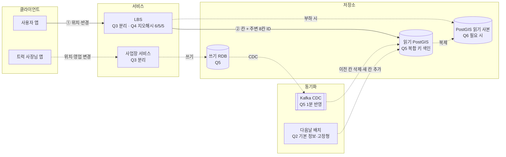

# 1장 근접성 서비스 — donguk · S3 트럭맵

> **한 줄 요약**: 위치·영업 상태만 1분 반영으로 좁히고, 지오해시 + (geohash, business_id) 복합 키 색인을 쓰기 RDB → Kafka CDC → 읽기 PostGIS(CQRS)로 갱신하며, 크기가 수 GB라 샤딩 없이 필요 시 읽기 사본으로 버틴다.

## 1. 전제

| 핵심 숫자 | 값 | 계산식 |
|---|---|---|
| 평균 / 피크 검색 QPS | 278 / 2,780 | 300만 × 8회 = 2,400만/일 ÷ 86,400, × 10 |
| 위치 변경 쓰기 QPS | 9.3 | 이동형 20만 × 4회 = 80만/일 |
| 데이터 크기 | 0.5~1GB, 색인 포함 수 GB | 사업장 50만 × 1~2KB |

- **교재와 다른 제약**: 위치 변경은 **1분 안에** 반영(교재는 다음날). 사용자 위치 저장 금지. 축제 구역에 평소의 10배 피크

## 2. 결정 7개

| # | 결정 | 내 선택 | 근거 (한 줄) | 감수한 것 |
|---|---|---|---|---|
| Q1 | 규모 | 피크 2,780 QPS, 읽기 위주 | 쓰기 부담은 양이 아니라 색인·읽기 서버로의 복제 | 피크가 축제 구역 몇 칸에 몰리는 핫스팟 |
| Q2 | 반영 시점·반경 | 위치·영업 상태·이동형 등록/폐업 1분, 고정형·기본 정보 다음날 / 고정 3종, 반경 안만 + 밀집 시 그룹핑 | 즉시는 이벤트, 다음날은 변경분 배치. 사용자가 반경을 고른 이유가 있다 | 배치가 최신 이벤트를 덮어쓸 위험, 결과 적은 지역 UX |
| Q3 | API·서비스 | `GET /lbs/nearby` → ID 목록 / 커서(기준 좌표 고정) / LBS·사업장 분리 | 쓰기와 읽기 특성이 달라 확장·장애 격리에 유리 | 페이지 사이 트럭 이동 시 중복·누락 |
| Q4 ★ | 공간 색인 | 지오해시 (300m→6, 1km→5, 3km→5) | 행 추가·삭제만으로 갱신, 내 칸 + 주변 8칸 후 거리순 | 칸 크기 고정이라 축제 칸 과밀 |
| Q5 | 저장소 | CQRS: 쓰기 RDB → Kafka CDC → 읽기 PostGIS / 복합 키 | 실시간성과 공간 기능을 함께, 복합 키라 락 불필요 | 미결정: CDC 지연 1분 감시, GiST와 지오해시 역할 중복 |
| Q6 | DB 확장 | 지금은 불필요, 필요 시 읽기 사본, 핫스팟 지속 시 지역 샤딩 검토 | 수 GB라 샤딩 불필요, CDC로 1분 반영 충분 (돌발에도 유지) | 사본 지연 누적, 샤딩이 핫스팟을 한 샤드로 몰아줌 |
| Q7 | 캐시 | 미진행 | — | — |

> 바뀐 결정: Q2 고정형 신규 등록 1분 → 다음날, 반경 자동 확장 → 고정 선택지 (꼬리 질문)

## 3. 시스템 전체 설계도

실선 = 주변 검색 · 점선 = 쓰기·비동기

**주변 검색**: ① 위치·반경(300m/1km/3km) 요청 → ② LBS가 지오해시 길이 결정(6/5/5) → ③ 내 칸 + 주변 8칸 지오해시 생성 → ④ PostGIS(또는 사본) 복합 키 색인에서 ID 조회 → ⑤ 거리순 정렬, 반경 밖 제외, 밀집 시 그룹핑 → ⑥ ID 목록 + next_cursor 응답

## 4. 교재와 다르게 간 곳

| 결정 | 교재 | 나 | 이 시나리오에서 왜 |
|---|---|---|---|
| 반영 시점 | 다음날 일괄 | 항목별 (1분 이벤트 / 다음날 배치) | 1분 요구를 이동형 20만 곳에만 걸어 비용을 줄인다 |
| 저장소 | RDB 주-부, 복제 지연 무시 | CQRS (RDB → Kafka CDC → PostGIS) | 1분 반영이 필요해 이중 쓰기 없이 읽기·쓰기 분리 |
| 반경 정책 | 기본 5km, 부족하면 확대 | 고정 3종 + 밀집 시 그룹핑 | 축제 300m 안 수천 대, 너무 멀면 찾아가지 않는다 |

## 5. 미팅 안건

- **가장 자신 없는 결정**: (미진행)
- **같이 이야기할 질문**: 축제처럼 한 칸에 읽기와 쓰기가 동시에 몰리는 핫스팟을 각자 어디서 막았나(캐시, 그룹핑, 사본, 샤딩)? 지역 샤딩은 이 문제를 푸는가, 악화시키는가?
