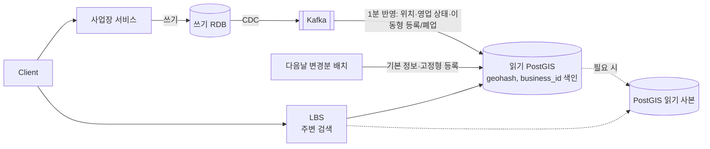

# 근접성 서비스 설계 — donguk

> 진행 상황: Q1~Q7 완료, **Q8(캐시)·Q9(최종 흐름·회고)는 미진행**. 사용자 요청으로 Q7까지의 결정만으로 정리함.
> 구버전 grill 양식(질문 9개) 원본. 미팅용 정리본은 [근접성설계_donguk_2026-10-18.md](근접성설계_donguk_2026-10-18.md)

## 1. 시나리오

**S3. 트럭맵 — 푸드트럭·팝업스토어 실시간 지도**

| 항목 | 값 |
|---|---|
| 서비스 지역 | 대한민국 |
| DAU | 300만 |
| 1인당 하루 검색 | 8회 |
| 등록 사업장 수 | 50만 (이 중 이동형 20만) |
| 위치 변경 빈도 | 이동형 사업장 1곳이 하루 평균 4회 위치 변경 |
| 피크 | 주말 축제·불꽃놀이 행사장 주변에 평소의 10배 |
| 검색 반경 | 300m / 1km / 3km |
| 정보 변경 반영 | **위치 변경은 1분 안에** 검색 결과에 반영. 메뉴·사진은 다음날이어도 된다 |
| 데이터 보호 | 사업장 위치는 공개 정보. 사용자 위치는 저장 금지 |

**설계 포인트**: 교재의 "다음날 반영" 가정이 깨진다. 쓰기 QPS와 색인 갱신 방식, 캐시 무효화가 핵심이다.

## 2. 요구사항
### 기능 요구사항
- 위치와 반경(300m / 1km / 3km 고정 선택지)으로 주변 사업장(트럭·팝업) 검색, 반경 안 결과만 반환
- 밀집 지역(예: 축제 300m 안 수천 대)은 그룹핑해서 표시
- 사업장 위치 변경·영업 시작/종료·이동형 사업장 등록/폐업을 1분 안에 검색에 반영
- 고정형 신규 등록·기본 정보·메뉴·사진 변경은 다음날 반영
### 비기능 요구사항 (우선순위 순)
1. 실시간성: 위치·영업 상태 변경 1분 이내 반영
2. 피크(축제 구역 10배) 시 조회 처리 능력, 쓰기와 읽기의 장애 격리
3. 데이터 보호: 사용자 위치 저장 금지
### 규모 추정
- 평균 검색 QPS: 278 (300만 × 8회 = 2,400만/일 ÷ 86,400)
- 피크 검색 QPS: 2,780 (평균 × 10, 축제 구역에 집중)
- 쓰기 특성: 위치 변경 9.3 QPS (20만 × 4회 = 80만/일). 쓰기가 부담스러운 건 양이 아니라 인덱스 및 읽기 서버로의 복제. 교재는 하루 한 번 업데이트라 문제가 안 되지만 여기는 1분 안에 반영되어야 함
- 데이터 크기: 사업장 50만 곳 × 1~2KB = 약 0.5~1GB, 인덱스 포함 수 GB 수준
### 데이터 보호 정책
- 사업장 위치는 공개 정보. 사용자 위치는 저장하지 않는다

## 3. 결정 로그

| # | 단계 | 결정 사항 | 선택 | 근거 (본인 작성) | 인지한 트레이드오프 |
|---|---|---|---|---|---|
| Q1 | 요구사항 | 검색 QPS | 평균 278 / 피크 2,780 / 쓰기 9.3 | 단순 QPS만으론 판단 보류, 이론상 DB 한 대로 가능. 조회가 압도적으로 크므로 조회용 DB 구축. 쓰기 부담은 양이 아니라 인덱스 및 읽기 서버로의 복제 | 피크가 축제 구역 몇 개 칸에 몰리는 핫스팟 문제(진행자 지적) |
| Q2 | 요구사항 | 반영 시점 | D) 항목별: 위치·영업 시작/종료·이동형 등록/폐업 = 1분, 고정형 신규 등록·기본 정보 = 다음날 | 즉시 반영은 이벤트 방식, 다음날 반영은 변경분만 업데이트 | 두 경로가 같은 레코드를 건드리면 배치가 최신 이벤트를 덮어쓸 수 있음(진행자 지적) |
| Q3 | 요구사항 | 반경 정책 | A) 고정 선택지, 반경 안 결과만 | 사용자가 선택한 이유가 있을 것. 너무 멀면 안 찾아갈 것. 300m 안 2천 대면 그룹핑 | 그룹핑 집계를 서버에서 어떻게 할지, 결과가 적은 지역 UX(진행자 지적) |
| Q4 | 초안 설계 | API·페이지·서비스 분리 | `GET /lbs/nearby?lat&lng&radius` → 응답 사업장 ID / B) 커서 / B) 분리 | 커서는 거리와 사업장 ID처럼 안정적인 정렬 기준, 커서에 기준좌표 고정. 하루 80만 건 위치 업데이트와 행사장 검색 급증을 고려하면 쓰기와 읽기 처리 특성이 달라 분리가 확장성과 장애 격리 측면에서 유리 | 페이지 사이 트럭 이동 시 중복·누락, 목록용 정보를 위한 추가 호출(진행자 지적) |
| Q5 | 초안 설계 | 공간 색인 | C) 지오해시 (300m→6, 1km→5, 3km→5) | 행 추가·삭제로 갱신이 쉬움. 내 셀을 중심으로 주변 8개 셀을 붙이고 거리순 정렬 | 칸 크기 고정이라 축제 구역 칸 과밀, 반경 밖 후보를 실제 거리로 거르는 단계(진행자 지적) |
| Q6 | 초안 설계 | 저장소·색인 저장 | B) CQRS — 쓰기 RDB, 읽기 PostGIS, CDC 동기화 / B) (geohash, business_id) 복합 키 | PostGIS로 복제하면 실시간성과 풍부한 기능을 동시에 지원. 복합키로 잡으면 별도의 락이 없어도 됨 | **미결정**: CDC 지연 1분 보장·감시, PostGIS GiST와 지오해시 테이블 역할 중복 |
| Q7 | 규모 확장 | DB 확장 | 사업장 D) 지금은 불필요 / 색인 D) 단일 PostGIS, 필요 시 A) 읽기 사본 / 핫스팟 지속 시 C) 검토 | 50만 × 1~2KB ≈ 0.5~1GB, 인덱스 포함 수 GB라 샤딩 불필요. CDC로 충분히 반영 가능, CDC 스트림 엔진은 Kafka | **미결정**: 사본 추가 시 지연 누적의 1분 SLO 근거, 지역 샤딩이 핫스팟을 한 샤드로 몰아주는 문제, 앞단에서 부하를 막는 방법 |
| Q8 | 규모 확장 | 캐시 | **미진행** | — | — |
| Q9 | 규모 확장 | 최종 흐름·회고 | **미진행** | — | — |

> 꼬리 질문 후 바뀐 결정: Q2 — 고정형 신규 등록 1분 → 다음날 (이유: 고정형은 다음날 반영이면 충분)
> 꼬리 질문 후 바뀐 결정: Q3 — D(자동 확장) → A(고정 선택지) (이유: 사용자가 선택한 이유가 있을 것, 너무 멀면 안 찾아감)
> 돌발 상황 후 바뀐 결정: 없음

## 4. 초안 설계
### API
```
GET /lbs/nearby?lat={위도}&lng={경도}&radius={300|1000|3000}&cursor={커서}
  → 응답: 사업장 ID 목록 + next_cursor
  커서: (기준 좌표, 마지막 거리, 마지막 사업장 ID) — 기준 좌표 고정
```
- 서비스 분리: LBS(읽기) / 사업장 서비스(쓰기)
### 데이터 모델
- 쓰기 모델(RDB): business (사업장 정보, 위치, 영업 상태)
- 읽기 모델(PostGIS): Kafka 기반 CDC로 동기화
- 지리 색인: (geohash, business_id) 복합 키, 사업장마다 1행
### 공간 색인
- 방식: 지오해시
- 세부 설정: 300m→6자리, 1km→5자리, 3km→5자리
- 가장자리·결과 부족 처리: 내 셀 + 주변 8개 셀 조회 → 거리순 정렬. 반경 안 결과만 반환(Q3), 밀집 시 그룹핑

## 5. 규모 확장 설계
- DB 확장: 사업장 테이블은 수 GB 수준이라 지금은 샤딩 불필요
- 색인 확장: 단일 PostGIS로 시작, 읽기 부하가 커지면 읽기 사본 증설. 지역 핫스팟이 지속되면 지역 기준 샤딩 검토
- 캐시: **미진행** (Q8)
- 지역 / 가용성 구역: 다루지 않음
- 결과 필터링: 다루지 않음

## 6. 돌발 상황 대응
- 상황: 여의도 불꽃축제 당일, 트럭 2천 대가 한 시간 안에 같은 구역으로 이동, 사용자 50만 명이 그 구역 검색
- 대응: 앞의 결정 변경 없음. CDC(Kafka)로 1분 안 반영이 충분히 가능하다고 판단. 읽기 부하는 필요 시 PostGIS 읽기 사본으로 대응
- 남은 쟁점(미결정): 같은 9칸에 몰리는 읽기를 DB 앞단에서 흡수할 방법, 사본 추가 시 복제 지연 누적, 지역 샤딩이 핫스팟을 한 샤드에 몰아주는 문제

## 7. 최종 아키텍처

> Q8·Q9 미진행이라 캐시·로드밸런서 등 사용자가 고르지 않은 컴포넌트는 넣지 않았다.



### 주변 검색 흐름 (Q4~Q7 결정으로 진행자가 구성, Q9 미진행)
1. 클라이언트가 위도·경도·반경(300m/1km/3km)으로 `GET /lbs/nearby` 요청
2. LBS가 반경에 맞는 지오해시 길이 결정(6 / 5 / 5)
3. 내 칸 + 주변 8칸의 지오해시 목록 생성
4. PostGIS(또는 읽기 사본)의 (geohash, business_id) 색인에서 사업장 ID 조회
5. 거리순 정렬, 커서(기준 좌표 고정)로 페이지 분할, 밀집 시 그룹핑
6. 사업장 ID 목록과 next_cursor 응답

### 사업장 정보 수정 흐름
1. 사장님(트럭)이 사업장 서비스로 위치·영업 상태 변경 요청
2. 사업장 서비스가 쓰기 RDB에 기록
3. CDC가 변경을 Kafka로 발행
4. 소비자가 PostGIS 색인에서 이전 칸 행 삭제, 새 칸 행 추가(락 불필요) — 1분 이내
5. 기본 정보·고정형 신규 등록은 다음날 변경분 배치로 PostGIS에 반영

## 8. 교재 기준안과 비교

| 결정 | 교재 기준안 | 내 선택 | 이 시나리오에서의 장점 / 리스크 |
|---|---|---|---|
| 반영 시점 | 다음날 일괄 | 항목별(1분 이벤트 / 다음날 배치) | 장점: 1분 요구를 꼭 필요한 이동형 20만 곳에만 걸어 비용을 줄임. 리스크: 두 경로가 같은 레코드를 갱신할 때 순서 보장 필요 |
| 반경 정책 | 기본 5km, 부족하면 칸 확대 가능 | 고정 3종, 반경 안 결과만 + 밀집 시 그룹핑 | 장점: 정밀도 종류가 3개로 묶여 색인·캐시 단순. 리스크: 교외 빈 결과 UX, 그룹핑 집계 비용 |
| 공간 색인 | 지오해시 | 지오해시 (3km→5자리 추가) | 장점: 행 추가·삭제만으로 1분 갱신 가능, 쿼드트리처럼 재구축·락 불필요. 리스크: 칸 크기 고정이라 축제 칸 과밀 |
| 저장소 | RDB 주-부, 복제 지연 무시 | CQRS(쓰기 RDB → Kafka CDC → 읽기 PostGIS) | 장점: 이중 쓰기 없이 읽기·쓰기 분리, 공간 함수 활용. 리스크: 복제 단계가 늘어 지연 감시 필요, PostGIS GiST와 지오해시 테이블의 역할 중복 |
| 색인 저장 | 복합 키 1행(추천) | 복합 키 1행 | 교재와 같음. 트럭이 같은 칸에 동시에 몰려도 락 경합 없음 |
| DB 확장 | 사업장 ID 샤딩, 색인은 사본 증설 | 둘 다 지금은 불필요, 필요 시 사본 | 장점: 크기 계산에 근거한 판단. 리스크: 사본으로 나눠도 같은 칸 핫스팟 자체는 남음 |
| 캐시 | 지오해시→ID, ID→정보 2종 Redis | 미진행 | 교재는 다음날 반영이라 TTL·야간 갱신으로 충분하지만, 이 시나리오에서는 이전 칸·새 칸 무효화가 쟁점 |

## 9. 본인 회고
- 가장 자신 없는 결정: (미진행 — Q9)
- 트래픽이 10배가 되면 가장 먼저 무너질 곳: (미진행 — Q9)

## 10. 진행자 코멘트
- 근거가 가장 탄탄했던 결정:
  - **Q1 쓰기 부담의 본질**: "쓰기가 부담스러운 건 양이 아니라 인덱스 및 읽기 서버로의 복제"라는 판단이 이후 지오해시 선택(Q5), 복합 키(Q6), CDC(Q6) 결정으로 일관되게 이어졌다.
  - **Q7 크기 먼저 계산**: 50만 × 1~2KB로 크기를 먼저 보고 샤딩을 미룬 판단은 교재가 강조하는 순서 그대로다.
- 다음에 더 파볼 주제:
  - **캐시와 핫스팟(Q8 미진행)**: 같은 9칸에 천 단위 QPS가 몰릴 때 지오해시 키 캐시, 이전 칸·새 칸 무효화, 캐시 스탬피드
  - **CDC 지연 SLO**: Kafka lag + PostGIS 사본 복제 지연을 1분 안에 묶는 감시·알람 설계, 1분을 넘겼을 때 대응
  - **PostGIS를 쓴다면 지오해시 테이블이 필요한가**: GiST(`ST_DWithin`)만으로 검색할지, 지오해시를 캐시 키 용도로만 쓸지
  - (교재 주제 중 다루지 않은 것) 지역·가용성 구역 배치, 업종·영업 중 필터링, 반경 밖 후보를 실제 거리로 거르는 단계

## 11. 스터디 토론 질문
- 1분 반영 요구를 CDC + 읽기 모델로 푼 설계와, LBS 서버 메모리 색인(또는 Redis GEO)을 이벤트로 직접 갱신한 설계는 지연·운영 복잡도·장애 시 복구에서 어떻게 다른가?
- 축제처럼 **한 칸에 읽기와 쓰기가 동시에 몰리는** 핫스팟을 각자 어디서 막았나(캐시, 그룹핑 집계, 사본, 샤딩)? 지역 샤딩은 이 문제를 푸는가, 악화시키는가?
- 고정 반경 + 그룹핑과 k개 최근접(쿼드트리)은 밀도 편차가 극단적인 이 시나리오에서 어느 쪽이 사용자 경험과 서버 부하 면에서 나은가?
