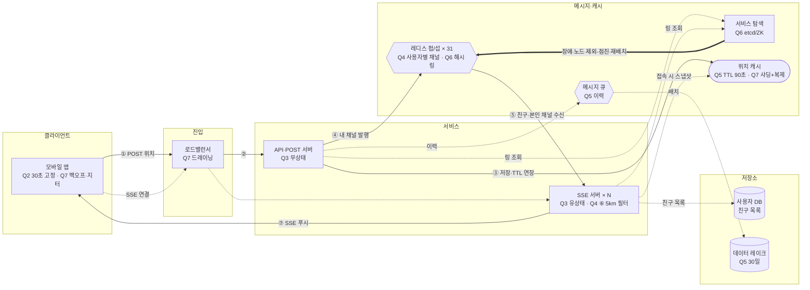

# 2장 주변 친구 — donguk · S1 동네친구

> **한 줄 요약**: 위치 업로드는 HTTP POST, 수신은 SSE로 나누고, 레디스 펍/섭 사용자별 채널(친구 전원 구독 + 구독 측 필터)로 전파하며, 연말 피크용 펍/섭 31대는 미리 확보한다.

## 1. 전제

| 핵심 숫자 | 값 | 계산식 |
|---|---|---|
| 위치 갱신 QPS | 6.7만 (연말 피크 약 20만) | 2,000만 × 10% = 200만 / 30초 |
| 초당 전파 메시지 (팬아웃) | 100만 (연말 피크 약 300만) | 6.7만 × 150 × 10% |

- **교재와 다른 제약**: 규모가 교재의 1/5이고 한국 전용. 위치 이력은 ML용으로 30일만 보관, 위치 공유는 opt-in

## 2. 결정 7개

| # | 결정 | 내 선택 | 근거 (한 줄) | 감수한 것 |
|---|---|---|---|---|
| Q1 | 규모 | 동시 200만 / 갱신 6.7만 QPS / 팬아웃 100만/s, 쓰기 위주 | 갱신마다 반경 안 친구 15명에게 전달 | 상한 1,000명·도심 밀집 시 편차 |
| Q2 | 갱신 주기·활성 판단 | 고정 30초 / TTL 90초 | 유실 허용이라 단순하고 부하 예측 쉬운 고정 주기, 유실은 다음 갱신으로 복구. 연결 여부로는 위치 최신성을 모름 | 정지 사용자도 전송, 90초 넘게 끊기면 비활성 표시 |
| Q3 | 통신·서버 구조 | 업로드 HTTP POST + 수신 SSE / 무상태 API·유상태 SSE 서버 분리, 접속 즉시 전송 + 친구 스냅샷 후 30초 주기 | 핵심은 단방향 푸시라 SSE가 단순하고 자동 재연결 지원. 30초는 갱신 주기지 첫 화면 대기 시간이 아님 | 요청마다 인증 오버헤드, 수신자 위치는 본인 채널 구독으로 로컬 갱신(구독 +1) |
| Q4 ★ | 위치 변경 전파 | 레디스 펍/섭, 사용자별 채널 / 친구 전원 구독 / 구독 측(SSE 서버) 필터 | 유실 허용이라 메시지 저장 불필요. 전원 구독이면 거리 기반 구독 관리 불필요 | 반경 밖 활성 친구에게도 push, 발행 측 필터는 나중에 |
| Q5 | 위치 저장소 | 최신: 레디스 `location:{userId}` TTL 90초 / 이력: 메시지 큐 → 데이터 레이크 (30일, 약 17TB) | 최신 위치만 필요하고 끊기면 자동 만료. POST 서버가 저장·발행, SSE 서버는 이벤트로 로컬 갱신해 매번 조회 안 함 | 레디스 재시작 시 스냅샷 공백 |
| Q6 | 펍/섭 클러스터 | 메모리 6GB(1대)·CPU 10대 → 연말 31대 사전 확장 / 해시 링 + 서비스 탐색, 점진 재배치 | 펍/섭 서버가 구독 정보를 들고 있어 피크 중 증설은 재구독 폭주·유실. 31대는 피크 전 최소 용량 | 장애 복구를 SSE 재연결로 하면 재연결 폭주, 도심 집중 시 SSE push 증가 |
| Q7 | SSE 서버·위치 캐시 | 소규모 롤링 + 드레이닝, 재연결 백오프·지터·속도 제한 / 레디스 클러스터, 사용자 ID 해시 샤딩 + 샤드별 복제본 | 재연결마다 친구 목록·위치 150건·재구독이 몰림. 200MB라 메모리는 충분하지만 피크 쓰기 20만 QPS | 배포가 느려지고 재연결 지연 |

> 바뀐 결정: Q3 + 접속 즉시 전송·스냅샷 (꼬리 질문), + 해시 링·서비스 탐색 라우팅, 재연결 시 스냅샷 복구 (돌발) · Q7 드레이닝 → + 백오프·지터·재구독 배치 (피드백 반영)

## 3. 시스템 전체 설계도

실선 = 위치 갱신 → 친구 화면 반영 · 점선 = 쓰기·비동기 · 굵은 선 = 돌발 대응

![[주변친구설계_donguk_2026-10-25.excalidraw]]

**위치 갱신 → 친구 화면 반영**: ① 앱이 위치 POST → ② 로드밸런서가 API 서버로 → ③ 위치 캐시 저장·TTL 연장 → ④ 내 채널에 발행 → ⑤ 친구·본인 채널을 구독한 SSE 서버가 수신 → ⑥ 거리 계산·5km 필터 → ⑦ 반경 안이면 친구 앱에 SSE 푸시

## 4. 교재와 다르게 간 곳

| 결정 | 교재 | 나 | 이 시나리오에서 왜 |
|---|---|---|---|
| 통신 | 웹소켓 하나로 양방향 | 업로드 POST + 수신 SSE | 핵심이 단방향 푸시라 HTTP 기반 SSE가 단순하고 자동 재연결 지원 |
| 핸들러의 내 위치 | 웹소켓으로 직접 받음 | 본인 채널 구독으로 로컬 갱신 | POST 서버와 SSE 서버를 나눴기 때문 |
| 위치 이력 | Cassandra | 메시지 큐 → 데이터 레이크 | ML용 30일 보관이라 실시간 조회 DB가 필요 없음 |

## 5. 미팅 안건

- **가장 자신 없는 결정**: 이벤트가 몰릴 때 대응 방안
- **같이 이야기할 질문**: POST + SSE로 나눈 구조(본인 채널 구독 +1, 요청마다 인증)가 웹소켓 하나보다 정말 단순한가?
