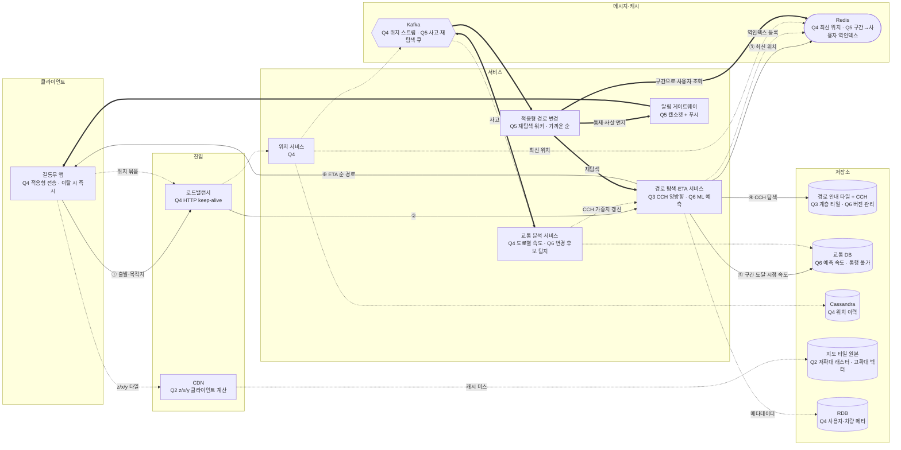

# ch03 미팅과제

> 시나리오: **S1 길동무** (국내 자동차 내비) · grill 원본: [구글맵설계_donguk_2026-11-01.md](구글맵설계_donguk_2026-11-01.md)

> **한 줄 요약**: 계층적 경로 안내 타일 + CCH로 전국 그래프를 탐색하고 교통은 지름길 가중치로 반영하며, 사고 시에는 도로 구간 → 사용자 역인덱스로 영향받는 사용자를 찾아 웹소켓으로 먼저 알린다.

## 1. 전제

| 핵심 숫자 | 값 | 계산식 |
|---|---|---|
| 위치 갱신 QPS (평균 / 피크) | 8,000 / 4만 | 2억 분 × 60 / 10⁵ = 12만, ÷ 15초 묶음, × 5 |
| 지도 데이터 트래픽 | 250TB/일 ≈ 2.5GB/s (피크 100Gbps) | 2억 분 × 1.25MB, ÷ 10⁵초, × 5 |

- **교재와 다른 제약**: 국내 자동차 도로만, 규모는 교재의 1/25(하루 2억 분) / 출퇴근 ETA 오차 ±3분, 강남·여의도 고확대 조회가 많음

## 2. 결정

| # | 결정 | 내 선택 | 근거 (한 줄) | 감수한 것 |
|---|---|---|---|---|
| Q1 | 규모 | 하루 2억 분 / 위치 갱신 8,000 QPS (피크 4만) / 지도 2.5GB/s (피크 100Gbps) | 지도 타일 전송이 가장 큰 트래픽 → CDN과 네트워크 대역폭 압박 | — |
| Q2 | 지도 표시 / 타일 URL | 저확대 래스터 + CDN, 고확대 벡터(WebGL), 오프라인 패키지는 선택 기능 / z/x/y를 클라이언트가 계산 | 저확대는 반복 조회라 CDN이 효율적, 강남·여의도 고확대는 벡터로 정밀하게 / 서버 계산 부담을 없애고 CDN으로 직접 감 | 타일 파이프라인 두 벌, 고확대 렌더링 부담 |
| Q3 ★ | 경로 탐색 | 계층적 경로 안내 타일(저장·로딩) + CCH(탐색), 양방향 탐색 | 국내 도로만이라 전국 그래프 통합 관리 가능. 구조는 오프라인 사전 계산, 교통은 CCH로 지름길 가중치 갱신 | 경로 결과 캐시 어려움, 가중치 갱신 동기화 |
| Q4 | 위치 전송 / 저장 | 적응형(기본 15초, 고속·교차로 3~5초, 정체 15~30초, 이탈 시 즉시) + HTTP keep-alive / Kafka + Cassandra(이력) + Redis(최신 위치) + RDB(메타데이터) | 상황별로 정확도와 데이터 사용량을 맞춤 / 경로·ETA는 Redis 최신 위치, 교통 분석은 Kafka 소비 | 짧은 주기 구간만큼 쓰기 QPS 증가, 저장소 4종 운영 |
| Q5 | 영향 사용자 찾기 / 알림 / 재계산 폭주 | 도로 구간 → 사용자 역인덱스(Redis) / 웹소켓 + 모바일 푸시(보조) / Kafka 재탐색 큐 + 분산 워커, 사고 지점에 가까운 순, 중복 제거, 통제 사실을 먼저 알림 | 구간 ID로 바로 조회해 30만 명을 찾고, 큐로 처리량을 조절 | 역인덱스 갱신 비용, 같은 우회로 쏠림 |
| Q6 | ETA / 타일·CCH 갱신 | 현재 + 이력 + ML로 10~20분 예측, 신호·톨게이트·사고·공사 반영, 구간 도달 시점 속도로 계산 / 배치 재생성(구조) + 스트림 후보 탐지·검증 + 교통 DB 통행 불가(일시) + CCH 가중치 갱신(속도), 버전 관리·Kafka 알림·원자적 교체·롤백 | 출퇴근 미래 정체를 예측해 ±3분 목표를 맞춤 / 변화 종류별로 갱신 범위를 나눔 | 교체 시 메모리 두 배, 배포 중 버전 섞임 |

> 바뀐 결정: Q3 CH → CCH (세부 질문) / Q5 돌발로 Redis 역인덱스, Kafka 사고 이벤트·재탐색 큐, CCH 통제 구간 제외, 지도 사고 오버레이 추가

## 3. 전체 설계도

실선 = 경로 안내 요청 → 경로·ETA 응답 · 점선 = 쓰기·비동기 · 굵은 선 = 돌발 대응

**경로 안내 요청 → 경로·ETA 응답**: ① 출발지·목적지 요청 → ② 경로 서비스로 전달, 주소를 좌표로 변환 → ③ Redis에서 최신 위치 확인 → ④ 메모리에 올린 CCH로 양방향 탐색해 후보 경로를 구함 → ⑤ 각 구간에 도달할 시점의 예측 속도로 ETA 계산 → ⑥ ETA 순으로 응답하고 역인덱스에 등록

## 4. 교재와 다르게 간 곳

| 결정 | 교재 | 나 | 이 시나리오에서 왜 |
|---|---|---|---|
| 경로 탐색 | 계층적 경로 안내 타일 + A* 변형, 최단 경로(캐시)와 ETA(교통)를 분리 | 계층 타일은 저장·로딩, 탐색은 CCH, 교통은 지름길 가중치로 반영 | 국내 도로만이라 전국 그래프를 통합 관리할 수 있음 |
| 영향 사용자 찾기 | 현재 타일부터 상위 타일까지 재귀적으로 저장 | 도로 구간 → 사용자 역인덱스 | 사고 구간을 키로 바로 조회해 30만 명을 빨리 찾음 |
| 지도 표시 | 미리 만든 래스터 타일, 지오해시 URL | 저확대 래스터 + 고확대 벡터, z/x/y를 클라이언트가 계산 | 강남·여의도 고확대를 정밀하게, 서버 계산 부담을 없앰 |

## 5. 미팅 안건

- **가장 자신 없는 결정**: 없음
- **같이 이야기할 질문**: 교통을 CCH 탐색 안에 넣으면 경로 결과 캐시를 포기하게 된다. 교재처럼 최단 경로(구조)와 ETA(교통)를 나누는 쪽과 비교하면 출퇴근 ±3분 목표에는 어느 쪽이 더 유리할까?
