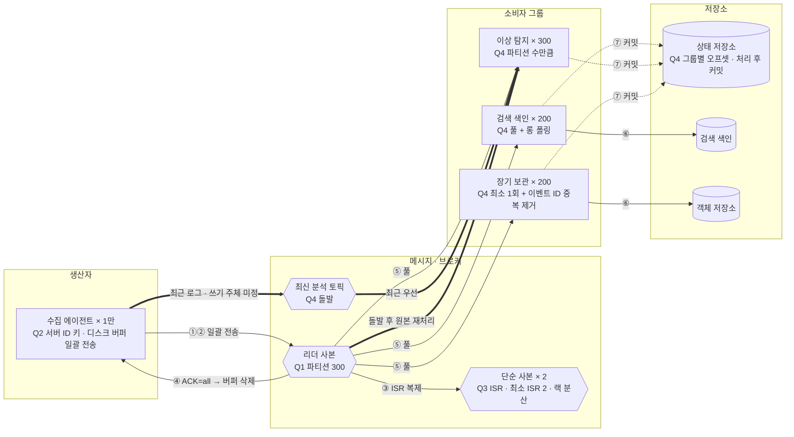

# 4장 분산 메시지 큐 — 동억 · S1 로그창고

> **한 줄 요약**: 서버 ID 키로 파티션 300개에 나누고, 에이전트 디스크 버퍼 + ACK=all(최소 ISR 2)로 손실을 막으며, 풀 + 최소 1회 소비에 장애 시 최근 로그를 별도 토픽으로 먼저 본다.

## 1. 전제

| 핵심 숫자 | 값 | 계산식 |
|---|---|---|
| 피크 쓰기 처리량 | 1,500MB/s, 150만 건/s (평균 500MB/s) | 50만 건/s × 1KB × 3 |
| 필요한 파티션 수 | 300 | 처리량 1.5GB ÷ 10MB = 150 / 소비자 150만 ÷ 1만 = 150 → 처리 속도 절반 대비 × 2 |
| 2주 저장량 (사본 3) | 약 1.81PB | 43.2TB/일 × 14 × 3 |

- **교재와 다른 제약**: 로그 0.1% 이하 유실 허용, 대신 생산자(서비스 서버)가 느려지면 안 된다

## 2. 결정 4개

| # | 결정 | 질문 | 내 선택 | 근거 (한 줄) | 감수한 것 |
|---|---|---|---|---|---|
| Q1 | 규모·병목 | 피크 150만 건/s(1.5GB/s), 2주 보관일 때 처리량·저장량·파티션 수는? 무엇이 먼저 한계인가? | 피크 1.5GB/s, 2주 1.81PB, 파티션 300 / C) 소비자 처리 속도 | 소비자 1명 1만 건/s라 병렬성이 파티션 수를 직접 정하고, 처리 속도가 반이면 파티션이 2배 | 파티션 확장 시 순서 영향 → 사전에 넉넉히 |
| Q2 | 파티션 키·생산자 전송 | ① 서버 1만 대 로그를 파티션 300개 중 어디에 넣고 순서는 어디까지? ② 생산자는 어떻게 보내나? | ① 서버 ID 키(`hash % 300`) ② 클라이언트 버퍼 일괄 전송 + 디스크 로컬 버퍼·전송 확인 | 서버별 순서 유지, 일괄 전송으로 생산자 부담·네트워크 오버헤드 감소 | 핫 파티션은 모니터링 후 순서 정책 재검토, 버퍼 장애 손실 위험 |
| Q3 ★ | 복제·ACK | 피크 1.5GB/s, 손실 0.1% 허용일 때 사본 몇 개를 어디에, ACK는 언제, 소비자는 어디서 읽나? (ISR이 리더만 남으면?) | ACK=all, 사본 3(브로커·랙 분산), 최소 ISR 2, 리더에서 읽기 | 대용량에서도 손실 0.1% 이하 유지, 사본 부족 시 무리한 쓰기 거부 | 쓰기 거부 시 에이전트 디스크 버퍼·백오프로 버팀(용량 상한), 재전송 중복 → 이벤트 ID 중복 제거 |
| Q4 | 소비·전달 보장 | (돌발: 로그 10배, 이상 탐지 lag 20분) ① 소비 방식과 그룹별 소비자 수는? ② 전달 방식과 오프셋 커밋 시점은? | ① 풀 + 롱 폴링, 검색 200 / 이상 탐지 300 / 보관 200 ② 최소 1회(처리 후 커밋) + 이벤트 ID 중복 제거 / 돌발: 최신 분석 토픽으로 최근 로그 우선, 끝난 뒤 원본 재처리 | 소비자가 처리 속도를 조절하고 그룹별 오프셋으로 장애를 격리, 평소 피크 150만 건/s를 감당 | 돌발 500만 건/s는 실시간으로 다 못 받음(파티션 300 상한), 그 요구가 생기면 파티션 증설 |

> 바뀐 결정: Q4 ① 소비자 수 검색·보관 100 → 200, ② D → B (꼬리 질문)

## 3. 시스템 전체 설계도

실선 = 메시지 발행 → 소비 · 점선 = 쓰기·비동기 · 굵은 선 = 돌발 대응

**메시지 발행 → 소비**: ① 에이전트 디스크 버퍼에 모아 서버 ID 키로 파티션 선택 → ② 리더 사본에 일괄 전송 → ③ ISR 복제(최소 2) → ④ ACK=all 회신 후 버퍼 삭제 → ⑤ 소비자 그룹 3개가 리더에서 풀 + 롱 폴링 → ⑥ 이벤트 ID 중복 제거 후 처리·저장 → ⑦ 오프셋 커밋

## 4. 교재와 다르게 간 곳

| 결정 | 교재 | 나 | 이 시나리오에서 왜 |
|---|---|---|---|
| 생산자 버퍼 | 클라이언트 라이브러리 메모리 버퍼 | 디스크 로컬 버퍼 + ACK 후 삭제 + 백오프 | ACK=all 쓰기 거부 때도 서비스 서버를 막지 않고 손실을 줄이려고 |
| 중복 처리 | 최소 1회는 "소비자가 중복 제거 가능하면" 정도 | 이벤트 ID 기반 중복 제거를 세 그룹 모두에 | 에이전트 재전송으로 생기는 중복을 흡수 |
| 소비 지연 대응 | 소비자 추가(파티션 수까지) | 최신 분석 토픽으로 최근 로그 우선 + 원본 재처리 | 파티션 300 상한으로 돌발 500만 건/s를 실시간 처리 불가 |

## 5. 미팅 안건

- **가장 자신 없는 결정**: Q3 ACK=all이 손실 허용 시나리오에 과한지 모르겠다
- **같이 이야기할 질문**: 장애 때 최근 로그를 먼저 보려면 별도 토픽(누가 쓰나?)과 이상 탐지 오프셋을 최신으로 건너뛰기 중 어느 쪽이 생산자를 덜 건드리나?
