# ch04. 분산 메시지 큐 (Distributed Message Queue)

> 범위: 교재 4장의 2단계(개략적 설계)와 3단계(상세 설계). 그림은 `images/figNN.jpg`이고, 번호는 교재 그림 번호와 같다.
> 이 장의 목표는 Kafka 같은 **이벤트 스트리밍 플랫폼**이다. 메시지를 디스크에 2주 보관하고 반복 소비할 수 있어야 한다. RabbitMQ 같은 전통 큐는 메시지를 소비하면 지우고 순서를 보장하지 않아서 설계가 훨씬 단순하다.

## 핵심 요약

1. **디스크를 순차적으로만 쓴다.** 메시지를 파티션별 append-only 로그(WAL, 세그먼트 파일)로 저장한다. 순차 I/O와 OS 페이지 캐시 덕분에 회전 디스크로도 수백 MB/s가 나온다. 여기에 **배치**(프로듀서·브로커·컨슈머 전 구간)와 **메시지 포맷 무변형**(복사 최소화)을 더해 높은 처리량을 낸다.
2. **확장 단위는 파티션이다.** 토픽을 파티션으로 나눠 브로커에 분산한다. 순서는 파티션 안에서만 보장된다. 한 파티션은 컨슈머 그룹 안에서 컨슈머 하나만 읽는다. 컨슈머 그룹 하나로 point-to-point를, 그룹 여러 개로 pub/sub을 함께 지원한다.
3. **내구성과 지연 시간은 설정으로 교환한다.** 파티션마다 리더 1개와 팔로워 여러 개로 복제한다. ISR과 `ACK=0/1/all`로 내구성과 지연을 맞바꾸고, 프로듀서 ACK 설정과 컨슈머의 오프셋 커밋 시점을 조합해 at-most/at-least/exactly once 전달 보장을 고른다.

## 설계 정리

### 2단계 — 개략적 설계

#### 기본 구성 요소

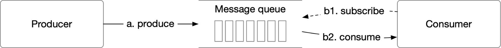

- **프로듀서**는 메시지를 큐로 보내고, **컨슈머**는 큐를 구독해서 메시지를 소비한다.
- 메시지 큐는 가운데서 둘을 **분리(decouple)**한다. 그래서 프로듀서와 컨슈머를 각각 따로 운영하고 확장할 수 있다.
- 프로듀서와 컨슈머는 클라이언트이고 메시지 큐는 서버다. 둘은 네트워크로 통신한다.

#### 메시지 모델

| 모델 | 동작 | 그림 |
|---|---|---|
| **Point-to-point** | 메시지 하나를 **컨슈머 하나만** 소비한다. 소비가 확인(ack)되면 큐에서 지운다(보관 없음). 전통 큐 방식이다. | 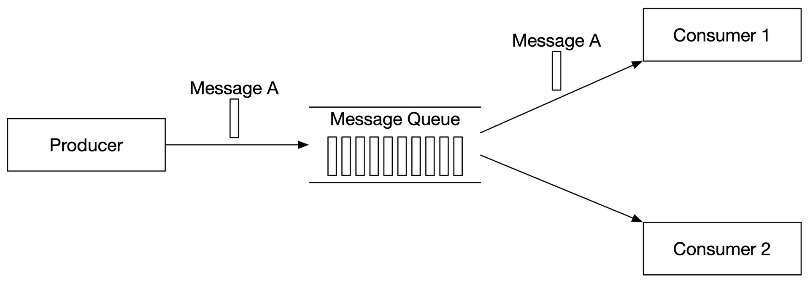 |
| **Publish-subscribe** | **토픽**(클러스터 전체에서 이름이 유일한 메시지 분류)으로 보낸 메시지를 그 토픽을 구독한 **모든 컨슈머**가 받는다. | 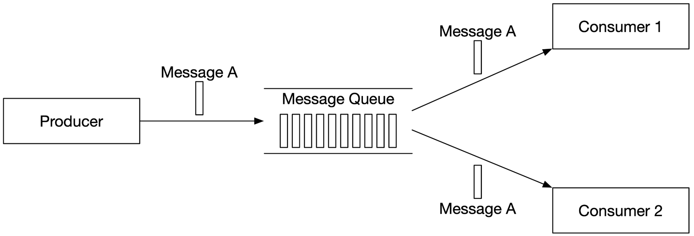 |

- 이 설계는 메시지를 2주 보관하므로 pub/sub에 더 자연스럽게 들어맞는다. point-to-point는 **컨슈머 그룹**으로 흉내 낸다.

#### 토픽, 파티션, 브로커

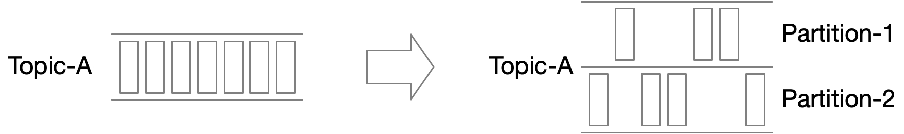

- 토픽 하나가 서버 한 대에 다 안 들어가면 **파티션**(샤딩)으로 나눈다. 파티션은 토픽 메시지의 부분집합이다.
- 파티션을 들고 있는 서버가 **브로커**다. 파티션을 브로커에 고르게 나누는 것이 확장성의 핵심이고, 토픽 용량은 파티션 수를 늘려서 키운다.
- 파티션 하나는 **FIFO 큐**처럼 동작한다. 그래서 순서는 파티션 안에서만 보장된다. 파티션 안에서 메시지의 위치를 **오프셋**이라고 한다.
- 메시지에 **키**(예: 사용자 ID)가 있으면 같은 키는 항상 같은 파티션으로 간다. 키가 없으면 파티션을 무작위로 고른다.
- 컨슈머 여러 개가 한 토픽을 구독하면 각자 파티션 일부를 맡는다. 이 컨슈머 묶음이 **컨슈머 그룹**이다.

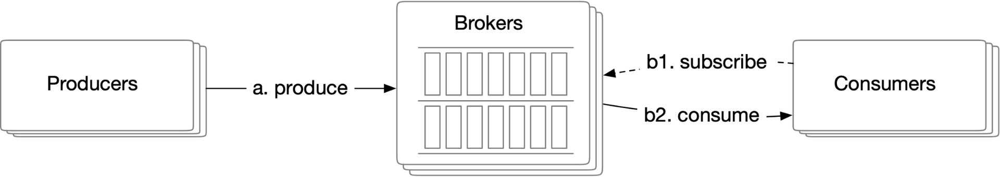

#### 컨슈머 그룹

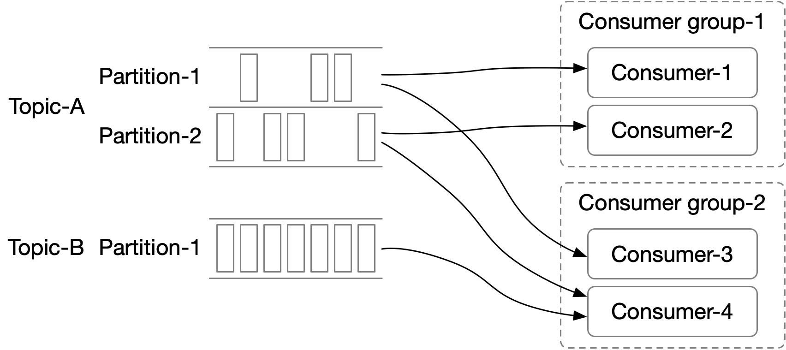

- 컨슈머 그룹은 함께 메시지를 소비하는 컨슈머 집합이다. 그룹마다 **자기 오프셋을 따로 관리**한다(예: 과금 그룹, 회계 그룹).
- 그룹 1은 토픽 A를, 그룹 2는 토픽 A와 B를 구독한다. 그러면 토픽 A의 같은 메시지를 두 그룹이 모두 소비한다(pub/sub).
- **문제**: 같은 파티션을 여러 컨슈머가 병렬로 읽으면 순서가 깨진다.
- **제약**: **한 파티션은 같은 그룹 안에서 컨슈머 하나만** 읽는다. 컨슈머 수가 파티션 수보다 많으면 노는 컨슈머가 생긴다(그림의 그룹 2 컨슈머 3).
- 이 제약 아래서 모든 컨슈머를 한 그룹에 넣으면 point-to-point와 같아진다.
- 파티션은 가장 작은 저장 단위다. 그래서 **파티션을 미리 넉넉하게 만들어 두고** 확장할 때는 컨슈머만 늘린다. 실무에서는 파티션 수가 컨슈머 수보다 훨씬 많다.

#### 개략적 아키텍처

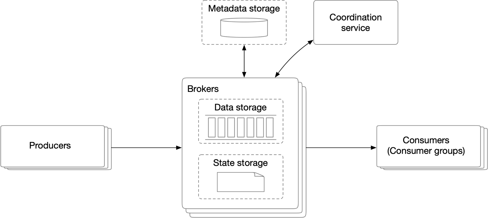

| 영역 | 구성 요소 | 역할 |
|---|---|---|
| 클라이언트 | 프로듀서 | 특정 토픽으로 메시지 push |
| | 컨슈머 그룹 | 토픽을 구독하고 메시지 소비 |
| 핵심 서비스·저장소 | 브로커 | 파티션 여러 개 보유 |
| | 데이터 저장소 | 파티션별 메시지 영구 저장 |
| | 상태 저장소 | 컨슈머 상태(오프셋 등) |
| | 메타데이터 저장소 | 토픽 설정·속성 |
| 조정 서비스 | 서비스 탐색 | 살아 있는 브로커 파악 |
| | 리더 선출 | 브로커 중 하나를 **active controller**로 선출(클러스터에 하나뿐), 파티션 배정 담당. ZooKeeper나 etcd 사용 |

### 3단계 — 상세 설계

높은 처리량과 긴 보관 기간을 함께 만족하려고 다음 세 가지를 택했다.
1. 회전 디스크의 **순차 접근** 성능과 OS의 공격적인 **디스크 캐시**를 활용하는 디스크 자료 구조
2. 프로듀서에서 큐를 거쳐 컨슈머까지 **변형 없이** 전달되는 메시지 구조(복사 최소화)
3. **배치** 우선. 작은 I/O는 처리량의 적이다.

#### 데이터 저장소

메시지 큐의 트래픽 패턴은 이렇다.
- 쓰기도 많고 읽기도 많다.
- 수정과 삭제가 없다.
- 대부분 순차 읽기/쓰기다.

| 선택지 | 판단 |
|---|---|
| ① 데이터베이스(RDB 토픽 테이블 / NoSQL 컬렉션) | 저장은 할 수 있지만, 쓰기와 읽기가 모두 많은 대규모 패턴을 함께 감당하기 어렵다. 병목이 된다. |
| ② **WAL(Write-Ahead Log)** ✅ | append-only 파일(MySQL redo log, ZooKeeper WAL과 같은 방식). 순수 순차 접근이고, 회전 디스크는 용량이 크고 싸다. |

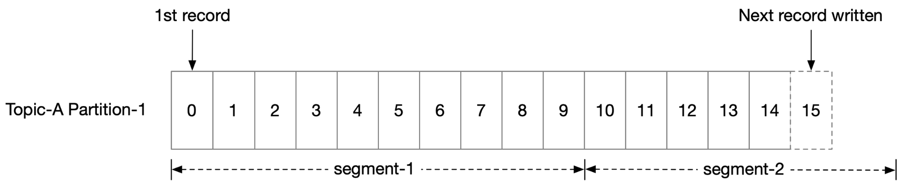

- 새 메시지는 파티션 끝에 붙고 오프셋은 단조 증가한다. 가장 쉬운 방법은 로그 파일의 줄 번호를 오프셋으로 쓰는 것이다.
- 파일을 무한히 키울 수 없으니 **세그먼트**로 나눈다.
  - **active 세그먼트**에만 쓴다. 일정 크기가 되면 새 active 세그먼트를 만들고, 기존 것은 inactive가 된다.
  - inactive 세그먼트는 읽기만 받는다. 보관 기간이나 용량 한도를 넘으면 오래된 것부터 잘라낸다.

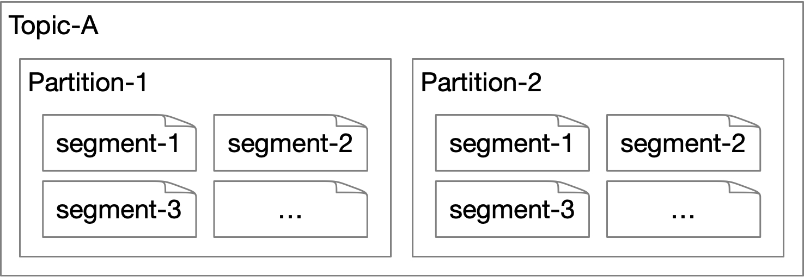

- 같은 파티션의 세그먼트는 `Partition-{:partition_id}` 폴더에 모은다.

**디스크 성능 메모**
- "회전 디스크는 느리다"는 **랜덤 접근에만** 맞는 말이다. 순차 접근으로 설계하면 RAID(스트라이핑)로 수백 MB/s 읽기·쓰기가 나온다. 충분하고 비용 구조도 좋다.
- 최신 OS는 남는 메모리를 전부 디스크 캐시로 쓸 만큼 공격적으로 캐싱한다. WAL은 이것도 활용한다.

#### 메시지 자료 구조

프로듀서, 큐, 컨슈머 사이의 **계약**이다. 셋 중 하나라도 포맷이 다르면 메시지를 변형해야 하고, 그러면 비싼 복사가 생긴다.

| 필드 | 타입 | 설명 |
|---|---|---|
| key | byte[] | 파티션 결정용. `hash(key) % numPartitions`, 없으면 무작위. 프로듀서가 매핑 알고리즘을 직접 정의할 수도 있다. |
| value | byte[] | 페이로드(평문 또는 압축 바이너리) |
| topic | string | 소속 토픽 |
| partition | integer | 소속 파티션 ID |
| offset | long | 파티션 내 위치. **topic + partition + offset**으로 메시지 하나를 특정한다. |
| timestamp | long | 저장 시각 |
| size | integer | 메시지 크기 |
| crc | integer | 무결성 검사(CRC) |

- key는 파티션 번호가 **아니다**. 키에는 보통 비즈니스 정보가 담기고, 파티션 번호는 큐 내부 개념이라 클라이언트에 노출하지 않는다. 매핑 알고리즘이 적절하면 파티션 수가 바뀌어도 고르게 분산된다.
- KV 저장소의 key와도 다르다. 메시지 키는 유일하지 않아도 되고 필수도 아니며, 키로 값을 조회하지도 않는다.
- 필요하면 선택 필드를 추가한다(예: 필터링용 **tag**).

#### 배치

배치는 프로듀서, 컨슈머, 큐 자체 모두에서 쓴다.
- 여러 메시지를 네트워크 요청 하나로 묶어 **왕복 비용을 분산**한다.
- 브로커가 큰 덩어리로 로그에 쓰므로 순차 쓰기 블록과 연속된 디스크 캐시 블록이 커진다. 그만큼 순차 처리량이 오른다.
- **트레이드오프는 지연 시간이다.** 전통 큐처럼 지연이 중요하면 배치를 작게 잡는다(디스크 성능은 조금 손해). 처리량 위주면 토픽당 파티션을 늘려 보완한다.

#### 프로듀서 흐름

**1안: 라우팅 계층을 둔다**

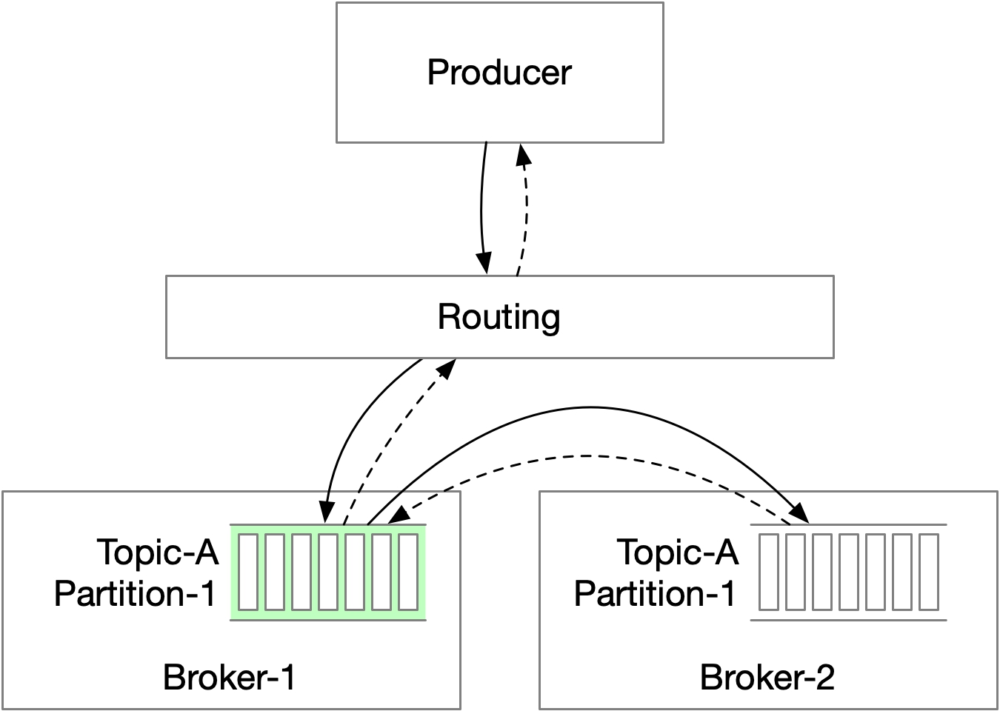

1. 프로듀서가 라우팅 계층으로 보낸다.
2. 라우팅 계층은 메타데이터 저장소의 **복제본 분배 계획**을 로컬에 캐시해 두고, 해당 파티션의 **리더 복제본**이 있는 브로커로 보낸다.
3. 리더가 메시지를 받으면 팔로워가 리더에서 데이터를 **pull**해 간다.
4. "충분한" 복제본이 동기화되면 리더가 커밋(디스크 저장)해서 소비 가능 상태로 만들고, 프로듀서에 응답한다.

단점이 두 가지다. 네트워크 홉이 하나 더 생겨 지연이 늘고, 배치를 고려하지 않았다.

**2안(개선): 라우팅과 버퍼를 프로듀서 클라이언트 라이브러리에 넣는다**

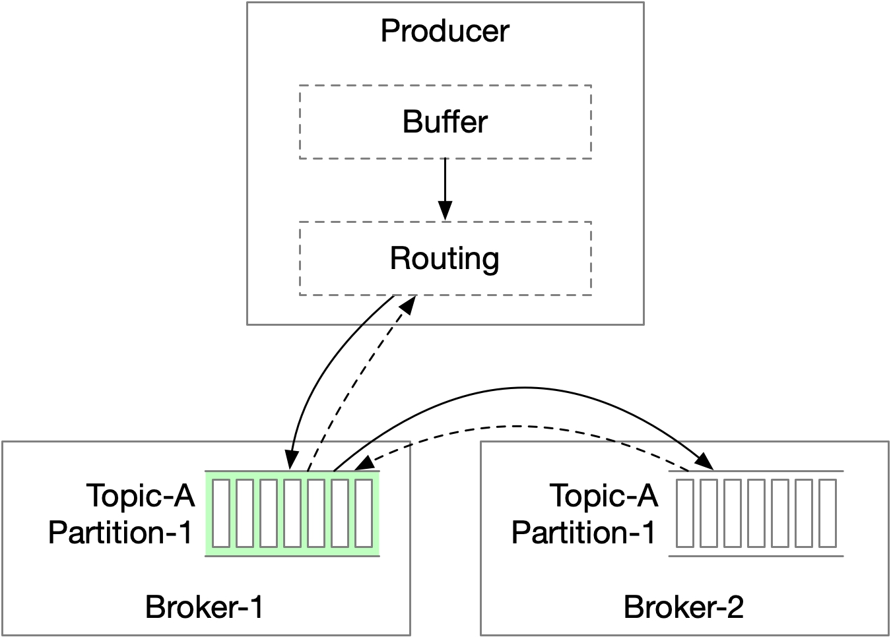

- 홉이 줄어 지연이 낮아진다.
- 프로듀서가 파티션 선택 로직을 직접 가질 수 있다.
- 메모리 버퍼에 모았다가 큰 배치로 보내므로 처리량이 오른다.

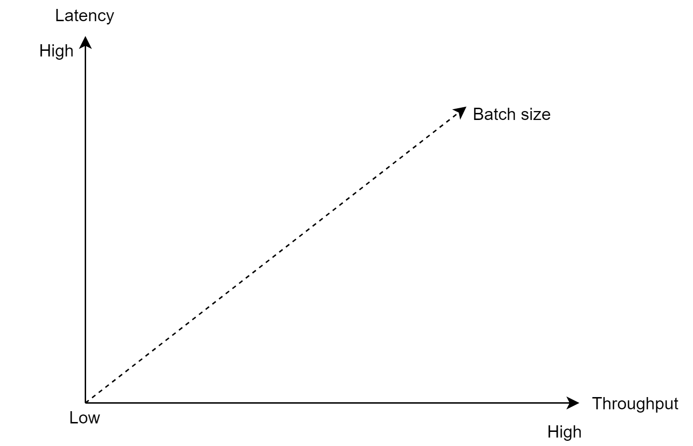

- 배치 크기는 **처리량과 지연의 고전적인 트레이드오프**다. 배치가 크면 처리량이 오르지만 모으는 시간만큼 지연이 늘고, 작으면 그 반대다. 용도에 맞게 조정한다.

**라우팅이 읽는 지도는 누가 만드나: 컨트롤러**

라우팅(1안의 라우팅 계층, 2안의 프로듀서 내부)은 메시지를 **파티션의 리더 복제본이 있는 브로커**로 보내야 한다. 이때 보는 지도가 **복제본 분배 계획**(replica distribution plan)이고, 이 지도를 그리는 쪽이 **컨트롤러**다.

| | 쓰는 쪽: 컨트롤러 | 읽는 쪽: 라우팅 |
|---|---|---|
| 소속 | **브로커 쪽**. 브로커 중 하나이고 클러스터에 1개 | **프로듀서 쪽**. 2안에서는 클라이언트 라이브러리 안 |
| 하는 일 | 파티션과 복제본을 어느 브로커에 둘지 정해 **메타데이터 저장소에 저장** | 계획을 읽어 캐시하고, 메시지를 리더 브로커로 바로 보냄 |
| 바뀔 때 | 브로커 장애·추가 시 새 계획을 만듦(Figure 28, 29) | 바뀐 계획을 다시 받아 새 리더로 보냄 |

교재 근거:
- **Figure 11 (1안, 별도 라우팅 계층)**: 교재가 직접 쓴 문장이다. *"The routing layer reads the replica distribution plan from the metadata storage and caches it locally."* 라우팅 계층이 계획을 읽어 리더 복제본이 있는 브로커로 보낸다.
- **Figure 12 (2안, 라우팅을 프로듀서 클라이언트 라이브러리에 넣음)**: 라우팅 계층이 프로듀서 안으로 들어왔으니 같은 계획을 프로듀서가 들고 있게 된다. 다만 교재는 이 경우 계획을 어떻게 받아 오는지 따로 쓰지 않았다. 파티션 수 변경 절에 *"the producer will be notified after it communicates with any broker"* 라는 문장만 있다(아무 브로커와 통신하면 바뀐 걸 알게 된다).

- 정리하면 **지도를 그리는 건 컨트롤러, 지도를 보고 찾아가는 건 프로듀서**다. 프로듀서 안에 라우팅이 있다고 해서 컨트롤러가 프로듀서 소속이 되는 것은 아니다.
- 컨트롤러의 정의, 선출 방식, 코디네이터와의 차이는 아래 「컨트롤러 정리」에 모아 두었다.
- 그림책 비유: 🦊 여우 집사(컨트롤러)가 마을 입구에 지도를 붙이고, 🚌 버스를 모는 서버 로봇(프로듀서 안의 라우팅)이 그 지도를 보고 로기를 ☆ 보관소 앞에 내려 준다.

#### 컨슈머 흐름

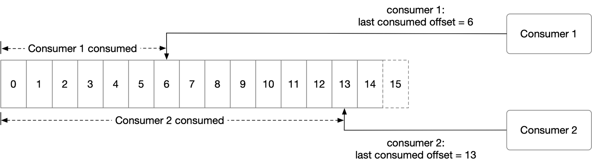

컨슈머가 파티션 안의 오프셋을 지정하면 그 위치부터 이벤트 묶음을 받는다.

**Push vs Pull**

| | Push (브로커 → 컨슈머) | Pull (컨슈머 ← 브로커) ✅ |
|---|---|---|
| 장점 | 받는 즉시 보내므로 지연이 낮다. | 컨슈머가 소비 속도를 정한다(실시간 그룹과 배치 그룹 공존 가능). 소비가 생산보다 느리면 컨슈머를 늘리거나 나중에 따라잡으면 된다. 현재 위치 이후를 한 번에 가져오므로 **공격적인 배치**에 유리하다. |
| 단점 | 소비가 생산보다 느리면 컨슈머가 압도된다. 처리 능력이 제각각인 컨슈머를 다루기 어렵다(속도를 브로커가 정함). | 메시지가 없어도 계속 당겨서 자원을 낭비한다. **롱 폴링**(일정 시간 대기)으로 완화한다. |

대부분의 메시지 큐가 **pull**을 택한다.

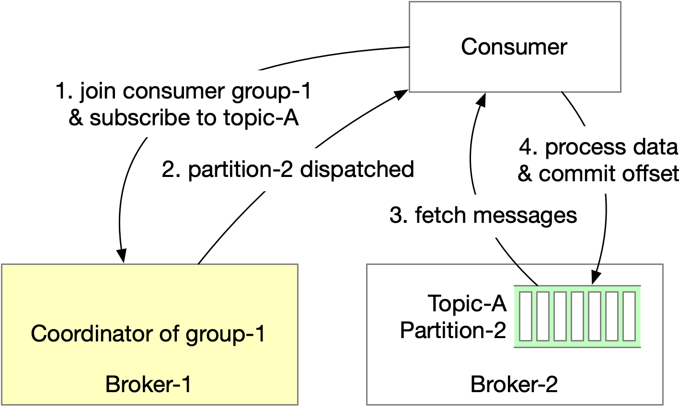

1. 새 컨슈머가 그룹 1에 들어와 토픽 A를 구독하려 한다. **그룹 이름을 해시**해서 담당 브로커를 찾는다. 같은 그룹은 모두 같은 브로커에 붙고, 이 브로커가 그 그룹의 **코디네이터**다.
   - 컨슈머 그룹 코디네이터는 Figure 8의 조정 서비스(ZooKeeper 등)와 **다르다**. 코디네이터는 컨슈머 그룹을, 조정 서비스는 브로커 클러스터를 조정한다.
2. 코디네이터가 가입을 확인하고 파티션 2를 배정한다(배정 전략은 round-robin, range 등).
3. 컨슈머는 상태 저장소에 있는 **마지막 소비 오프셋**부터 가져온다.
4. 처리한 뒤 오프셋을 브로커에 커밋한다. **처리와 커밋의 순서**가 전달 보장 수준을 결정한다(뒤에 나옴).

#### 컨슈머 리밸런싱

어떤 컨슈머가 어떤 파티션을 맡을지 다시 정하는 과정이다. 컨슈머 가입, 탈퇴, 장애, 파티션 조정 때 일어난다.

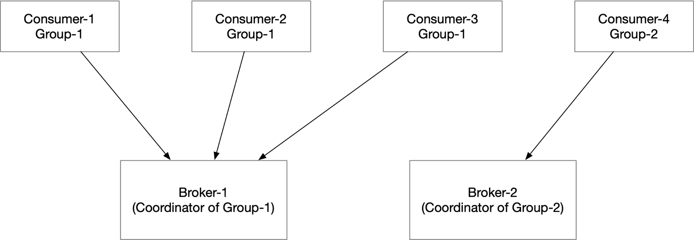

- 코디네이터는 브로커 중 하나다. 컨슈머의 **하트비트**를 받고 파티션별 오프셋을 관리한다.
- 코디네이터는 가입한 컨슈머 목록을 유지하고, 목록이 바뀌면 그룹의 **리더 컨슈머**를 새로 뽑는다.
- 리더 컨슈머가 **파티션 배정 계획**을 만들어 코디네이터에 보고하면, 코디네이터가 그룹의 다른 컨슈머에게 전파한다.
- 네트워크 문제, 장애, 재시작 등으로 하트비트가 끊기면 리밸런싱을 시작한다.

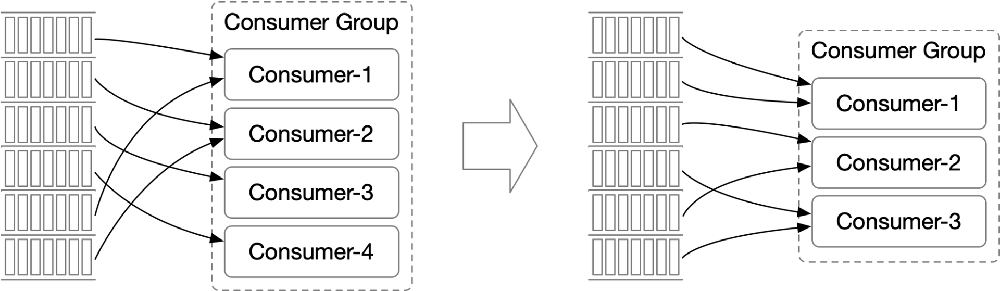

예시: 그룹에 컨슈머 2개, 토픽에 파티션 4개.

**새 컨슈머 가입**

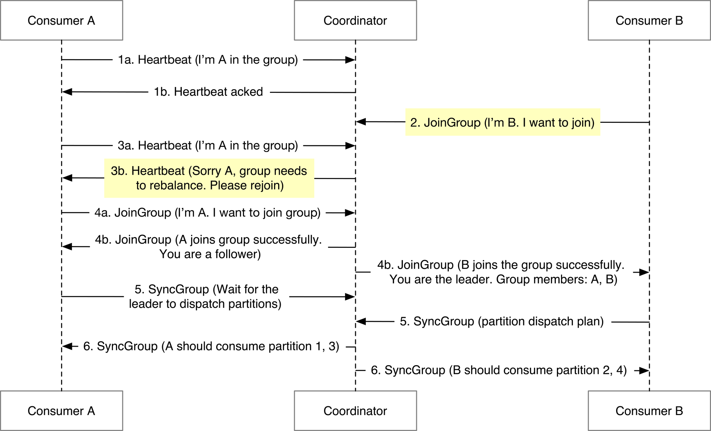

1. 처음에는 A만 있어서 모든 파티션을 소비하며 하트비트를 보낸다.
2. B가 가입 요청을 보낸다.
3. 코디네이터가 리밸런싱이 필요하다고 판단한다. 알림은 **수동적**이다. A의 하트비트가 오면 그 응답으로 재가입을 요청한다.
4. 모두 재가입하면 코디네이터가 그중 하나를 리더로 뽑아 결과를 알린다.
5. 리더가 배정 계획을 만들어 코디네이터에 보내고, 팔로워는 코디네이터에게 계획을 물어본다.
6. 새로 배정된 파티션부터 소비를 시작한다.

**기존 컨슈머 탈퇴**

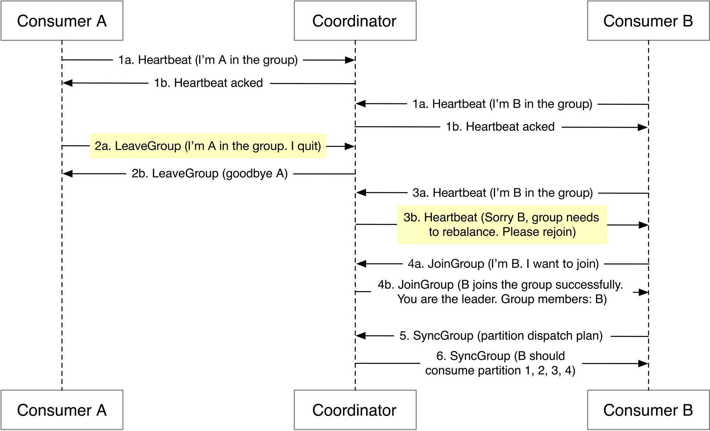

A가 종료하려고 탈퇴를 요청한다. 코디네이터는 B의 하트비트가 올 때 재가입을 요청하고, 이후는 가입 시나리오와 같다.

**기존 컨슈머 장애**

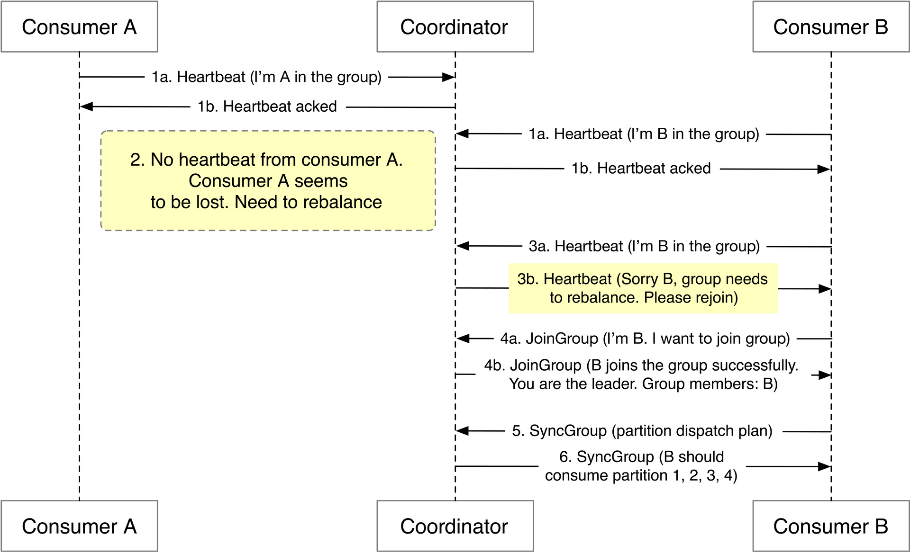

A가 죽어 하트비트가 일정 시간 동안 안 오면 코디네이터가 A를 dead로 표시하고 리밸런싱을 시작한다. 이후는 같다.

#### 상태 저장소

저장하는 것:
- 파티션과 컨슈머의 매핑
- 컨슈머 그룹별·파티션별 **마지막 소비 오프셋**

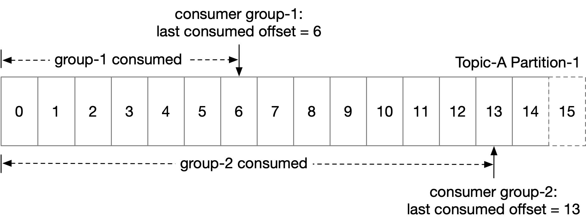

- 그룹 1이 오프셋 6을 커밋했다는 것은 6까지(6 포함) 소비했다는 뜻이다. 그룹 1은 6, 그룹 2는 13처럼 그룹마다 독립적이다. 컨슈머가 죽으면 같은 그룹의 다른 컨슈머가 이 오프셋부터 이어서 읽는다.
- 접근 패턴: 읽기와 쓰기가 잦지만 양은 적다. 갱신이 잦고 삭제는 드물다. **랜덤** 읽기·쓰기이고 **일관성이 중요**하다.
- 그래서 ZooKeeper 같은 KV 저장소가 적합하다. (Kafka는 오프셋 저장을 ZooKeeper에서 브로커 내부로 옮겼다.)

#### 메타데이터 저장소

- 토픽 설정과 속성(파티션 수, 보관 기간, 복제본 분배)을 저장한다.
- 변경이 드물고 양이 적지만 **일관성 요구가 높다**. ZooKeeper가 적합하다.

#### ZooKeeper

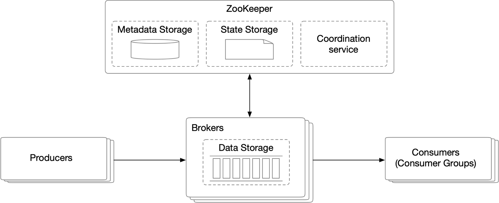

계층형 KV 저장소로, 분산 설정, 동기화, 이름 등록에 쓴다. 적용하면 이렇게 바뀐다.
- 메타데이터 저장소와 상태 저장소를 ZooKeeper로 옮긴다.
- 브로커는 **메시지 데이터 저장소만** 관리한다.
- 브로커 클러스터의 리더 선출도 ZooKeeper가 돕는다.

#### 컨트롤러 정리 (조정 서비스·코디네이터와 구분)

> 교재에서 컨트롤러는 그림 안에 "Controller" 박스로 따로 그려지지 않는다. 정의와 역할은 모두 본문에만 나온다. 같은 대상을 *active controller*, *leader*(브로커 노드), *broker controller*로 섞어 부른다.

**정의** (2단계 개략적 아키텍처, Figure 8 본문)
> Leader election: one of the brokers is selected as the **active controller**. There is only one active controller in the cluster. The active controller is responsible for assigning partitions. Apache Zookeeper or etcd are commonly used to elect a controller.

- 정체: **브로커 중 하나**다. 별도 서버가 아니다.
- 개수: 클러스터 전체에 **딱 하나**
- 뽑는 방법: 조정 서비스(ZooKeeper/etcd)의 리더 선출로 뽑힌다. 그림에서는 Figure 8의 `Coordination service` 박스, Figure 22에서 ZooKeeper 안으로 들어간 `Coordination service`에 해당한다.

**하는 일** (교재에 나오는 순서대로)

| 상황 | 컨트롤러가 하는 일 | 근거 |
|---|---|---|
| 파티션 배정 | 토픽의 파티션을 어느 브로커에 둘지 정한다. | Figure 8 본문 |
| 복제본 분배 계획 | 파티션마다 리더·팔로워 복제본을 어느 브로커에 둘지(**replica distribution plan**) 만들어 **메타데이터 저장소에 저장**한다. 모든 브로커가 이 계획대로 동작한다. | Figure 23 뒤 본문 |
| 브로커 장애 | 죽은 브로커를 감지하고 남은 브로커로 **새 분배 계획**을 만든다. 리더를 잃은 파티션은 새 리더를 정하고, 부족한 복제본을 다른 브로커에 새로 만든다. | Figure 28 |
| 브로커 추가·제거 | 설정보다 많은 복제본을 **일시적으로 허용**한다. 새 브로커가 따라잡으면 남는 복제본을 정리해서 데이터 유실 없이 옮긴다. | Figure 29 |

프로듀서(라우팅)가 이 계획을 읽어 쓰는 방식은 위 「프로듀서 흐름」 끝의 「라우팅이 읽는 지도는 누가 만드나」 참고.

**비슷한 이름과의 구분**

| | 조정 서비스 | 컨트롤러 | 컨슈머 그룹 코디네이터 |
|---|---|---|---|
| 정체 | 외부 시스템(ZooKeeper/etcd) | 브로커 중 하나 | 브로커 중 하나 |
| 개수 | 1세트 | 클러스터에 1개 | **컨슈머 그룹마다** 1개(그룹 이름 해시로 결정) |
| 조정 대상 | 브로커 클러스터(살아 있는 브로커, 리더 선출) | 파티션·복제본 배치 | 컨슈머 그룹(하트비트, 리밸런싱, 오프셋) |
| 교재 그림 | Figure 8, 22 | (그림 없음, 본문만) Figure 23·28·29 설명 | Figure 15~20 |

- 교재가 직접 못 박은 구분(Figure 15 설명): *"Despite the naming similarity, the consumer group coordinator is different from the coordination service mentioned in Figure 8. The former coordinates the consumer group, while the latter coordinates the broker cluster."*
- 한 줄로 정리하면: **조정 서비스가 컨트롤러를 뽑고, 컨트롤러는 브로커 쪽(파티션·복제본)을, 코디네이터는 컨슈머 쪽(그룹·리밸런싱)을 챙긴다.**
- 그림책 비유: 🦊 여우 집사 = 컨트롤러, 🦉 부엉이 = 코디네이터

#### 복제

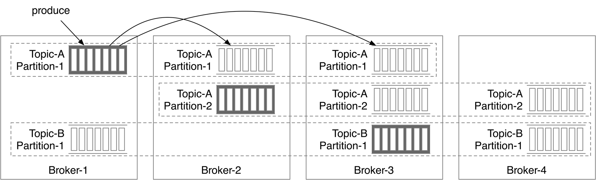

- 파티션마다 복제본 3개를 **서로 다른 브로커**에 둔다. 강조 표시된 것이 리더이고 나머지는 팔로워다.
- 프로듀서는 **리더에만** 쓴다. 팔로워는 리더에서 계속 pull한다. **충분한** 복제본에 동기화되면 리더가 프로듀서에 ack를 보낸다.
- **복제본 분배 계획** 예:
  - 토픽 A 파티션 1: 리더 브로커 1, 팔로워 2·3
  - 토픽 A 파티션 2: 리더 브로커 2, 팔로워 3·4
  - 토픽 B 파티션 1: 리더 브로커 3, 팔로워 4·1
- 계획은 조정 서비스의 도움으로 선출된 **리더 브로커(컨트롤러)**가 만들어 메타데이터 저장소에 저장한다. 모든 브로커가 이 계획대로 동작한다.

#### ISR (In-Sync Replicas)

- 리더와 동기화된 복제본 집합이다. "동기화"의 기준은 토픽 설정에 따른다. 예: `replica.lag.max.messages=4`면 리더보다 3개 이하로 뒤처진 팔로워까지 ISR에 남는다. 리더는 기본으로 ISR에 포함된다.

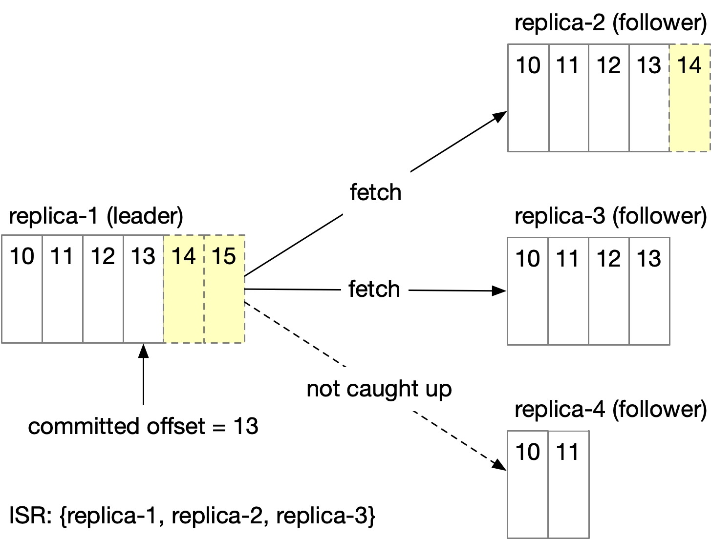

- 리더의 **커밋된 오프셋**은 13이다. 새 메시지 2개가 리더에 쓰였지만 아직 커밋되지 않았다. 커밋된 오프셋이란 그 오프셋까지 ISR 전체에 동기화됐다는 뜻이다.
- replica-2와 replica-3은 리더를 다 따라잡아 ISR에 있다. replica-4는 설정된 지연 시간 안에 못 따라잡아 ISR에서 빠졌고, 따라잡으면 다시 들어간다.
- **ISR이 필요한 이유**: 모든 복제본이 동기화된 뒤 ack하면 가장 안전하다. 하지만 느린 복제본 하나 때문에 파티션 전체가 느려지거나 쓸 수 없게 된다. ISR은 **성능과 내구성의 절충점**이다.
- ISR 판정: 보통 파티션 리더가 각 복제본의 지연(lag)을 계산해서 ISR 목록을 관리한다.

**ACK 설정**: 프로듀서는 K개의 ISR이 받을 때까지 기다리도록 정할 수 있다.

| 설정 | 동작 | 지연 | 내구성 | 용도 | 그림 |
|---|---|---|---|---|---|
| **ACK=all** | 모든 ISR이 받으면 ack. 가장 느린 ISR을 기다린다. `min.insync.replicas`(그림에서는 2) 이상일 때만 의미가 있다. | 높음 | 최강 | 유실 불가 | 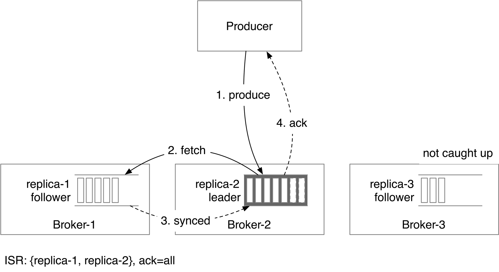 |
| **ACK=1** | 리더가 저장하면 ack. 팔로워 복제 전에 리더가 죽으면 **유실**된다. | 중간 | 중간 | 저지연, 가끔 유실 허용 | 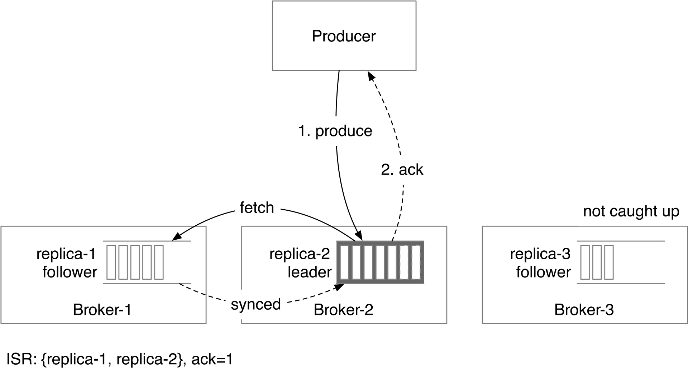 |
| **ACK=0** | ack를 기다리지 않고 계속 보낸다. **재시도 없음**. | 최저 | 최약 | 메트릭·로그 수집 | 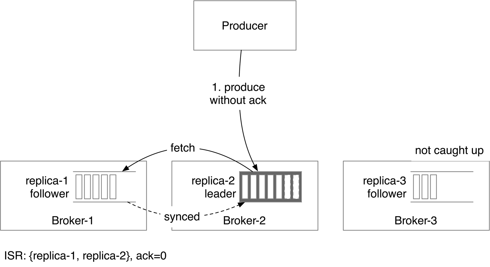 |

**컨슈머는 리더에서 읽는다.** 이유:
- 설계와 운영이 단순하다.
- 파티션 하나는 그룹 안에서 컨슈머 하나만 읽으므로 리더 연결 수가 제한된다.
- 토픽이 아주 뜨겁지 않으면 연결 수가 많지 않다. 뜨거우면 파티션과 컨슈머를 늘리면 된다.
- 예외: 컨슈머가 리더와 **다른 데이터센터**에 있으면 가장 가까운 ISR에서 읽게 하는 것이 낫다.

#### 확장성

| 대상 | 확장 방법 |
|---|---|
| **프로듀서** | 그룹 조정이 필요 없어서 인스턴스를 추가하거나 빼면 끝이다. |
| **컨슈머** | 그룹끼리 격리되어 있어서 그룹 추가와 삭제가 쉽다. 그룹 안에서는 리밸런싱이 추가, 제거, 장애를 처리한다. |
| **브로커** | 아래의 장애 복구와 브로커 추가 절차 참고 |
| **파티션** | 아래의 파티션 증가·감소 참고 |

**브로커 장애 복구**

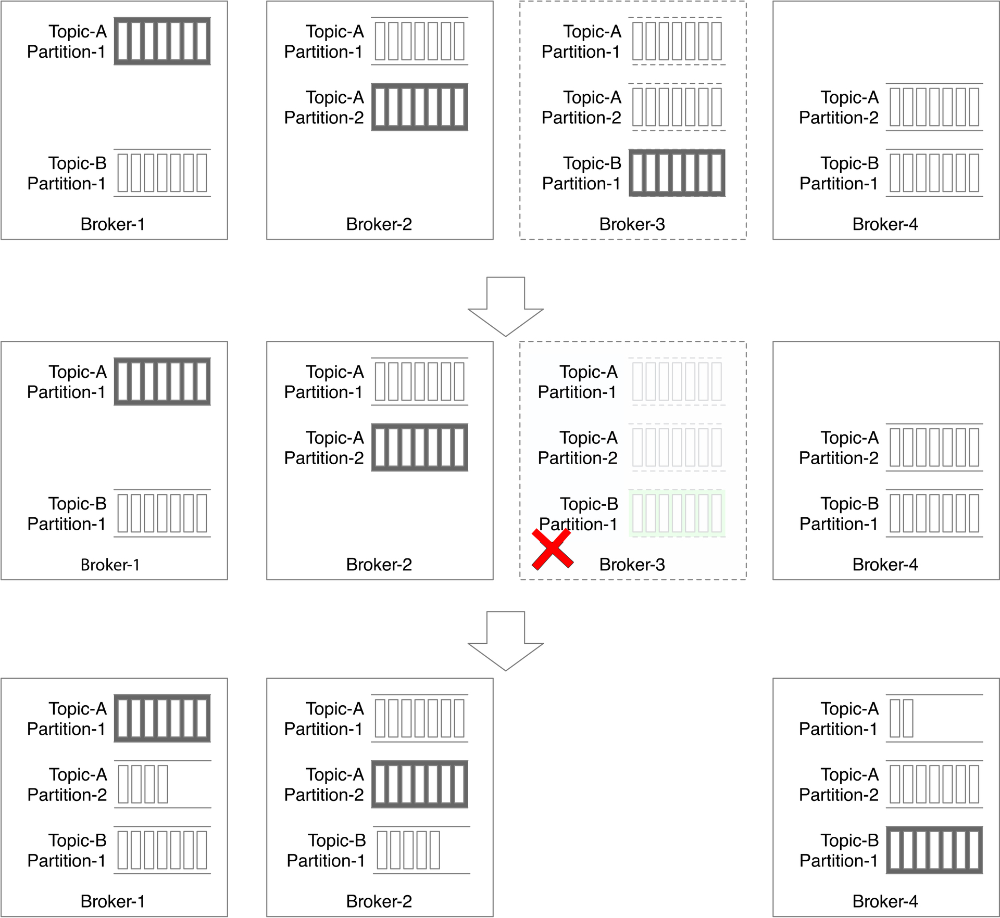

1. 브로커 4대에서 분배 계획은 A-1: 1(L), 2, 3 / A-2: 2(L), 3, 4 / B-1: 3(L), 4, 1이다.
2. 브로커 3이 죽으면 그 노드의 파티션이 모두 사라진다. A-1: 1(L), 2 / A-2: 2(L), 4 / B-1: 4, 1 (B-1은 리더를 잃었다).
3. 컨트롤러가 이를 감지하고 새 계획을 만든다(→ 위 「컨트롤러 정리」). A-1: 1(L), 2, **4** / A-2: 2(L), 4, **1** / B-1: 4(L), 1, **2**.
4. 새 복제본은 팔로워로 리더를 따라잡는다.

추가로 고려할 점:
- **최소 ISR 수**가 클수록 안전하지만 지연이 늘어난다.
- 한 파티션의 복제본은 **같은 노드에 두지 않는다**. 그 노드가 죽으면 다 잃고, 같은 노드에 복제하는 것은 자원 낭비다.
- 복제본이 모두 죽으면 그 파티션 데이터는 영구 유실된다. 복제본 수와 위치는 안전성, 비용, 지연 사이의 트레이드오프다. 데이터센터를 넘겨 분산하면 안전하지만 지연과 비용이 크다. 대안으로 **데이터 미러링**이 있다(범위 밖).

**브로커 추가**

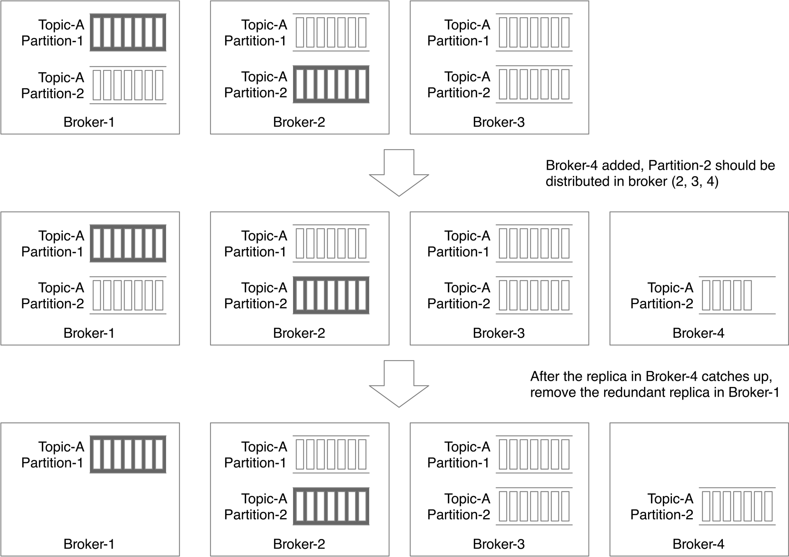

단순히 복제본을 재분배하는 대신, 컨트롤러가 **일시적으로 설정보다 많은 복제본**을 허용한다.
1. 브로커 3대, 파티션 2개, 파티션당 복제본 3개로 시작한다.
2. 브로커 4를 추가하고 파티션 2의 분배를 (2, 3, 4)로 바꾼다. 브로커 4의 새 복제본이 리더(브로커 2)에서 복사를 시작한다. 이 동안 복제본은 일시적으로 3개를 넘는다.
3. 브로커 4가 따라잡으면 브로커 1의 남는 복제본을 정상적으로 제거한다.

이렇게 하면 브로커를 추가할 때 데이터가 유실되지 않는다. 제거할 때도 같은 방식을 쓴다.

**파티션 수 변경**

파티션 수가 바뀌면 프로듀서는 아무 브로커와 통신할 때 알게 되고, 컨슈머는 리밸런싱한다. 그래서 둘 다 안전하다.

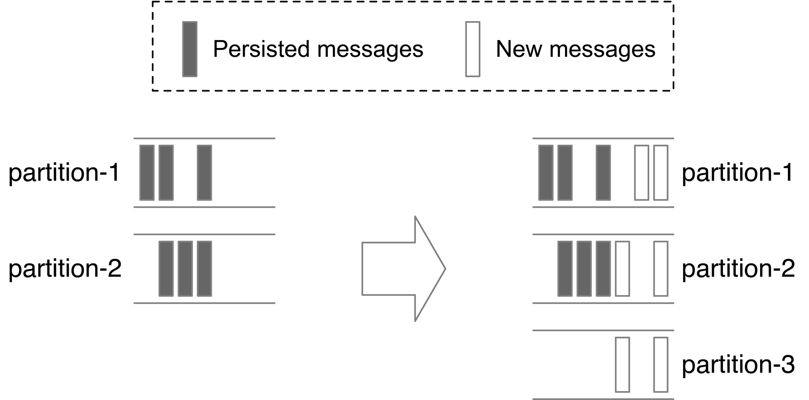

- **증가**: 기존 메시지는 옛 파티션에 그대로 있어서 **데이터 이동이 없다**. 새 메시지는 3개 파티션 모두에 들어간다. 간단하다.

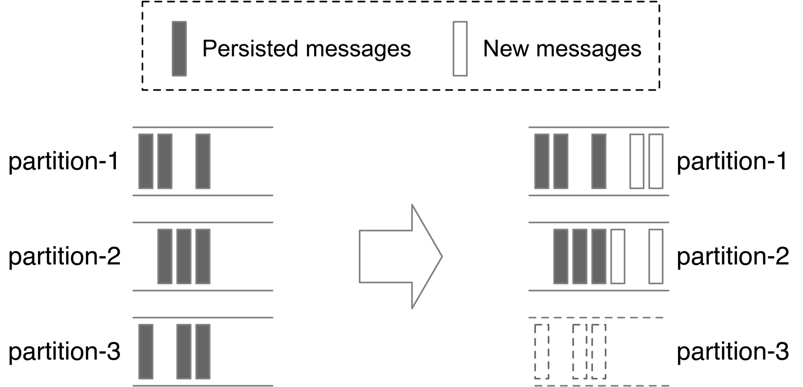

- **감소**는 더 복잡하다.
  - 폐기된 partition-3에는 새 메시지가 더 이상 들어오지 않는다.
  - partition-3을 바로 지울 수는 없다. 아직 소비 중일 수 있으므로 **보관 기간이 지나야** 지우고 공간을 비운다. 파티션을 줄여도 공간이 바로 확보되지 않는다.
  - 전환 기간에 프로듀서는 2개 파티션에만 보내고, 컨슈머는 3개 모두에서 읽는다. 보관 기간이 끝나면 컨슈머 그룹을 리밸런싱한다.

#### 데이터 전달 보장 (Delivery Semantics)

| 보장 | 프로듀서 | 컨슈머 | 결과 | 용도 | 그림 |
|---|---|---|---|---|---|
| **At-most once** | 비동기 전송, `ack=0`, 실패해도 **재시도 없음** | **처리 전에** 오프셋 커밋. 커밋 직후 죽으면 재소비하지 않는다. | 유실 가능, 중복 없음 | 모니터링 메트릭 | 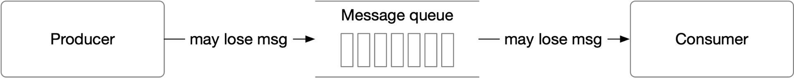 |
| **At-least once** | 동기 전송 또는 콜백, `ack=1`/`all`, 실패나 타임아웃이면 **계속 재시도** | **처리 성공 후** 커밋. 처리는 했는데 커밋 전에 죽으면 재시작 후 다시 소비해 **중복**이 생긴다. | 유실 없음, 중복 가능 | 중복이 문제 안 되거나 컨슈머에서 중복 제거가 가능한 경우(예: 고유 키로 DB 중복 쓰기 거부) | 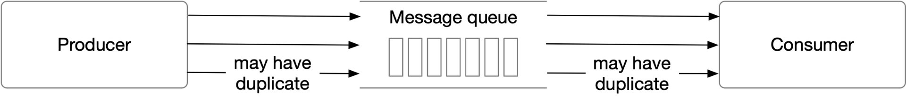 |
| **Exactly once** | 프로듀서 → 큐 구간 정확히 한 번 | 큐 → 컨슈머 구간 정확히 한 번 | 사용자에게는 가장 편하지만 시스템 성능과 복잡도 비용이 가장 크다 | 금융(결제, 거래, 회계). 중복을 허용할 수 없고 하위 서비스가 **멱등성을 지원하지 않을 때** | 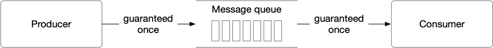 |

> 교재는 exactly once를 *어떻게* 구현하는지 다루지 않는다. 그림도 "양쪽 구간 모두 guaranteed once"뿐이다.

#### 고급 기능

**메시지 필터링**

- 상황: 주문 시스템은 주문 활동을 전부 한 토픽에 보내지만, 결제 시스템은 결제(checkout)와 환불만 필요하다.
- 소비자마다 전용 토픽을 만들면 문제가 생긴다. 요구가 생길 때마다 토픽이 늘고, 같은 메시지를 중복 저장해 자원을 낭비하며, 프로듀서와 컨슈머가 강하게 결합된다(새 요구마다 프로듀서를 수정해야 한다).
- 컨슈머가 다 받아서 버리는 방식은 유연하지만 불필요한 트래픽이 생긴다.
- **브로커에서 필터링**하는 쪽이 낫다. 다만 페이로드를 복호화하거나 역직렬화하면 브로커 성능이 떨어지고, 민감한 데이터를 큐가 읽게 된다. 그래서 필터용 데이터는 **메타데이터(tag)**에 넣는다. 태그를 여러 개 붙이면 여러 차원으로 거를 수 있다. 수식 같은 복잡한 조건은 파서나 스크립트 실행기가 필요해 큐에는 너무 무겁다.

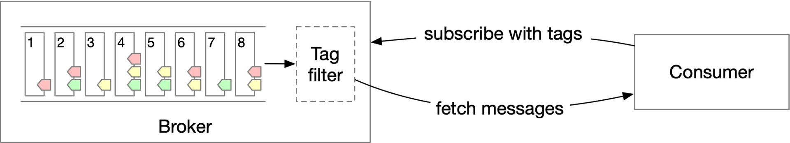

**지연 메시지 / 예약 메시지**

- 예시: 주문 후 30분 안에 결제하지 않으면 주문을 닫는다. 확인 메시지를 지금 보내고 30분 뒤에 전달한다. 받았을 때 미결제면 주문을 닫고, 결제됐으면 무시한다.
- 지연 메시지는 바로 토픽에 넣지 않는다. 브로커의 **임시 저장소**에 넣었다가 시간이 되면 토픽으로 옮긴다.

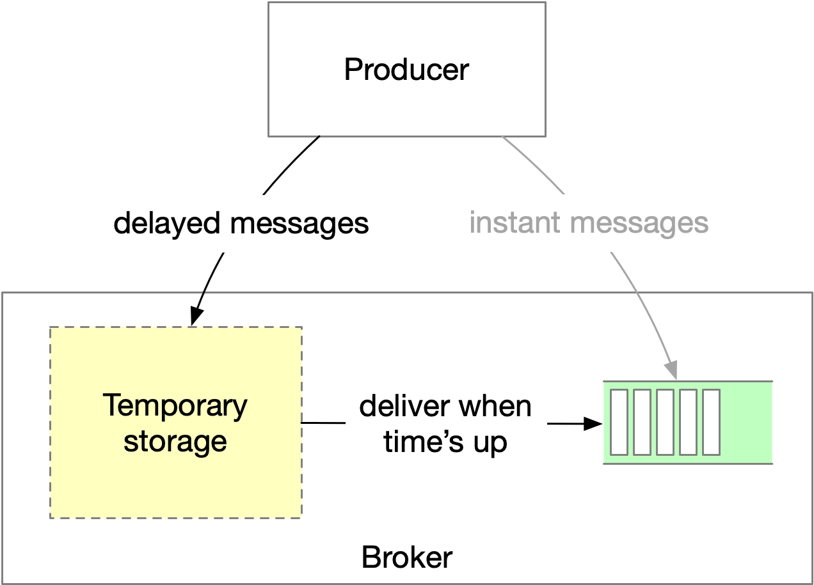

- 임시 저장소는 하나 이상의 특수 토픽으로 둘 수 있다.
- 타이머 구현(범위 밖)은 두 가지가 대표적이다.
  - **미리 정한 지연 단계별 전용 큐**. RocketMQ는 임의 정밀도를 지원하지 않고 1s, 5s, 10s, 30s, 1m, 2m, 3m, 4m, 6m, 8m, 9m, 10m, 20m, 30m, 1h, 2h 단계만 지원한다.
  - **계층적 타이밍 휠(Hierarchical time wheel)**
- 예약 메시지(정해진 시각에 전달)도 설계가 거의 같다.

## 토론하고 싶은 것

(스터디 시간에 다른 사람들과 이야기해보고 싶은 질문)

## 더 찾아본 것 (선택)

(챕터 밖에서 추가로 조사한 내용, 참고 링크)
