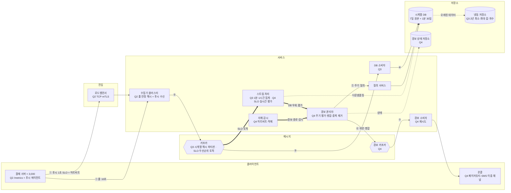

# 5장 지표 모니터링 및 경보 시스템 — 동억 · S4 결제SLO

> **한 줄 요약**: 일반 지표는 풀, 결제 SLO 지표는 푸시로 모아 카프카에 싣고, 핵심 SLO 경보는 시계열 DB를 거치지 않고 스트림에서 바로 평가해 DB 장애에도 경보가 울리게 한다.

## 1. 전제

| 핵심 숫자 | 값 | 계산식 |
|---|---|---|
| 초당 데이터 포인트 | 1.6×10⁵/s (시계열 151만 개) | 3,000 × 500 ÷ 10초 + 1만 ÷ 1초 |
| 2년 전체 저장량 (다운샘플링 후 / 전) | 약 3.5TB / 약 187TB | 하루 256GB: 7일 원본 + 1분 단위 + 1시간 단위 / 256GB × 730일 |

- **교재와 다른 제약**: 사업 지표(결제 실패율)를 1초 주기로 보고 30초 안에 경보, 누락 0건 / 감사 때문에 2년 보관

## 2. 결정 4개

| # | 결정 | 질문 | 내 선택 | 근거 (한 줄) | 감수한 것 |
|---|---|---|---|---|---|
| Q1 | 규모·병목 | 151만 시계열·16만/s에서 2년 저장량은? 가장 먼저 한계에 닿는 것은? | 질의·경보 평가 부하 (평가 150회/s) | 저장은 다운샘플링으로 98% 절감 가능, 30초 경보 목표가 더 빡빡 | 쓰기 16만/s·시계열 151만 개는 후순위 |
| Q2 ★ | 수집 방식 | 서버 지표 150만 개(10초)와 SLO 1만 개(1초)를 어떻게 모으고, 수집기 여러 대에 어떻게 나누나? | 혼합: 일반 지표 풀(안정 해시) + SLO 지표 푸시(LB·TCP·mTLS, 하트비트·시퀀스 번호) | 핵심 지표는 집계 지연 최소화·로컬 버퍼로 유실 방지, 푸시의 상태 진단은 하트비트로 보완 | 두 경로 운영 부담 |
| Q3 | 전송·데이터 줄이기 | ① 수집기와 TSDB 사이에 무엇을 두고 파티션은? ② 어디서 줄이고 2년 감사 보관엔 무엇을 남기나? | ① 카프카(시계열 식별자 해시 파티션, SLO 우선순위 토픽) → 적재 + 핵심 경보 평가 입력 (돌발) ② 지표마다 다르게(에이전트 + 플링크 1분/1시간) + 최소·최대·합·개수 + 냉동 저장소 | DB 장애에도 유실 방지, 평균만으론 PG 응답 급증 확인 불가 | 카프카 운영 부담, 원본 별도 보존 시 저장량 |
| Q4 | 경보 평가·전달 | (돌발: TSDB 15분 장애로 경보 침묵) ① 경보 규칙을 어디서 평가하나? ② 어떻게 확실히 전달하고 줄이나? | ① 혼합: 일반 규칙은 주기 질의, 핵심 SLO는 카프카 스트림 실시간 평가 ② 카프카 + 경보 상태 저장소 + 재시도, PG·대상별 병합, 자체 감시, SMS 이중 채널 | DB가 15분 죽어도 핵심 결제 경보는 독립 동작, 미수신·타임아웃은 수집 장애 경보로 | 경로 이원화 운영 부담 |

> 바뀐 결정: Q3 ① 카프카(DB 적재 큐) → 카프카(적재 + 핵심 경보 평가 입력) (돌발)

## 3. 시스템 전체 설계도

실선 = 지표 수집 → 경보 발령 · 점선 = 쓰기·비동기 · 굵은 선 = 돌발 대응

**지표 수집 → 경보 발령**: ① 풀(10초) / 푸시(1초 SLO) → ② 수집기 → 카프카 → ③ DB 소비자 → ④ 시계열 DB → ⑤ 경보 관리자가 질의 서비스로 주기 평가 → ⑥ 위반 시 병합·중복 제거 후 경보 카프카 → ⑦ 경보 소비자가 온콜 호출 (핵심 SLO는 ③~⑤ 대신 플링크에서 실시간 평가)

## 4. 교재와 다르게 간 곳

| 결정 | 교재 | 나 | 이 시나리오에서 왜 |
|---|---|---|---|
| 경보 평가 | 경보 관리자가 질의 서비스로 주기 평가 | 핵심 SLO는 카프카 스트림에서 실시간 평가 | TSDB 장애 = 경보 침묵을 끊어야 누락 0건 |
| 수집 방식 | 풀/푸시 장단점 비교 | 일반 풀 + SLO 푸시 혼합 | 1초 결제 지표는 지연 최소·로컬 버퍼가 중요 |
| 다운샘플링 | 1년, 평균 | 2년, 최소·최대·합·개수 + 냉동 저장소 | 감사·분쟁 때 PG 응답 급증을 확인해야 함 |

## 5. 미팅 안건

- **가장 자신 없는 결정**: 
- **같이 이야기할 질문**: 자체 감시가 같은 카프카·클러스터 위에 있으면 함께 죽는다 — 외부 데드맨 스위치까지 둬야 누락 0건이라 말할 수 있나?
