# ch05. 지표 모니터링 및 경보 시스템 (Metrics Monitoring and Alerting System)

> 범위: 교재 5장 전체(1~4단계). 그림은 `images/figNN.jpg`이고, 번호는 교재 그림 번호와 같다(Figure 1~22 전부 추출).
> 목표는 Datadog 같은 SaaS가 아니라 **대기업 사내용** 지표 모니터링·경보 시스템이다. 로그(ELK)와 분산 추적은 범위 밖이고, CPU·메모리·QPS 같은 **운영 지표**만 다룬다.

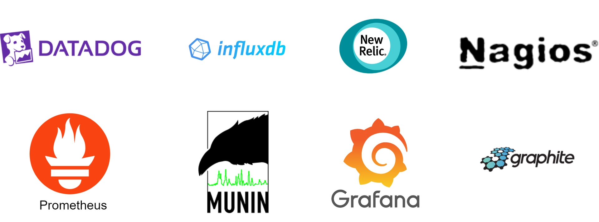

*그림 1. 널리 쓰이는 지표 모니터링·경보 서비스*

## 핵심 요약

1. **지표는 시계열이고, 저장소는 시계열 DB(TSDB)를 쓴다.** 시계열은 `이름 + 레이블 집합 + (값, 타임스탬프) 배열`이다. 쓰기는 끊임없이 많고 읽기는 몰렸다 빠졌다 한다. MySQL은 이동 평균 같은 질의가 어렵고 무거운 쓰기에 약하며, Cassandra/Bigtable은 스키마를 직접 짜야 한다. 그래서 InfluxDB·Prometheus 같은 TSDB를 고른다. 레이블은 무엇보다 **카디널리티를 낮게** 유지해야 한다.
2. **수집은 pull과 push 중 정답이 없다. 장단점을 말할 수 있어야 한다.** pull(Prometheus)은 서비스 탐색 + 안정 해시 링으로 수집기를 나누고, push(CloudWatch, Graphite)는 에이전트 + 로드밸런서 + 오토스케일링 수집기 클러스터를 쓴다. 대규모 조직은 둘 다 지원하게 된다(서버리스는 에이전트를 못 깐다).
3. **파이프라인은 Kafka로 버티고, 데이터는 줄여서 1년 보관한다.** 수집기 → Kafka → 스트림 소비자 → TSDB로 두면 DB 장애 때도 데이터를 잃지 않는다. 저장 공간은 **델타 인코딩·압축, 다운샘플링(7일 원본 → 30일 1분 → 1년 1시간), 콜드 스토리지**로 줄인다. 경보와 시각화는 보통 **직접 만들지 않고** Alertmanager, Grafana 같은 기존 도구를 쓴다.

## 설계 정리

### 1단계 — 문제 이해 및 설계 범위 확정

| 질문 | 답 |
|---|---|
| 누구를 위한 시스템? | 사내용(SaaS 아님) |
| 어떤 지표? | 운영 지표: CPU 부하, 메모리, 디스크, 서비스 RPS, 웹 풀의 서버 수 등. **비즈니스 지표는 제외** |
| 규모 | DAU 1억, 서버 풀 1,000개 × 풀당 100대 |
| 보관 기간 | 1년 |
| 해상도 축소 | 7일은 원본, 이후 30일은 1분 단위, 그 뒤는 1시간 단위로 롤업 |
| 경보 채널 | 이메일, 전화, PagerDuty, 웹훅(HTTP 엔드포인트) |
| 로그 수집 / 분산 추적 | 둘 다 **안 함** |

**규모 정리**: 풀 1,000 × 머신 100 × 머신당 지표 100 = **약 1,000만 개 지표(시계열)**.

**비기능 요구사항**

| 항목 | 내용 |
|---|---|
| 규모 확장성 | 지표·경보 양이 늘어도 감당 |
| 낮은 지연 | 대시보드·경보 질의가 빨라야 함 |
| 안정성 | 중요한 경보를 놓치면 안 됨 |
| 유연성 | 새 기술을 쉽게 붙일 수 있는 파이프라인 |

**범위 밖**: 로그 모니터링(ELK 스택), 분산 추적(Dapper, Zipkin — 요청이 서비스 사이를 오가는 경로 추적).

### 2단계 — 개략적 설계

#### 기본 구성 요소 5가지

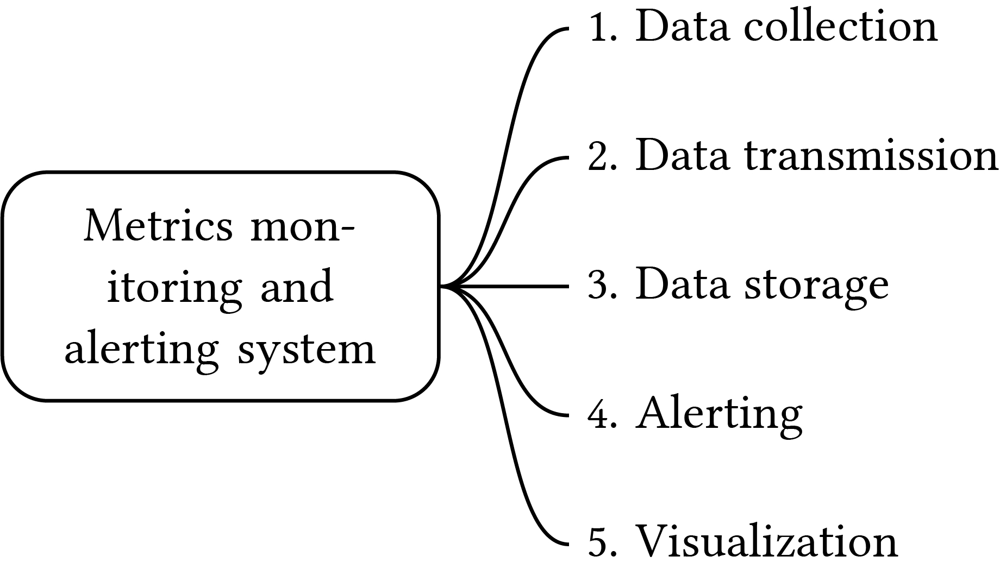

*그림 2. 시스템의 다섯 가지 구성 요소*

| 구성 요소 | 하는 일 |
|---|---|
| 데이터 수집 | 여러 출처에서 지표 데이터를 모은다 |
| 데이터 전송 | 출처에서 모니터링 시스템으로 보낸다 |
| 데이터 저장소 | 들어온 데이터를 정리해 저장한다 |
| 경보 | 데이터를 분석해 이상을 찾고 경보를 만들어 여러 채널로 보낸다 |
| 시각화 | 그래프·차트로 보여 준다. 사람은 그림으로 볼 때 패턴·추세·문제를 잘 찾는다 |

#### 데이터 모델

지표는 보통 **시계열**로 기록한다. 시계열은 이름과 (선택적으로) 레이블 집합으로 유일하게 식별되고 타임스탬프가 붙은 값을 여러 개 담는다.

**예 1: 운영 서버 i631의 20:00 CPU 부하는?**

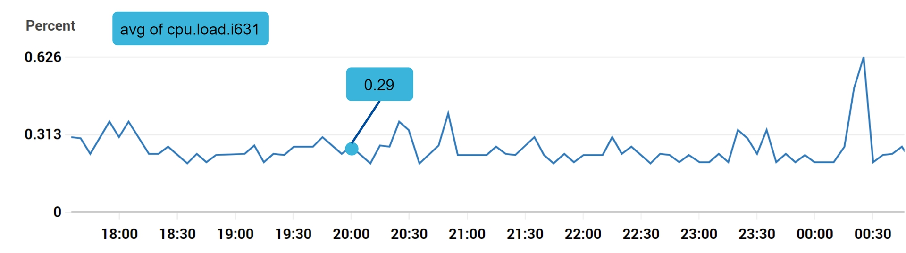

*그림 3. CPU 부하*

| 필드 | 값 |
|---|---|
| metric_name | cpu.load |
| labels | host:i631,env:prod |
| timestamp | 1613707265 |
| value | 0.29 |

- **레이블**은 값을 구분하고 나눠 보는 기준으로, `키:값` 쌍으로 적는다. 지표 이름이 "무엇을 쟀는가"라면 레이블은 "어느 대상을 쟀는가"다. 위 예는 "운영(`env:prod`) 서버 i631(`host:i631`)의 CPU 부하가 0.29였다"로 읽는다.
  - 같은 지표 이름이라도 레이블 조합이 다르면 다른 시계열이다. `cpu.load{host:i631, env:prod}`와 `cpu.load{host:i632, env:prod}`는 서로 다른 시계열이다.
  - 출처(`host`, `env`)를 담는 경우가 가장 흔하지만, `http_requests{method:GET, status_code:500}`처럼 요청의 종류를 담기도 한다.
  - 질의할 때 레이블로 거르거나(`env:prod`만) 묶는다(`env`별 평균).
  - 제품마다 부르는 이름이 다르다. Prometheus는 label, InfluxDB·Datadog은 tag라고 부르고, 일반적으로는 dimension(차원)이라고도 한다.

**예 2: us-west 리전 웹 서버 전체의 최근 10분 평균 CPU 부하는?**

```
CPU.load host=webserver01,region=us-west 1613707265 50
CPU.load host=webserver01,region=us-west 1613707265 62
CPU.load host=webserver02,region=us-west 1613707265 43
CPU.load host=webserver02,region=us-west 1613707265 53
...
CPU.load host=webserver01,region=us-west 1613707265 76
CPU.load host=webserver01,region=us-west 1613707265 83
```

- 각 줄 끝의 값을 평균 내면 된다. 이런 줄 형식을 **라인 프로토콜**(line protocol)이라 하고, Prometheus·OpenTSDB 등 많은 모니터링 소프트웨어의 공통 입력 형식이다.

**시계열의 구성 (Table 2)**

| 이름 | 타입 |
|---|---|
| 지표 이름 | String |
| 태그/레이블 집합 | `<key:value>` 쌍의 리스트 |
| 값과 타임스탬프 배열 | `<value, timestamp>` 쌍의 배열 |

#### 데이터 접근 패턴

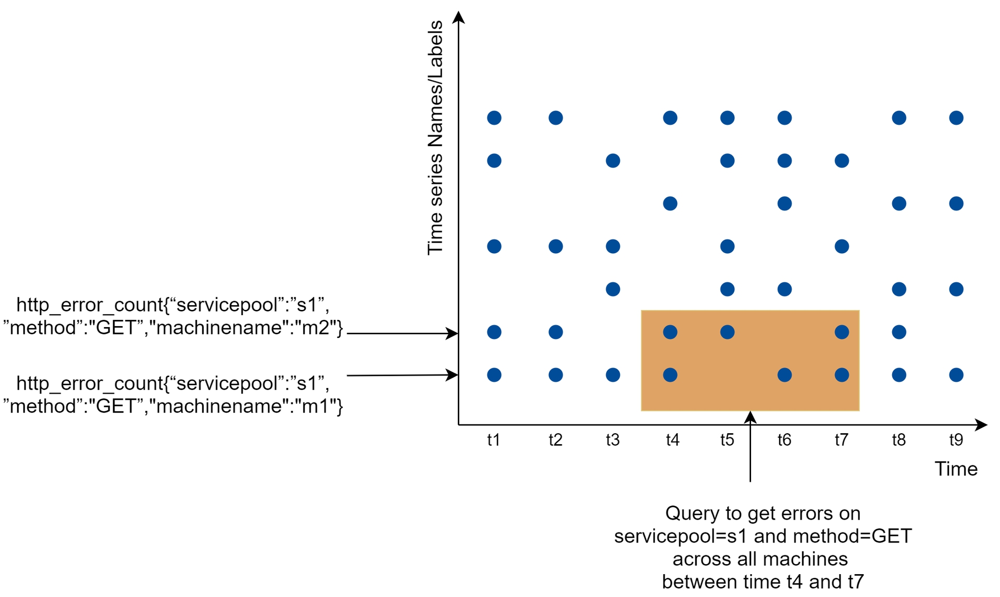

*그림 4. 데이터 접근 패턴*

- y축의 각 줄이 시계열 하나(이름 + 레이블로 식별), x축은 시간이다.
- **쓰기 부하가 크다.** 어느 순간에나 많은 시계열에 점이 찍힌다. 약 1,000만 개 지표를 높은 빈도로 수집하므로 확실히 쓰기 중심이다.
- **읽기는 급증(spiky)한다.** 시각화와 경보 서비스가 질의를 보내는데, 그래프·경보의 접근 패턴에 따라 읽기량이 몰렸다 빠진다.
- 정리: **쓰기는 꾸준히 무겁고 읽기는 들쭉날쭉하다.**

#### 데이터 저장소 고르기

데이터 저장소는 설계의 핵심이다. 저장소를 직접 만들거나 범용 저장소(MySQL)를 쓰는 방법은 권하지 않는다.

| 선택지 | 판단 |
|---|---|
| 관계형 DB (MySQL) | 이론상 가능하지만 이 규모에서는 전문가 수준 튜닝이 필요하다. 구간 이동 평균 같은 시계열 연산의 SQL이 복잡하고 읽기 어렵다. 태그마다 인덱스를 따로 달아야 한다. 꾸준한 대량 쓰기에 약하다. |
| NoSQL (Cassandra, Bigtable) | 시계열을 다룰 수는 있다. 하지만 내부 동작을 깊이 알아야 확장 가능한 스키마를 짤 수 있다. 이미 산업용 TSDB가 있으니 굳이 쓸 이유가 없다. |
| **시계열 DB** ✅ | 시계열에 최적화돼 같은 양을 훨씬 적은 서버로 처리한다. SQL보다 쓰기 쉬운 전용 질의 인터페이스를 갖췄고 보관 기간·집계 관리 기능도 있다. |

TSDB 예시:
- **OpenTSDB**: 분산 TSDB지만 Hadoop/HBase 위에서 돌아서 클러스터 운영이 복잡하다.
- Twitter **MetricsDB**, Amazon **Timestream**.
- DB-engines 기준 가장 인기 있는 두 가지는 **InfluxDB**와 **Prometheus**. 둘 다 메모리 캐시 + 디스크 저장소에 주로 기대고, 내구성과 성능을 잘 챙긴다.
- **TimescaleDB** (교재 밖, 직접 추가): PostgreSQL 확장으로 동작하는 TSDB다. 별도 DB를 새로 들이지 않고 PostgreSQL 위에서 시계열을 다룬다.
  - **하이퍼테이블**(hypertable): 평범한 테이블처럼 보이지만, 안에서는 시간 구간별 청크(chunk)로 자동 분할된다. 최근 청크에 쓰기가 몰리고 오래된 청크는 통째로 지울 수 있어 시계열 접근 패턴에 맞는다.
  - 질의는 **표준 SQL** 그대로 쓰고, `time_bucket()` 같은 시계열 함수를 더한다. 지표를 서비스 테이블과 JOIN할 수도 있다.
  - 이 장에서 다루는 기능도 갖췄다. 롤업은 연속 집계(continuous aggregate), 압축은 오래된 청크의 컬럼형 압축, 보관 기간은 보존 정책(retention policy)으로 처리한다.
  - 위 표의 "관계형 DB는 시계열에 약하다"는 판단을 확장으로 메운 셈이다. 이미 PostgreSQL을 운영하는 조직이라면 선택지가 된다.

- 면접에서 TSDB 내부까지 알 필요는 없다(이력서에 쓴 게 아니라면). **"지표는 본질적으로 시계열이니 InfluxDB 같은 TSDB에 저장한다"** 고 말할 수 있으면 된다.
- 좋은 TSDB는 **레이블로 대량 시계열을 빠르게 집계·분석**한다. 레이블 기반 집계 기능은 시각화에 꼭 필요한데, 범용 DB로 직접 구현하려면 품이 많이 든다. InfluxDB는 레이블에 인덱스를 만든다. 무엇보다 **레이블의 카디널리티를 낮게**(가능한 값의 종류가 적게) 유지해야 한다.
  - 예를 들어 `region`(값 5개)이나 `status_code`(수십 개)는 카디널리티가 낮다. `user_id`(수백만 개)나 `request_id`(요청마다 값이 새로 생김)는 카디널리티가 높다.
  - 시계열 수는 레이블마다 가능한 값의 수를 곱한 만큼 생긴다. `http_requests{region, status_code}`는 많아야 5 × 30 = 150개지만, 여기에 `user_id`를 붙이면 수억 개로 늘어난다.

#### 개략적 아키텍처

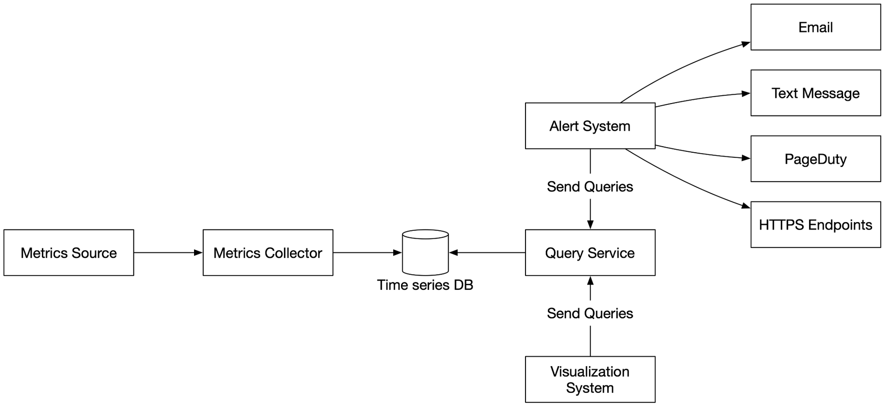

*그림 6. 개략적 설계*

| 구성 요소 | 역할 |
|---|---|
| 지표 출처 | 애플리케이션 서버, SQL DB, 메시지 큐 등 |
| 지표 수집기 | 지표를 모아 TSDB에 쓴다 |
| 시계열 DB | 지표를 시계열로 저장. 전용 질의 인터페이스, 레이블 인덱스 제공 |
| 질의 서비스 | TSDB 조회를 쉽게 해 주는 얇은 래퍼. 좋은 TSDB면 TSDB 자체 질의 인터페이스로 대체해도 된다 |
| 경보 시스템 | 여러 경보 채널로 알림을 보낸다 |
| 시각화 시스템 | 지표를 그래프·차트로 보여 준다 |

### 3단계 — 상세 설계

다룰 주제: 지표 수집 / 전송 파이프라인 확장 / 질의 서비스 / 저장소 계층 / 경보 시스템 / 시각화 시스템

#### 지표 수집

카운터나 CPU 사용률 같은 지표는 **가끔 유실돼도 큰일 나지 않는다.** 클라이언트는 보내고 잊어도(fire and forget) 된다.

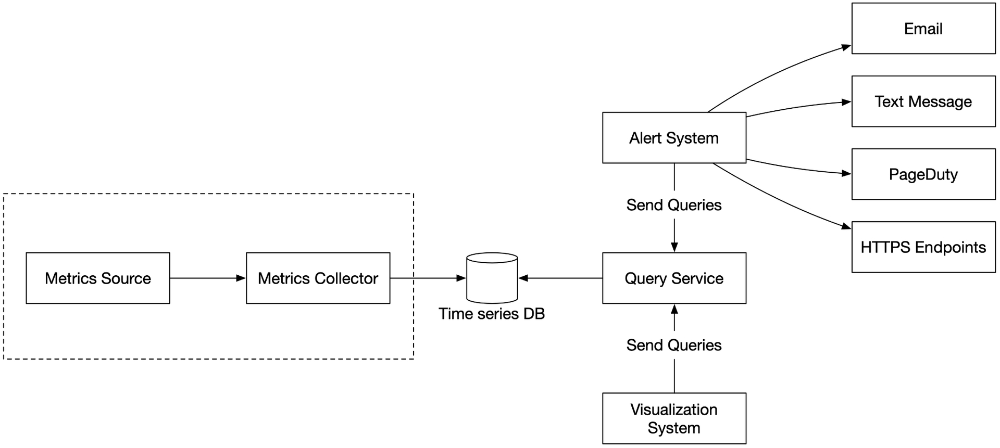

*그림 7. 지표 수집 흐름*

##### Pull 모델

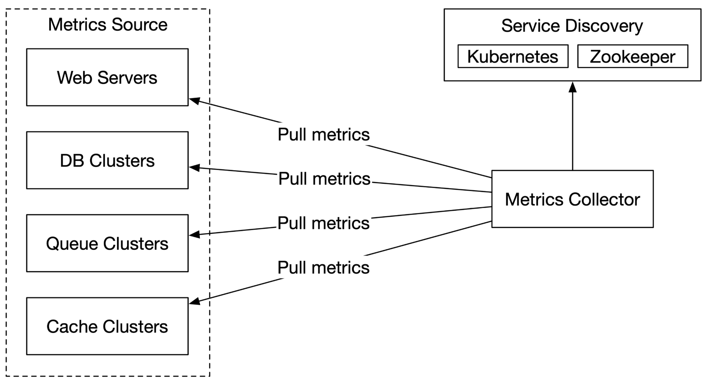

*그림 8. Pull 모델*

전용 수집기가 실행 중인 애플리케이션에서 HTTP로 주기적으로 지표를 **당겨 온다.**

- 수집기는 당겨 올 **서비스 엔드포인트 전체 목록**을 알아야 한다.
  - 단순한 방법: 수집기 서버에 모든 엔드포인트의 DNS/IP를 파일로 둔다. 서버가 자주 늘고 주는 대규모 환경에선 유지가 어렵고, 새 서버를 놓치기 쉽다.
  - 해법: **서비스 탐색**(etcd, ZooKeeper). 서비스는 자기 가용성을 등록해 두고 수집기는 엔드포인트 목록이 바뀔 때마다 통지를 받는다.

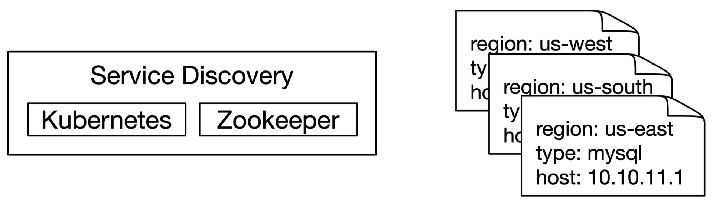

*그림 9. 서비스 탐색*

- 서비스 탐색에는 **언제, 어디서** 지표를 수집할지 정하는 설정 규칙이 들어 있다.

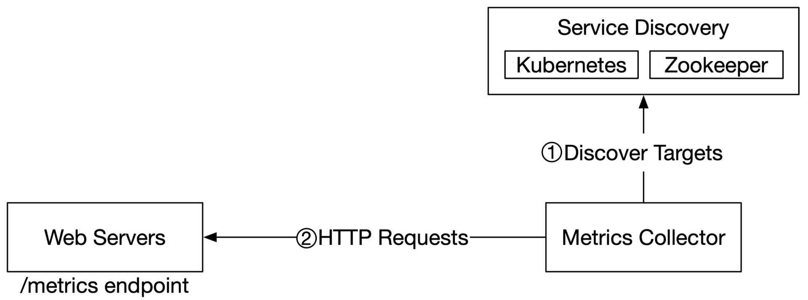

*그림 10. Pull 모델 상세*

1. 수집기가 서비스 탐색에서 엔드포인트 설정 메타데이터를 가져온다(수집 주기, IP, 타임아웃·재시도 파라미터 등).
2. 수집기가 미리 정한 HTTP 엔드포인트(예: `/metrics`)로 지표를 당겨 온다. 엔드포인트를 열려면 보통 서비스에 클라이언트 라이브러리를 넣어야 한다(그림에서는 웹 서버).
3. (선택) 수집기가 서비스 탐색에 **변경 이벤트 알림**을 등록해 엔드포인트 변경을 통지받는다. 또는 주기적으로 폴링한다.

**수집기를 여러 대로 늘리면: 안정 해시 링**

- 이 규모에서는 수집기 한 대로 수천 대 서버를 감당 못 하니 수집기 풀을 쓴다.
- 문제: 여러 수집기가 **같은 서버에서 중복 수집**할 수 있다. 조정 방식이 필요하다.
- 해법: 수집기마다 **안정 해시 링의 구간**을 맡기고, 감시 대상 서버를 고유 이름으로 링에 매핑한다. 그러면 서버 하나는 수집기 하나만 맡는다.

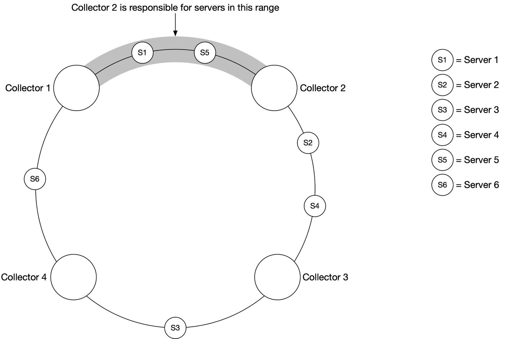

*그림 11. 안정 해시*

- 수집기 4대, 지표 출처 서버 6대. 수집기 2는 서버 1과 서버 5를 맡는다.

##### Push 모델

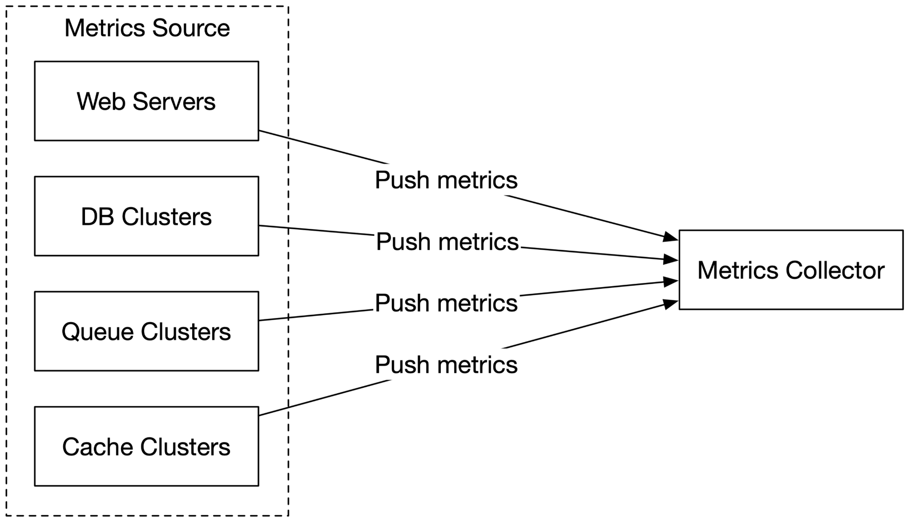

*그림 12. Push 모델*

웹 서버, DB 서버 등 지표 출처가 수집기로 지표를 **직접 보낸다.**

- 보통 감시 대상 서버마다 **수집 에이전트**를 설치한다. 에이전트는 오래 떠 있으면서 그 서버의 서비스 지표를 모으고 주기적으로 수집기에 push한다.
- 에이전트가 보내기 전에 로컬에서 **집계**(특히 단순 카운터)할 수 있다. 수집기로 가는 데이터량을 줄이는 효과적인 방법이다.
- push 트래픽이 많아 수집기가 오류로 거절하면, 에이전트가 로컬(디스크 등)에 작은 버퍼를 두고 나중에 재전송할 수 있다.
  - 단, 서버가 **오토스케일링 그룹**에서 자주 교체되면 로컬에 잠깐 들고 있던 데이터도 잃을 수 있다(수집기가 밀릴 때).
- 수집기가 밀리지 않게 하려면 수집기를 **로드밸런서 뒤의 오토스케일링 클러스터**로 둔다. 수집기 서버의 CPU 부하를 기준으로 늘리고 줄인다.

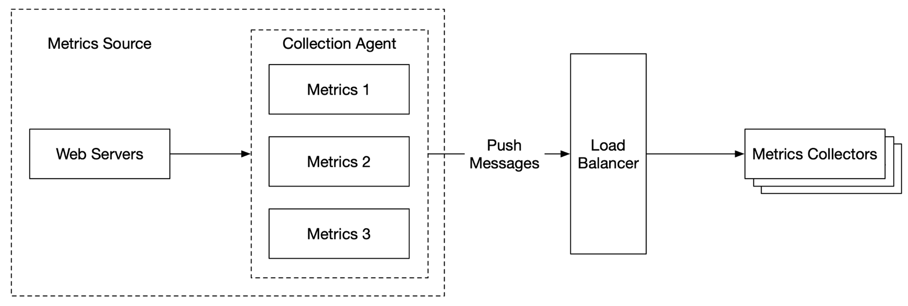

*그림 13. 로드밸런서*

##### Pull vs Push

- pull 예: **Prometheus**. push 예: **Amazon CloudWatch, Graphite**.
- 면접에서는 승자를 고르기보다 **장단점을 아는 것**이 중요하다.

| 항목 | Pull | Push |
|---|---|---|
| 쉬운 디버깅 | 앱 서버의 `/metrics` 엔드포인트로 언제든(노트북에서도) 지표를 볼 수 있다. **Pull 우세** | |
| 상태 확인 | 앱 서버가 pull에 응답하지 않으면 서버가 죽었는지 바로 안다. **Pull 우세** | 지표가 안 오면 네트워크 문제일 수도 있다 |
| 단명 작업 | | 일부 배치 작업은 pull될 만큼 오래 살지 않는다. **Push 우세**. pull 모델은 **push gateway**로 보완 가능 |
| 방화벽·복잡한 네트워크 | 모든 지표 엔드포인트에 접근 가능해야 한다. 다중 데이터센터에서 문제가 될 수 있고 네트워크 인프라가 더 정교해야 한다 | 수집기가 로드밸런서 + 오토스케일링 그룹이면 어디서든 받을 수 있다. **Push 우세** |
| 성능 | 보통 TCP | 보통 UDP → 지연이 더 낮다. 반론: TCP 연결 수립 비용은 지표 페이로드 전송에 비하면 작다 |
| 데이터 신빙성 | 수집할 앱 서버가 설정 파일에 미리 정의돼 있으니 진짜임이 보장된다 | 아무 클라이언트나 push할 수 있다. 허용 목록이나 인증으로 해결 |

- 결론: 정답은 없다. 대규모 조직은 **둘 다 지원**해야 할 것이다. 특히 **서버리스**가 늘면서 애초에 에이전트를 설치할 곳이 없는 경우가 있다.

#### 지표 전송 파이프라인 확장


*그림 14. 지표 전송 파이프라인*

- pull이든 push든 수집기는 서버 클러스터이고 막대한 데이터를 받는다. 수요에 맞게 **오토스케일링**한다.
- 문제: **TSDB가 죽으면 데이터를 잃는다.**
- 해법: 중간에 **큐**를 둔다.

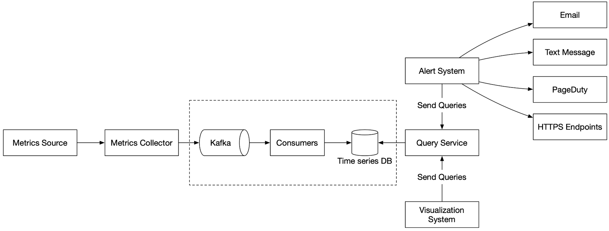

*그림 15. 큐 추가*

수집기 → **Kafka** → 소비자 또는 스트림 처리(Apache Storm, Flink, Spark) → TSDB

| 장점 |
|---|
| Kafka는 안정적이고 확장 가능한 분산 메시징 플랫폼이다 |
| 데이터 수집과 데이터 처리 서비스를 **분리**한다 |
| DB가 죽어도 Kafka에 데이터를 보관해 두니 **유실을 막는다** |

**Kafka 파티션으로 확장하기**

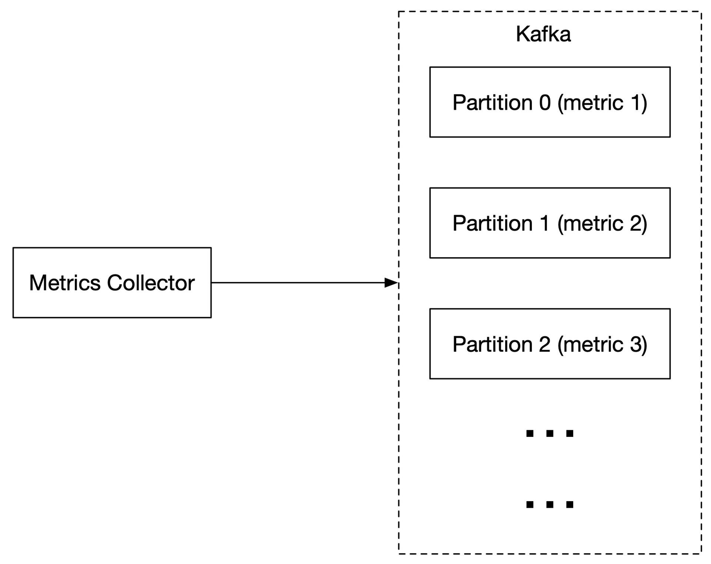

*그림 16. Kafka 파티션*

- 처리량 요구에 맞춰 **파티션 수**를 정한다.
- **지표 이름으로 파티셔닝**해서 소비자가 지표 이름별로 집계할 수 있게 한다.
- 태그/레이블로 **더 잘게** 파티셔닝한다.
- 지표를 분류하고 **우선순위**를 매겨 중요한 지표를 먼저 처리한다.

**Kafka의 대안**

- Kafka를 운영 규모로 유지하기는 만만치 않다. 면접관이 반박할 수도 있다.
- 중간 큐 없이 돌아가는 대규모 수집 시스템도 있다. 대표 예가 Facebook의 **Gorilla** 인메모리 TSDB다. 네트워크가 부분적으로 끊겨도 쓰기 가용성을 유지하도록 설계됐고, Kafka를 두는 것만큼 안정적이라고 볼 수 있다.

#### 집계는 어디서 할 수 있나

| 위치 | 방식 | 장점 | 단점 |
|---|---|---|---|
| 수집 에이전트 (클라이언트) | 단순 집계만. 예: 카운터를 1분마다 모아 보냄 | 전송량 감소 | 복잡한 로직 불가 |
| 수집 파이프라인 (저장 전) | Flink 같은 스트림 처리 엔진 | 계산 결과만 쓰니 **쓰기량이 크게 준다** | **늦게 도착한 이벤트** 처리가 어렵다. 원본을 안 남기니 정밀도와 유연성을 잃는다 |
| 질의 시점 (저장 후) | 질의할 때 원본을 기간별로 집계 | 데이터 손실 없음 | 전체 데이터셋을 대상으로 계산하니 질의가 느릴 수 있다 |

#### 질의 서비스

- 질의 서버 클러스터가 TSDB에 접근하고 시각화·경보 시스템의 요청을 처리한다.
- 질의 서버를 따로 두면 TSDB와 클라이언트(시각화·경보)가 **분리**된다. 그래서 TSDB나 시각화·경보 시스템을 필요할 때 바꿀 수 있다.

**캐시 계층**

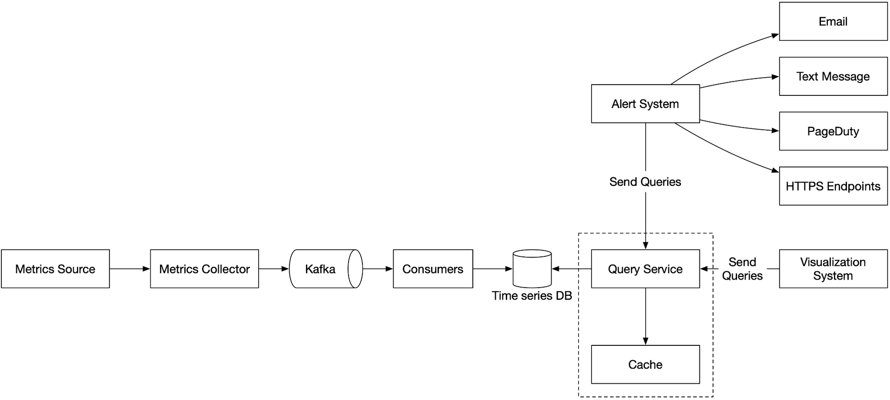

*그림 17. 캐시 계층*

- TSDB 부하를 줄이고 질의 서비스를 빠르게 하려고 질의 결과를 캐시 서버에 저장한다.

**질의 서비스를 두지 말자는 주장**

- 산업용 시각화·경보 시스템은 대부분 유명 TSDB와 연동하는 강력한 플러그인을 제공한다. 그러니 자체 추상화(질의 서비스)를 꼭 만들 필요는 없다.
- TSDB를 잘 골랐다면 자체 캐시도 필요 없다.

**TSDB 질의어**

Prometheus, InfluxDB 같은 인기 시스템은 SQL이 아니라 **자체 질의어**를 쓴다. 시계열 질의를 SQL로 짜기 어렵기 때문이다. 예를 들어 지수 이동 평균을 SQL로 구하면:

```sql
select id,
       temp,
       avg(temp) over (partition by group_nr order by time_read) as rolling_avg
from (
  select id,
         temp,
         time_read,
         interval_group,
         id - row_number() over (partition by interval_group order by time_read) as group_nr
  from (
    select id,
           time_read,
           "epoch"::timestamp + "900 seconds"::interval * (extract(epoch from time_read)::int4 / 900) as interval_group,
           temp
    from readings
  ) t1
) t2
order by time_read;
```

InfluxDB의 시계열 전용 언어 **Flux**로는 이렇게 끝난다.

```
from(db:"telegraf")
  |> range(start:-1h)
  |> filter(fn: (r) => r._measurement == "foo")
  |> exponentialMovingAverage(size:-10s)
```

> 교재의 SQL은 PDF 추출 과정에서 줄 순서와 쉼표가 깨져 있어서, 원 출처(InfluxData 블로그) 형태를 보고 읽기 좋게 정리했다. 요점은 "SQL은 이만큼 복잡하다"는 것이다.

#### 저장소 계층

**TSDB를 신중하게 고르자**

- Facebook 논문(Gorilla)에 따르면 운영 데이터 저장소로 들어온 질의의 **최소 85%가 최근 26시간 이내** 데이터를 대상으로 했다.
- 이 성질을 활용하는 TSDB를 쓰면 전체 성능이 크게 달라진다. 저장 엔진 설계가 궁금하면 InfluxDB 저장 엔진 설계 문서를 보라.

**공간 최적화**

저장할 지표 데이터가 엄청나니 다음 전략을 쓴다.

**① 데이터 인코딩과 압축**

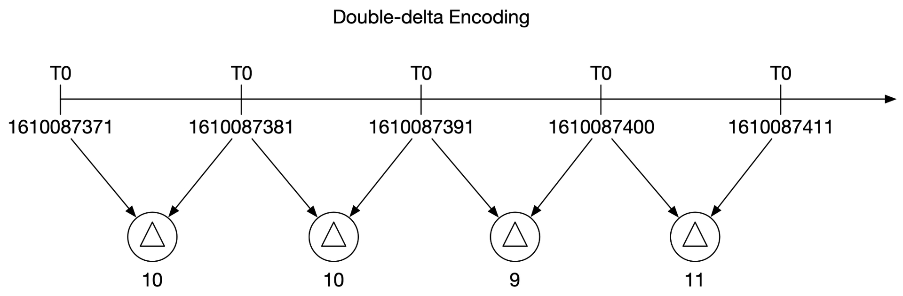

*그림 18. 데이터 인코딩*

- 좋은 TSDB에는 보통 내장돼 있다.
- 1610087371과 1610087381은 10초 차이다. 10은 **4비트**면 표현되는데, 타임스탬프 전체는 **32비트**다.
- 그래서 절댓값 대신 **기준값 하나 + 차이(델타)** 를 저장한다: `1610087371, 10, 10, 9, 11`

**② 다운샘플링**

고해상도 데이터를 저해상도로 바꿔 디스크 사용량을 줄인다. 보관 기간이 1년이니 오래된 데이터를 다운샘플링한다. 엔지니어·데이터 과학자가 지표별로 규칙을 정할 수 있게 한다.

| 보관 기간 | 해상도 |
|---|---|
| 7일 | 샘플링 없음(원본) |
| 30일 | 1분 단위로 다운샘플링 |
| 1년 | 1시간 단위로 다운샘플링 |

예: 10초 해상도 → 30초 해상도로 롤업(평균)

| metric | timestamp | hostname | metric_value |
|---|---|---|---|
| cpu | 2021-10-24T19:00:00Z | host-a | 10 |
| cpu | 2021-10-24T19:00:10Z | host-a | 16 |
| cpu | 2021-10-24T19:00:20Z | host-a | 20 |
| cpu | 2021-10-24T19:00:30Z | host-a | 30 |
| cpu | 2021-10-24T19:00:40Z | host-a | 20 |
| cpu | 2021-10-24T19:00:50Z | host-a | 30 |

↓

| metric | timestamp | hostname | metric_value (avg) |
|---|---|---|---|
| cpu | 2021-10-24T19:00:00Z | host-a | 19 |
| cpu | 2021-10-24T19:00:30Z | host-a | 25 |

> 메모: 교재 값이 산술 평균과 딱 맞지 않는다. (10+16+20)/3 ≈ 15.3, (30+20+30)/3 ≈ 26.7인데 교재는 19, 25다. 예시용 숫자로 보고 "6행 → 2행으로 줄어든다"는 개념만 가져가면 된다.

**③ 콜드 스토리지**

- 거의 쓰지 않는 비활성 데이터를 보관하는 저장소. 비용이 훨씬 싸다.

> 교재는 이 절 끝에 "결국 시각화·경보 시스템은 직접 만들기보다 서드파티를 쓰는 게 낫다"는 한 줄을 덧붙인다.

#### 경보 시스템

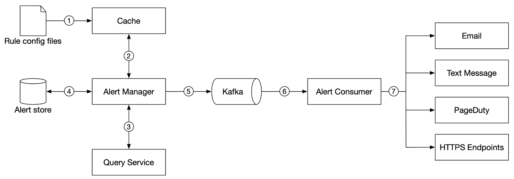

*그림 19. 경보 시스템*

1. **규칙 설정 파일을 캐시 서버에 올린다.** 규칙은 디스크의 설정 파일로 정의하고, 보통 YAML을 쓴다.

   ```yaml
   - name: instance_down
     rules:
     # 5분 넘게 연결되지 않는 인스턴스에 대해 경보
     - alert: instance_down
       expr: up == 0
       for: 5m
       labels:
         severity: page
   ```

2. **경보 관리자**가 캐시에서 경보 설정을 가져온다.
3. 경보 관리자가 규칙에 따라 정해진 주기로 **질의 서비스를 호출**한다. 값이 임곗값을 넘으면 경보 이벤트를 만든다. 경보 관리자가 맡는 일:
   - **필터링, 병합, 중복 제거**. 예: 한 인스턴스(instance1)에서 발생한 경보를 합친다.

     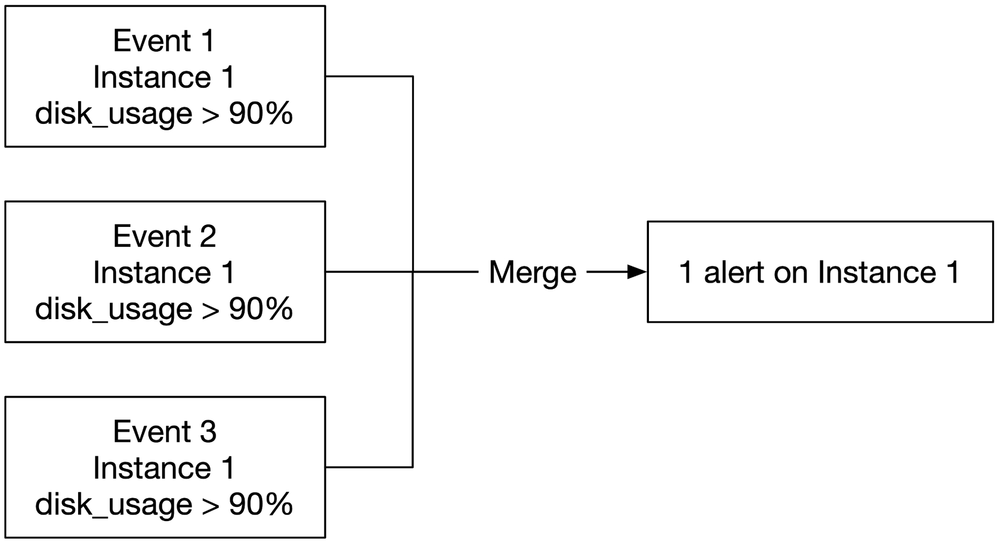

*그림 20. 경보 병합*

   - **접근 제어**: 일부 경보 관리 작업은 권한 있는 사람만 하게 한다.
   - **재시도**: 경보 상태를 확인해 알림이 **최소 한 번은** 가게 한다.
4. **경보 저장소**는 Cassandra 같은 키-값 DB다. 모든 경보의 상태(**inactive, pending, firing, resolved**)를 보관해 알림이 최소 한 번 전달되게 한다.
5. 보낼 만한 경보를 **Kafka**에 넣는다.
6. **경보 소비자**가 Kafka에서 경보 이벤트를 당겨 온다.
7. 경보 소비자가 이벤트를 처리해 이메일, 문자, PagerDuty, HTTP 엔드포인트 등 여러 채널로 알림을 보낸다.

**경보 시스템: 만들까, 살까**

- 기성 산업용 경보 시스템이 많고 대부분 인기 TSDB는 물론 이메일·PagerDuty 같은 알림 채널과도 연동이 잘 된다.
- 실무에서 경보 시스템을 직접 만들 이유를 찾기는 어렵다. 면접(특히 시니어)에서는 **결정의 근거**를 댈 준비를 하자.

#### 시각화 시스템

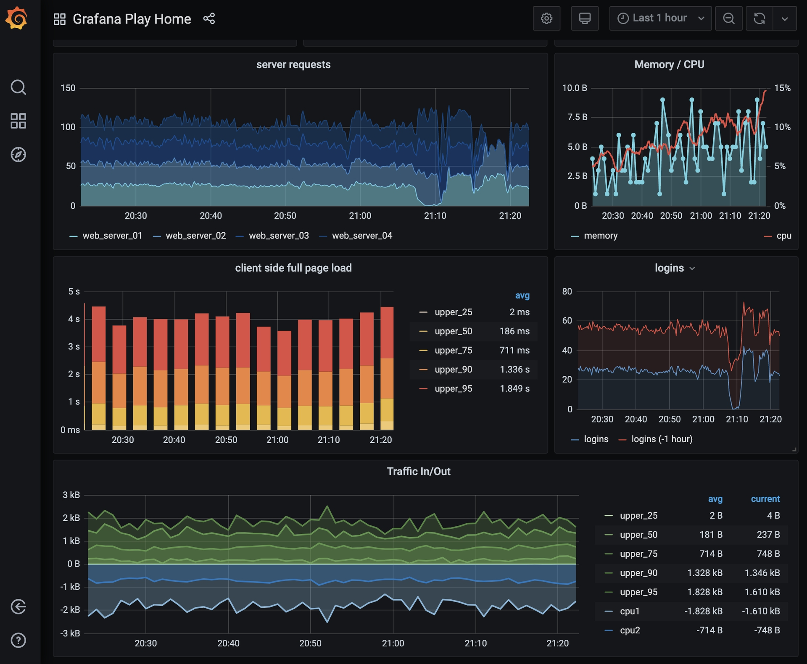

*그림 21. Grafana UI*

- 시각화는 데이터 계층 위에 만든다. 지표 대시보드에는 여러 시간 범위의 지표를, 경보 대시보드에는 경보를 보여 준다.
- 그림의 대시보드는 현재 서버 요청 수, 메모리/CPU 사용률, 페이지 로드 시간, 트래픽, 로그인 정보 등을 보여 준다.
- 품질 좋은 시각화 시스템은 만들기 어렵다. 그래서 기성품을 쓰는 편이 낫다는 주장이 설득력 있다. 예: **Grafana**는 인기 TSDB 대부분과 잘 연동된다.

### 4단계 — 마무리

다룬 핵심 기법:
- 지표 수집의 pull vs push 모델
- Kafka로 시스템 확장
- 알맞은 TSDB 선택
- 다운샘플링으로 데이터 크기 줄이기
- 경보·시각화 시스템의 build vs buy

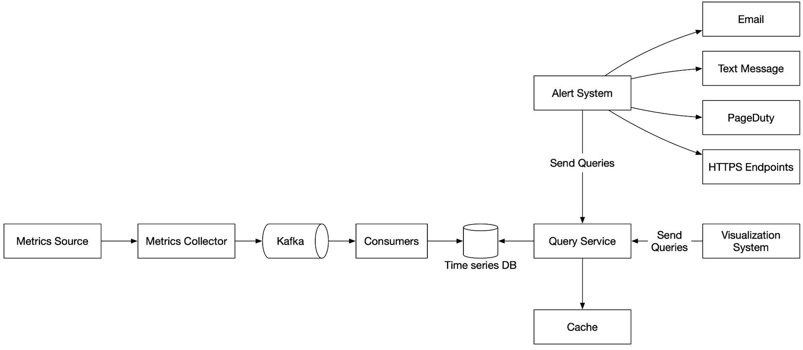

*그림 22. 최종 설계*

개략적 설계(Figure 6)에서 바뀐 점:
- 수집기와 TSDB 사이에 **Kafka + 소비자**가 들어갔다(DB 장애 대비, 수집·처리 분리).
- 질의 서비스 뒤에 **캐시**가 붙었다.

## 토론하고 싶은 것

1. **"1,000만 지표"는 초당 몇 건의 쓰기인가?** 교재는 "하루 약 1,000만 개 운영 지표가 쓰인다"고 썼지만, 계산식(풀 1,000 × 100대 × 100개)을 보면 1,000만은 **시계열 개수**다. 수집 주기를 10초로 잡으면 초당 100만 건 쓰기가 된다. 그러면 InfluxDB 한 대(초당 25만 건)로는 부족하고 최소 4대 이상 + 복제가 필요하다. 이 해석이 맞는지, 수집 주기는 몇 초가 적당한지 이야기해 보고 싶다.
2. **pull과 push 중 우리 회사라면?** Prometheus(pull)를 쓰면서 단명 배치 작업만 Pushgateway로 보내는 구성이 흔하다. 쿠버네티스 환경에서는 서비스 탐색이 사실상 공짜인데, 이 점이 pull을 고를 이유가 되는지.
3. **Kafka를 정말 넣어야 하나?** 교재도 Gorilla를 예로 들며 반론을 인정한다. 지표는 "가끔 잃어도 되는" 데이터라고 해 놓고(fire and forget), 유실을 막으려고 Kafka를 넣는 건 앞뒤가 맞는가? 어느 규모부터 Kafka를 둘 만한지.
4. **경보 경로에 Kafka가 또 있다.** 경보 관리자 → Kafka → 경보 소비자. 경보 저장소로 "최소 한 번"을 보장한다면 Kafka까지 필요한가? 반대로 중복 알림(최소 한 번의 대가)은 어떻게 줄이나 — 병합·중복 제거와 어떻게 맞물리는지.
5. **레이블 카디널리티 폭발.** `user_id`, `request_id` 같은 레이블을 붙이면 시계열 수가 폭발한다. 실무에서 이걸 어떻게 막는지(레이블 허용 목록, 수집 단계에서 drop 등).
6. **"Double-delta encoding" 그림과 본문이 다르다.** Figure 18 제목은 delta-of-delta지만 본문 예시(`1610087371, 10, 10, 9, 11`)는 1차 델타다. Gorilla의 진짜 delta-of-delta라면 `10, 0, -1, 2`가 되고, 주기가 일정하면 대부분 0이라 1비트로 저장된다. 이 차이로 압축률이 얼마나 달라지는지.
7. **다운샘플링할 때 평균만 남기면 되나?** 1시간 평균만 남기면 스파이크(최댓값)가 사라진다. min/max/count/sum을 같이 남겨야 하는지, p99 같은 백분위는 롤업이 안 되는데 어떻게 하는지.

## 더 찾아본 것 (선택)

- **Delta-of-delta 인코딩 (Gorilla 논문)**: 타임스탬프는 델타의 델타를 저장한다. 수집 주기가 일정하면 값이 0이 되어 1비트로 끝난다. 값(float)은 직전 값과 **XOR**해서 앞뒤 0 비트 수만 기록한다. 논문 기준 데이터 포인트 하나(16바이트)를 평균 약 1.37바이트로 줄였다. — [Gorilla: A Fast, Scalable, In-Memory Time Series Database](http://www.vldb.org/pvldb/vol8/p1816-teller.pdf)
- **Prometheus Pushgateway**: 단명 작업이 결과를 push해 두면 Prometheus가 그걸 pull해 간다. pull 모델의 "단명 작업" 약점을 메우는 장치다. — [prometheus/pushgateway](https://github.com/prometheus/pushgateway)
- **Pull doesn't scale — or does it?**: Prometheus 측의 반론. pull의 확장성 걱정은 대개 과장됐고 병목은 수집 방식이 아니라 TSDB에 있다는 주장. — [prometheus.io 블로그](https://prometheus.io/blog/2016/07/23/pull-does-not-scale-or-does-it/)
- 교재 참고 자료 전체: [bit.ly/systemDesignLinks](https://bit.ly/systemDesignLinks)
