# ch06. 광고 클릭 이벤트 집계 (Ad Click Event Aggregation)

> 범위: 교재 6장 전체(1~4단계). 그림은 `images/figNN.jpg`이고, 번호는 교재 그림 번호와 같다(Figure 1~29 전부 추출).
> 목표는 페이스북·구글 규모의 **광고 클릭 집계** 시스템이다. 집계 결과는 광고비 청구와 RTB에 쓰이므로 **정확성**이 지연시간보다 중요하다. 종단 지연은 몇 분까지 허용한다.

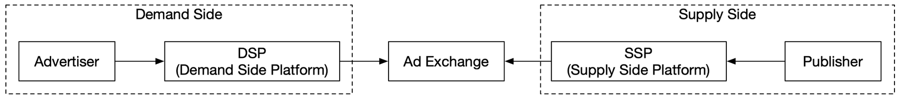

*그림 1. RTB(실시간 입찰) 절차*

온라인 광고의 핵심 장점은 **실시간 데이터로 효과를 잴 수 있다**는 것이다. 광고 지면은 **RTB**(Real-Time Bidding)로 사고판다. 광고주 쪽(Advertiser → DSP)과 매체 쪽(Publisher → SSP)이 광고 거래소(Ad Exchange)에서 만나 입찰하며, 이 과정은 보통 1초 안에 끝난다.

이 장에서 설계할 **클릭 집계**는 RTB 다음 단계다. 집계 결과로 광고주가 낼 돈이 정해지고, 캠페인 관리자는 이를 보고 예산·입찰 전략(타깃 그룹, 키워드 등)을 조정한다. CTR(클릭률)·CVR(전환율) 같은 핵심 지표도 클릭 집계에서 나온다.

## 핵심 요약

1. **원시 데이터와 집계 데이터를 둘 다 저장한다.** 원시 데이터는 백업이자 재계산의 원천이고 오래되면 콜드 스토리지로 옮긴다. 집계 데이터는 질의용 활성 데이터다. 쓰기가 많고(평균 1만, 최대 5만 QPS) 시간 범위 질의가 주라서 Cassandra 같은 NoSQL을 쓴다.
2. **로그 감시자 → Kafka → 집계 서비스(MapReduce DAG) → Kafka → DB 기록기 구조다.** 메시지 큐 두 개로 단계를 떼어 내 각각 확장한다. 두 번째 큐는 **종단 간 정확히 한 번**(원자적 커밋)을 위해 둔다. 집계 서비스는 Map(분배·정제) → Aggregate(노드별 분당 집계, top N은 힙) → Reduce(최종 병합)로 나뉜다. 필터는 **스타 스키마**로 미리 집계한다.
3. **정확성은 시간·중복·대사로 지킨다.** 집계 기준은 **이벤트 시각**이다. 조금 늦은 이벤트는 **워터마크**로 받고 많이 늦은 건 **하루 끝 대사(reconciliation) 배치**로 바로잡는다. 오프셋 저장과 결과 전송을 **분산 트랜잭션**으로 묶어 정확히 한 번을 만든다. 장애 복구는 **스냅숏 + Kafka 재생**, 재계산은 같은 집계 서비스를 다시 쓰는 **카파 아키텍처**로 한다.

## 설계 정리

### 1단계 — 문제 이해 및 설계 범위 확정

| 질문 | 답 |
|---|---|
| 입력 데이터 형식 | 여러 서버에 흩어진 **로그 파일**, 새 클릭이 파일 끝에 추가됨. 속성: `ad_id`, `click_timestamp`, `user_id`, `ip`, `country` |
| 데이터 양 | 하루 클릭 **10억 건**, 광고 **200만 개**, 클릭 수는 매년 **30%** 증가 |
| 지원할 질의 | ① 특정 광고의 최근 M분 클릭 수 ② 최근 1분간 클릭이 가장 많은 광고 100개(두 파라미터 모두 설정 가능, 집계는 매분) ③ 위 두 질의에 `ip`·`user_id`·`country` 필터 |
| 엣지 케이스 | 늦게 도착하는 이벤트, 중복 이벤트, 시스템 일부 장애 → 복구 고려 |
| 지연 요구 | 종단 간 **몇 분**. RTB는 1초 미만이어야 하지만, 클릭 집계는 청구·리포트용이라 몇 분이면 된다 |

**기능 요구사항**
- 최근 M분 동안의 `ad_id` 클릭 수 집계
- 매분 클릭이 가장 많은 `ad_id` 100개 반환
- 여러 속성으로 집계 필터링
- 페이스북·구글 규모의 데이터

**비기능 요구사항**

| 항목 | 내용 |
|---|---|
| 정확성 | 집계 결과가 RTB와 광고비 청구에 쓰이므로 가장 중요 |
| 지연·중복 이벤트 | 제대로 처리 |
| 견고성 | 부분 장애를 견딤 |
| 지연시간 | 종단 간 최대 몇 분 |

**개략적 추정**

| 항목 | 값 |
|---|---|
| DAU | 10억, 1인당 하루 평균 1회 클릭 → 하루 10억 건 |
| 평균 QPS | 10⁹ / 10⁵초 = **10,000** |
| 최대 QPS | 평균의 5배 = **50,000** |
| 저장 공간 | 클릭 1건 0.1KB → 하루 **100GB**, 한 달 약 **3TB** |

### 2단계 — 개략적 설계

#### 질의 API

클라이언트는 최종 사용자가 아니라 **대시보드 사용자**(데이터 과학자, PM, 광고주 등)다. 요구사항의 "최근 1분·상위 100개"는 API에서 "최근 M분·상위 N개"로 일반화한다. 필터는 질의 파라미터로 붙이므로 API는 두 개면 된다.

| API | 하는 일 | 요청 파라미터 | 응답 |
|---|---|---|---|
| `GET /v1/ads/{:ad_id}/aggregated_count` | 특정 `ad_id`의 클릭 수 집계 | `from`(시작 분, 기본 1분 전), `to`(끝 분, 기본 지금), `filter`(필터 전략 ID, 예: `001` = 미국 외 클릭 제외) | `ad_id`, `count` |
| `GET /v1/ads/popular_ads` | 최근 M분간 클릭 상위 N개 광고 | `count`(N), `window`(M, 분), `filter` | `ad_ids`(배열) |

#### 데이터 모델

**원시 데이터** — 로그 한 줄이 클릭 하나다.

```
[AdClickEvent] ad001, 2021-01-01 00:00:01, user 1, 207.148.22.22, USA
```

| ad_id | click_timestamp | user_id | ip | country |
|---|---|---|---|---|
| ad001 | 2021-01-01 00:00:01 | user1 | 207.148.22.22 | USA |
| ad001 | 2021-01-01 00:00:02 | user1 | 207.148.22.22 | USA |
| ad002 | 2021-01-01 00:00:02 | user2 | 209.153.56.11 | USA |

**집계 데이터** — 매분 집계한다. 필터를 지원하려고 `filter_id` 열을 더한다.

| ad_id | click_minute | filter_id | count |
|---|---|---|---|
| ad001 | 202101010000 | 0012 | 2 |
| ad001 | 202101010000 | 0023 | 3 |
| ad001 | 202101010001 | 0012 | 1 |
| ad001 | 202101010001 | 0023 | 6 |

`filter_id`는 별도 필터 테이블(`filter_id` → `region`, `IP`, `user_id` 조합)에 정의한다.

**상위 N개 광고**는 다음 구조로 저장한다.

| 필드 | 타입 | 설명 |
|---|---|---|
| `window_size` | integer | 집계 윈도 크기 M(분) |
| `update_time_minute` | timestamp | 마지막 갱신 시각(분 단위) |
| `most_clicked_ads` | array | 광고 ID 목록(JSON) |

**원시 데이터 vs 집계 데이터**

| | 원시 데이터만 | 집계 데이터만 |
|---|---|---|
| 장점 | 전체 데이터 보존, 필터·재계산 가능 | 데이터가 작음, 질의가 빠름 |
| 단점 | 저장 공간이 큼, 질의가 느림 | 데이터 손실(파생 데이터라 10건이 1건으로 줄 수 있음) |

그래서 **둘 다 저장한다.**
- 원시 데이터는 **백업**이다. 버그로 집계가 망가지면 버그를 고친 뒤 원시 데이터로 다시 계산한다. 평소엔 질의하지 않고, 오래된 건 콜드 스토리지로 옮긴다.
- 집계 데이터는 **활성 데이터**다. 원시 데이터는 너무 커서 직접 질의하면 비효율적이므로 읽기는 집계 데이터에 한다.

#### 데이터베이스 고르기

판단 기준: 데이터 형태(관계형/문서/blob), 읽기·쓰기 비중, 트랜잭션 필요 여부, SUM·COUNT 같은 OLAP 함수 의존도.

- **원시 데이터**: 쓰기 위주(평균 1만, 최대 5만 QPS)다. 읽기는 백업과 재계산, 데이터 과학자 분석용이라 적다. 관계형 DB는 쓰기 확장이 어렵다. **Cassandra, InfluxDB** 같은 NoSQL이 쓰기와 시간 범위 질의에 맞다.
  - 다른 선택지: **S3에 ORC·Parquet·AVRO 같은 컬럼형 형식**으로 저장. 파일 크기 상한(예: 10GB)을 두고 스트림 처리기가 원시 데이터를 쓰다가 상한에 닿으면 파일을 교체한다. 교재는 익숙한 Cassandra로 설명한다.
- **집계 데이터**: 시계열이고 **읽기·쓰기 둘 다 많다.** 대시보드가 자동 새로고침과 경보로 광고 200만 개 각각을 매분 조회하니 읽기가 많다. 집계 서비스가 매분 쓰니 쓰기도 많다. 원시 데이터와 같은 종류의 DB를 써도 된다.

#### 개략적 아키텍처

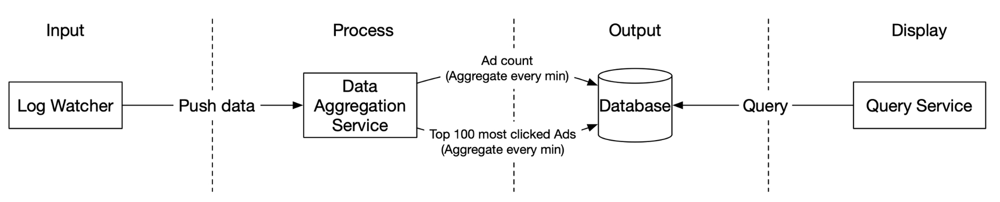

*그림 2. 집계 워크플로 — 입력(원시 데이터)과 출력(집계 결과) 모두 끝없는 데이터 스트림이다*

**비동기 처리** — 그림 2처럼 입력에서 집계 서비스, 다시 출력으로 바로 이어 붙이면 **동기식**이다. 동기식이면 생산자와 소비자의 처리 용량이 다를 때 문제가 된다. 트래픽이 갑자기 늘면 소비자가 메모리 부족으로 죽기도 하고 한 구성 요소가 멈추면 전체가 멈춘다. 그래서 **Kafka로 생산자와 소비자를 떼어 내** 각각 따로 확장한다.

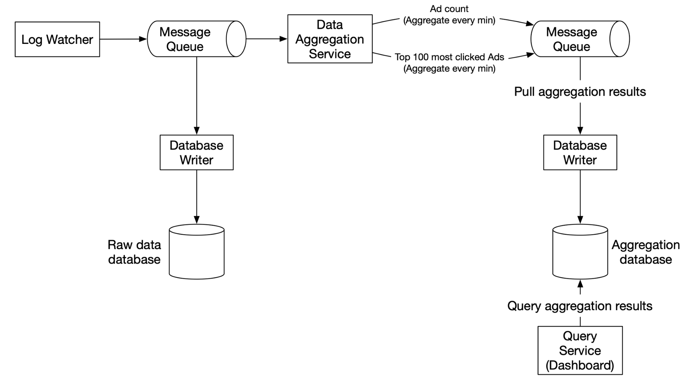

*그림 3. 개략적 설계*

- 로그 감시자, 집계 서비스, DB를 **메시지 큐 두 개**로 떼어 냈다. DB 기록기는 큐에서 데이터를 꺼내 DB 형식으로 바꿔 저장한다.
- **첫 번째 큐**: 클릭 이벤트 원본(`ad_id`, `click_timestamp`, `user_id`, `ip`, `country`)
- **두 번째 큐**: ① 분 단위 광고별 클릭 수(`ad_id`, `click_minute`, `count`) ② 분 단위 상위 N개 광고(`update_time_minute`, `most_clicked_ads`)
- 집계 결과를 DB에 바로 쓰지 않고 두 번째 큐를 두는 이유: **종단 간 정확히 한 번(exactly-once)**, 즉 원자적 커밋을 하려면 Kafka 같은 큐가 필요하다.

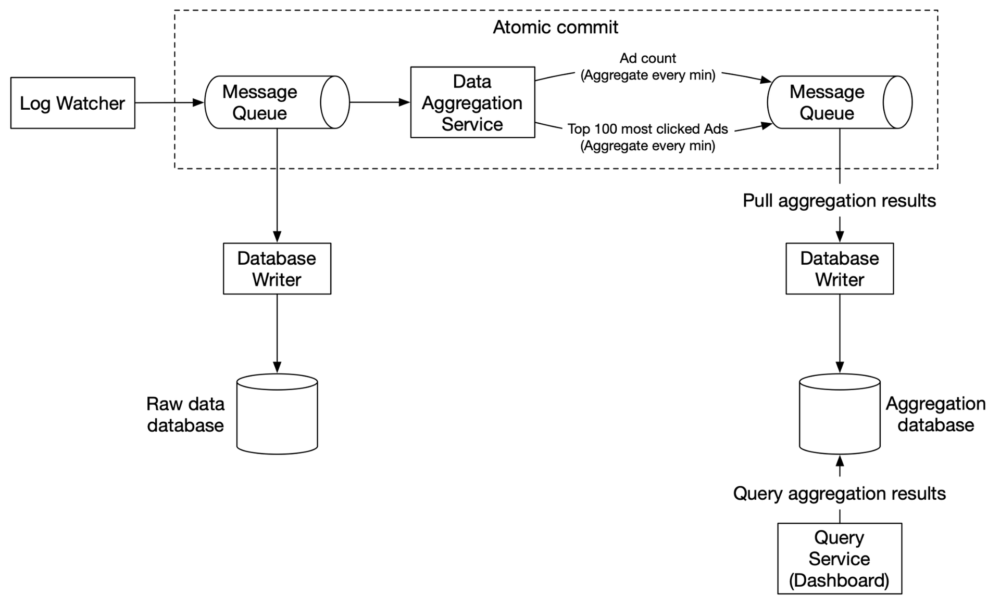

*그림 4. 종단 간 정확히 한 번*

점선 상자(첫 번째 큐 → 집계 서비스 → 두 번째 큐)가 **원자적 커밋 범위**다. 이벤트 소비, 집계, 결과 쓰기가 한꺼번에 성공하거나 한꺼번에 실패한다. 결과를 DB에 바로 쓰면 이 범위에 DB까지 넣어야 해서 어렵다. 그래서 Kafka까지만 원자적으로 쓰고, DB 반영은 DB 기록기가 따로 맡는다. 구체적인 방법은 3단계 「데이터 중복 제거」에서 다룬다.

#### 집계 서비스

광고 클릭 집계에는 **MapReduce**가 잘 맞고, 그 모델로 **DAG(방향성 비순환 그래프)**를 쓴다. 시스템을 Map/Aggregate/Reduce 같은 작은 계산 단위로 쪼개고, 각 노드는 한 가지 일만 해서 결과를 하류 노드로 넘긴다.

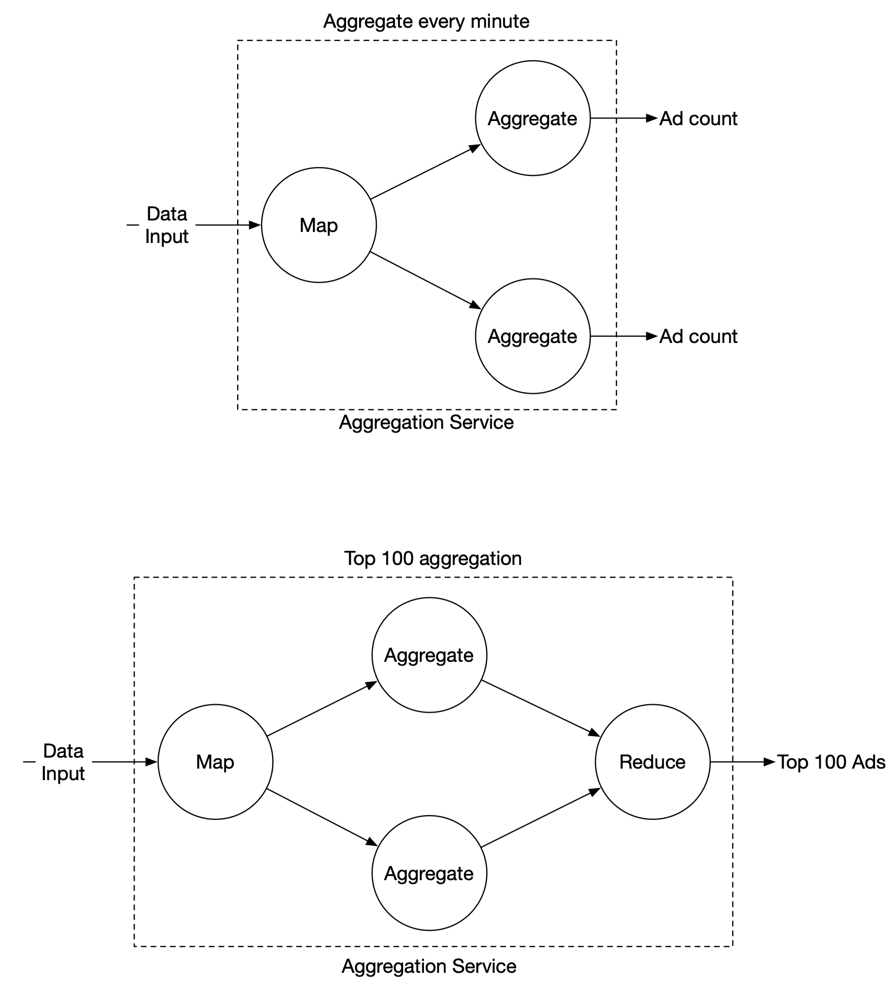

*그림 5. 집계 서비스*

| 노드 | 하는 일 |
|---|---|
| **Map** | 데이터 원천에서 읽어 필터링·변환한다. 예: `ad_id % 2 == 0`은 노드 1로, 나머지는 노드 2로 |
| **Aggregate** | `ad_id`별 클릭 수를 매분 **메모리에서** 센다. MapReduce로 보면 Reduce의 일부라서, map-aggregate-reduce는 사실상 map-reduce-reduce다 |
| **Reduce** | 모든 Aggregate 노드의 결과를 최종 결과로 줄인다. 예: 노드 3개가 각각 상위 3개를 내면 그중 상위 3개를 고른다 |

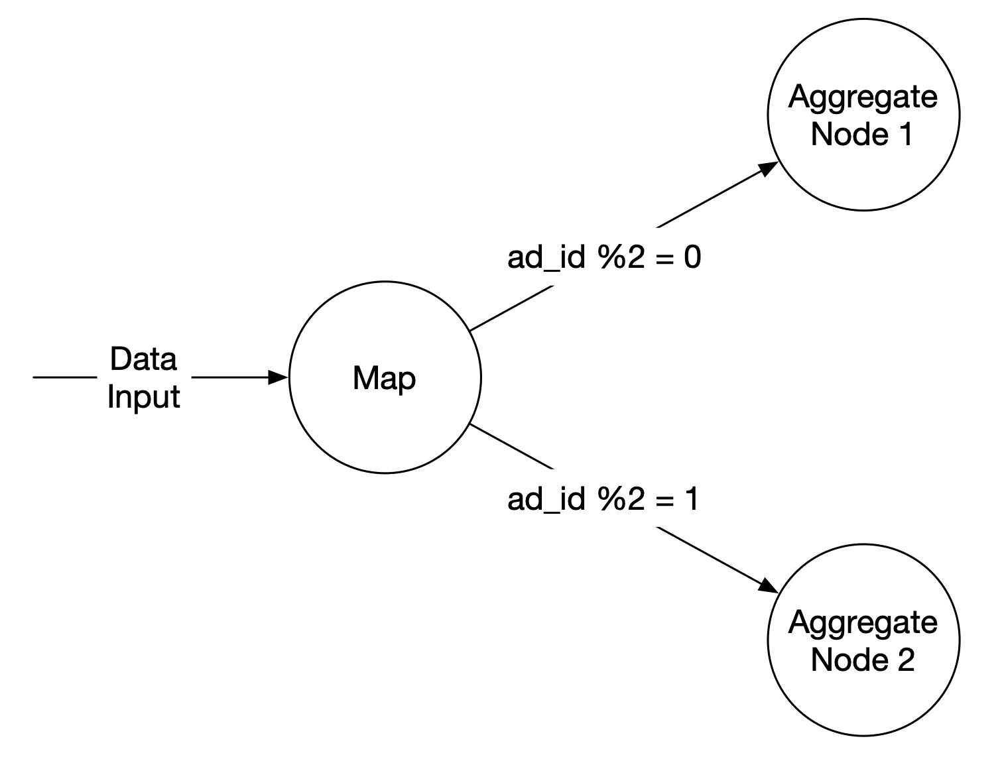

*그림 6. Map 연산*

**Map 노드가 왜 필요한가?** Kafka 파티션이나 태그로 나눠 Aggregate 노드가 직접 구독해도 된다. 하지만 ① 입력 데이터를 정제·정규화해야 할 수 있고 ② 데이터를 만드는 쪽을 우리가 통제하지 못해 같은 `ad_id`가 다른 파티션에 들어갈 수 있다. 이 일을 Map 노드가 맡는다.

Reduce 노드의 예: Aggregate 노드 3개가 각자 상위 3개 광고를 내면, Reduce 노드가 그 9개 중에서 전체 상위 3개를 고른다.

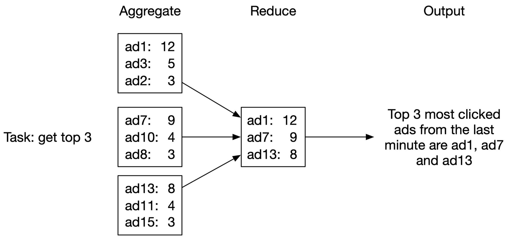

*그림 7. Reduce 노드*

- DAG 모델은 MapReduce 패러다임 그대로다. 큰 데이터를 병렬 분산 계산으로 작은 데이터로 바꾼다.
- 중간 데이터는 메모리에 두고, 노드끼리는 **TCP**(다른 프로세스) 또는 **공유 메모리**(다른 스레드)로 통신한다.

#### 주요 사용 사례

**① 클릭 수 집계** — Map 노드가 `ad_id % 3`으로 나누고 Aggregate 노드가 집계한다.

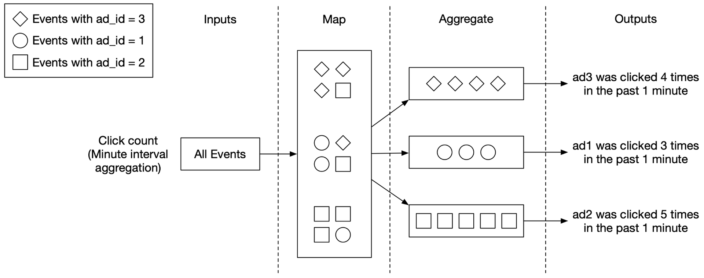

*그림 8. 클릭 수 집계*

**② 상위 N개 광고** — 각 Aggregate 노드가 **힙**으로 노드 안 상위 3개를 유지하고, Reduce 노드가 9개(3개 노드 × 3) 중 상위 3개를 매분 고른다. N으로 일반화할 수 있다.

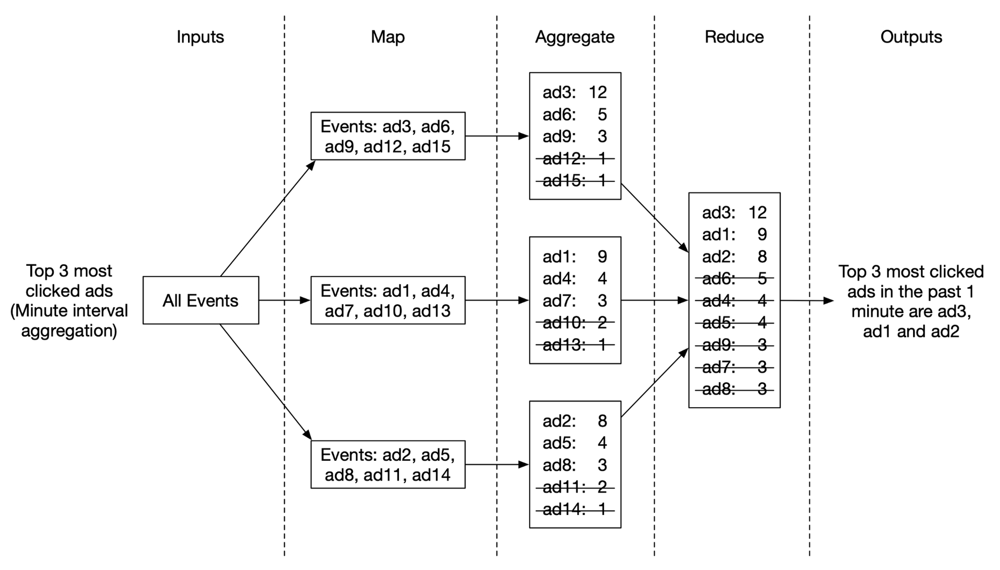

*그림 9. 클릭이 가장 많은 상위 N개 광고 반환*

**③ 데이터 필터링** — "미국 안에서 ad001의 클릭 수"처럼 필터 기준을 **미리 정해 두고 그 기준으로 집계**한다. 데이터 모델의 `filter_id`가 바로 이 "미리 정한 필터"이고, 아래 표는 그중 `country` 기준을 풀어 쓴 예다.

| ad_id | click_minute | country | count |
|---|---|---|---|
| ad001 | 202101010001 | USA | 100 |
| ad001 | 202101010001 | GPB | 200 |
| ad001 | 202101010001 | others | 3000 |
| ad002 | 202101010001 | USA | 10 |
| ad002 | 202101010001 | GPB | 25 |
| ad002 | 202101010001 | others | 12 |

- 이를 **스타 스키마**(star schema)라 하고, 데이터 웨어하우스에서 널리 쓴다. 필터 필드를 **차원**(dimension)이라 한다.
- 장점: 이해하고 구현하기 쉽다 / 추가 구성 요소 없이 기존 집계 서비스를 그대로 써서 차원을 늘릴 수 있다 / 미리 계산해 두니 조회가 빠르다.
- 단점: 필터 기준이 많아지면 **버킷과 레코드가 크게 늘어난다.**

##### 스타 스키마 풀어 보기 (마트·집계를 처음 보는 사람용)

**왜 필요한가.** 대시보드가 "1분 동안 미국에서 ad001이 몇 번 클릭됐나"를 묻는다고 하자. 원시 데이터로 답하려면 그 1분 동안 쌓인 클릭 로그를 모두 훑어서 세야 한다. 질의가 올 때마다 이 일을 반복하면 느리다. 그래서 자주 묻는 질문의 답을 **미리 세어 두고**, 질의가 오면 세어 둔 값을 한 줄 읽기만 한다. 엑셀 피벗 테이블을 미리 만들어 두는 것과 같다.

```sql
-- 원시 데이터: 질의할 때마다 해당 구간의 로그를 훑어서 센다
SELECT COUNT(*) FROM ad_click_raw
WHERE ad_id = 'ad001' AND country = 'USA'
  AND click_timestamp >= '2021-01-01 00:01' AND click_timestamp < '2021-01-01 00:02';

-- 미리 집계한 데이터: 이미 센 값을 한 줄 읽는다
SELECT count FROM ad_click_agg
WHERE ad_id = 'ad001' AND click_minute = 202101010001 AND country = 'USA';
```

**팩트와 차원.** 분석용 데이터는 보통 두 종류로 나눈다.

| 구분 | 뜻 | 이 장에서는 |
|---|---|---|
| **팩트**(fact) | 측정한 숫자. 더하고 세는 대상 | `count`(분당 클릭 수) |
| **차원**(dimension) | 숫자를 자르는 기준. "무엇별로" 볼지 | `ad_id`, `click_minute`, `country`, `ip`, `user_id` |

질문을 "**차원별 팩트**"로 읽으면 쉽다. "국가별·분별 클릭 수"에서 국가와 분이 차원이고, 클릭 수가 팩트다.

**왜 '스타'인가.** 팩트 테이블을 가운데 두고, 차원 테이블들이 키로 연결돼 둘레에 붙는다. 그림으로 그리면 별 모양이다.

```
                  [필터 차원]
            filter_id → country, ip, user_id
                       |
[시간 차원] ----- [팩트: 분당 클릭 수] ----- [광고 차원]
 click_minute     ad_id, click_minute,       ad_id → 광고주, 캠페인
                  filter_id, count           (교재엔 없음, 예시)
```

데이터 모델의 집계 테이블(`ad_id`, `click_minute`, `filter_id`, `count`)이 팩트 테이블이고, `filter_id`를 풀어 주는 필터 테이블이 차원 테이블이다. 팩트 테이블에는 차원의 키만 두고, 그 키가 무엇을 뜻하는지는 차원 테이블에서 찾는다.

엄밀히 말하면 스타 스키마는 테이블 모양(팩트 하나 + 차원 여럿)을 가리키는 말이고, "미리 집계해 둔다"는 것과는 별개다. 교재는 이 둘을 합쳐서 **차원 조합별로 미리 센 팩트 테이블**을 스타 스키마라고 부른다.

**웨어하우스와 마트.** 데이터 웨어하우스는 회사 전체의 분석용 데이터를 모아 둔 곳이고, 데이터 마트는 그중 한 주제(광고, 매출 등)만 떼어 내 그 팀이 쓰기 좋게 정리한 작은 웨어하우스다. 마트는 대개 스타 스키마로 설계한다. 이 장의 집계 DB도 광고 클릭이라는 한 주제만 미리 집계해 둔 곳이니, 성격은 "광고 클릭 마트"에 가깝다.

**단점이 왜 '레코드 폭증'인가.** 미리 세어 두려면 차원 값의 **모든 조합**마다 한 줄씩 있어야 한다. 차원 하나를 더할 때마다 줄 수가 곱으로 늘어난다.

- `country`만 3개 값(USA, GPB, others)이면 광고 하나당 분당 최대 3줄이다.
- 여기에 기기(모바일·PC·태블릿, 3개)를 더하면 3 × 3 = 9줄이 된다.
- `user_id`를 차원으로 넣으면 사용자 수만큼 곱해진다. 그러면 원시 데이터보다 크게 줄지 않아서 미리 집계하는 의미가 없어진다.

그래서 차원은 값의 종류가 적은 것(카디널리티가 낮은 것)만 고른다. 5장 지표 모니터링에서 레이블 카디널리티를 낮게 유지하라던 것과 같은 이야기다. 미리 정하지 않은 조합으로 물어야 하면 원시 데이터나 OLAP DB로 보내야 한다(아래 「토론하고 싶은 것」 4번).

### 3단계 — 상세 설계

다룰 것: 스트리밍 vs 일괄 처리(+ 데이터 재계산), 시간과 집계 윈도, 전달 보장(+ 중복 제거), 규모 확장, 장애 감내, 데이터 모니터링·정확성(+ 최종 설계), 대안 설계.

#### 스트리밍 vs 일괄 처리

| | 서비스(온라인) | 일괄 처리(오프라인) | 스트리밍(준실시간) |
|---|---|---|---|
| 응답성 | 클라이언트에 빨리 응답 | 응답 필요 없음 | 응답 필요 없음 |
| 입력 | 사용자 요청 | 크기가 정해진 대량 데이터 | 끝없는 스트림 |
| 출력 | 클라이언트 응답 | 구체화 뷰, 집계 지표 등 | 구체화 뷰, 집계 지표 등 |
| 성능 측정 | 가용성, 지연시간 | 처리량 | 처리량, 지연시간 |
| 예 | 온라인 쇼핑 | MapReduce | Flink |

- 그림 3의 설계는 **스트림 처리** 시스템이다. 들어오는 데이터를 바로 처리해 준실시간으로 집계한다. 일괄 처리는 과거 데이터 백업에만 쓴다.
- "일괄 + 스트리밍"이라 람다처럼 보이지만 그렇지 않다. 둘을 가르는 기준은 **집계 로직이 몇 벌인가**다.
  - **람다 아키텍처**: 일괄 엔진과 실시간 엔진, 두 경로가 따로 집계한다. 단점은 **코드베이스가 두 벌**이라는 것.
  - **카파 아키텍처**: 스트림 처리 엔진 하나로 실시간 처리와 재처리를 모두 한다.
- 이 설계는 **카파**다. 과거 데이터를 다시 처리할 때도 같은 집계 서비스를 통과한다(아래 「데이터 재계산」).

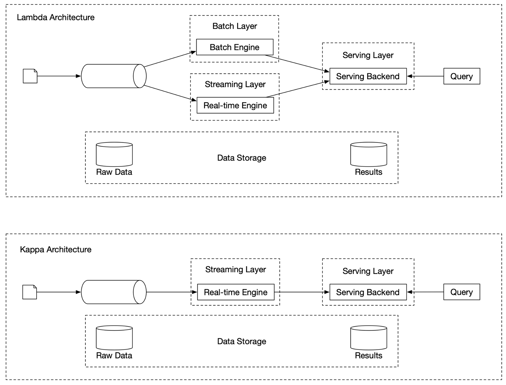

*그림 10. 람다와 카파 아키텍처 — 위(람다)는 Batch Layer와 Streaming Layer가 나란히 있고, 아래(카파)는 Streaming Layer 하나뿐이다*

#### 데이터 재계산

집계 서비스에 큰 버그가 있었다면, 버그가 들어간 시점부터 원시 데이터로 다시 집계해야 한다(**과거 데이터 재생**, historical data replay).

1. 재계산 서비스가 원시 데이터 저장소에서 일괄 작업으로 데이터를 읽는다.
2. 읽은 데이터를 **재계산 전용 집계 서비스**로 보낸다. 실시간 처리가 재생 때문에 느려지지 않게 하려는 것.
3. 집계 결과를 두 번째 큐로 보내고 집계 DB를 갱신한다.

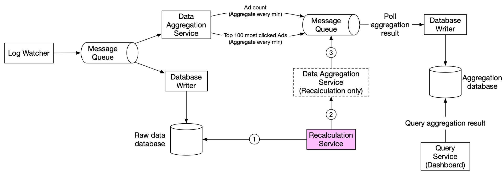

*그림 11. 재계산 서비스 — 집계 서비스는 재사용하고 데이터 원천만 원시 데이터로 바꾼다*

#### 시간

집계에 쓸 타임스탬프는 두 곳에서 생길 수 있다.
- **이벤트 시각**(event time): 광고가 클릭된 시각
- **처리 시각**(processing time): 이벤트를 처리하는 집계 서버의 시스템 시각

네트워크 지연과 비동기 환경(메시지 큐 경유) 때문에 둘의 차이가 클 수 있다. 아래 그림에서 이벤트 1은 5시간 늦게 도착한다.

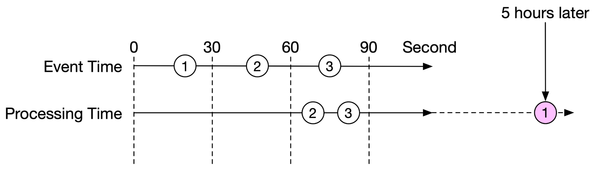

*그림 12. 늦게 도착한 이벤트*

| | 장점 | 단점 |
|---|---|---|
| 이벤트 시각 | 클릭 시각을 클라이언트가 정확히 알아 결과가 더 정확 | 클라이언트 타임스탬프에 의존. 시계가 틀리거나 악의적 사용자가 조작할 수 있음 |
| 처리 시각 | 서버 타임스탬프라 더 믿을 만함 | 이벤트가 한참 늦게 오면 부정확 |

정확성이 중요하므로 **이벤트 시각**으로 집계한다. 대신 지연 이벤트를 처리해야 한다.

**워터마크** — 1분 텀블링 윈도에서 이벤트 시각으로 판단하면, 윈도가 끝난 직후에 도착한 이벤트 2와 5를 놓친다.

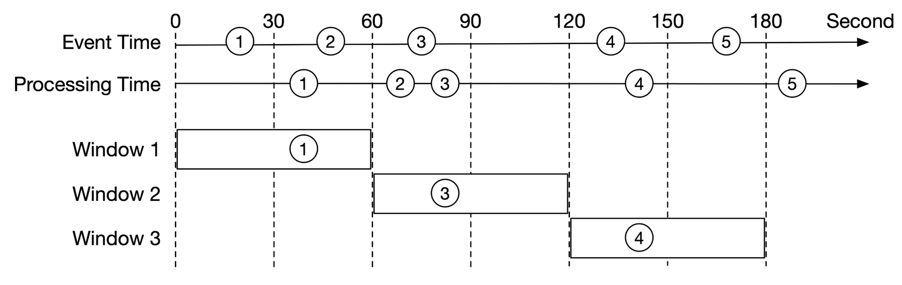

*그림 13. 집계 윈도에서 놓친 이벤트*

워터마크는 집계 윈도를 조금 늘린 것이다. 15초를 더 기다리면 윈도 1이 이벤트 2를, 윈도 3이 이벤트 5를 받는다. 이 15초는 조정 가능한 값이다.

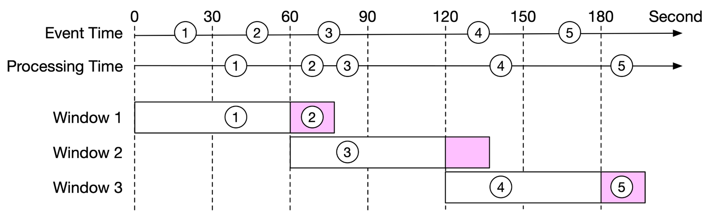

*그림 14. 워터마크*

- 워터마크 길이는 비즈니스 요구로 정한다. **길면** 많이 늦은 이벤트도 잡지만 지연시간이 는다. 반대로 **짧으면** 지연은 적은 대신 덜 정확하다.
- 워터마크로도 **아주 늦은 이벤트는 못 잡는다.** 드문 일에 복잡한 설계를 들이는 건 ROI가 낮다. 남는 오차는 **하루 끝 대사**로 바로잡는다.

#### 집계 윈도

DDIA(마틴 클레프만)는 윈도 함수를 네 가지로 나눈다: 텀블링(고정) 윈도, 호핑 윈도, 슬라이딩 윈도, 세션 윈도. 이 시스템과 관련 깊은 건 두 가지다.

- **텀블링 윈도**: 시간을 같은 길이로, 겹치지 않게 자른다. **매분 클릭 수 집계**(사용 사례 ①)에 맞다.
- **슬라이딩 윈도**: 정해진 간격으로 미끄러지며 이벤트를 묶는다. 윈도끼리 겹칠 수 있다. **최근 M분 상위 N개**(사용 사례 ②)에 맞다.

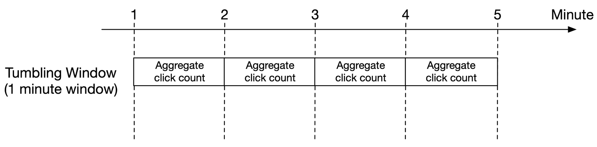

*그림 15. 텀블링 윈도*

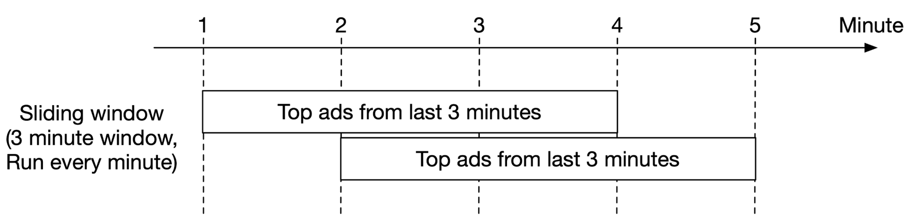

*그림 16. 슬라이딩 윈도*

#### 전달 보장

집계 결과가 청구에 쓰이므로 "중복 처리를 어떻게 막나?", "모든 이벤트를 처리했다고 어떻게 보장하나?"에 답해야 한다.

- Kafka 같은 큐는 **최대 한 번 / 최소 한 번 / 정확히 한 번**을 제공한다.
- 보통은 약간의 중복을 허용하는 **최소 한 번**이면 충분하다.
- 하지만 여기선 몇 퍼센트 차이가 **수백만 달러** 차이가 된다. 그래서 **정확히 한 번**을 권한다(Yelp 사례 참고).

#### 데이터 중복 제거

중복의 흔한 원인 두 가지:
- **클라이언트**: 같은 이벤트를 여러 번 보낸다. 악의적 중복은 광고 사기·위험 관리 구성 요소가 맡는다.
- **서버 장애**: 집계 노드가 집계 도중 죽고 상류가 확인(ack)을 못 받았다면, 같은 이벤트가 다시 와서 두 번 집계된다.

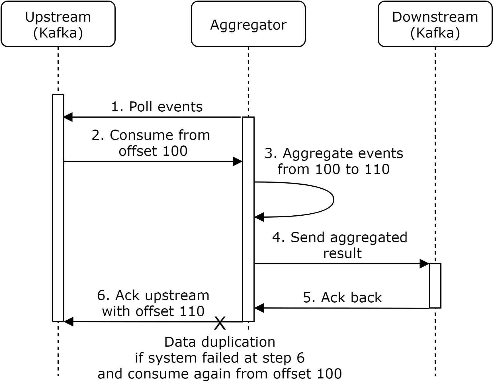

*그림 17. 중복 데이터 — 집계기는 소비 상태를 상류 Kafka의 오프셋으로 관리한다*

6단계(상류에 오프셋 110 확인)가 실패하면, 100~110 이벤트는 이미 하류로 갔는데 새 오프셋은 저장되지 않았다. 새 집계기는 오프셋 100부터 다시 소비하니 **중복**이 생긴다.

**해법 1: 외부 저장소(HDFS/S3)에 오프셋 기록**

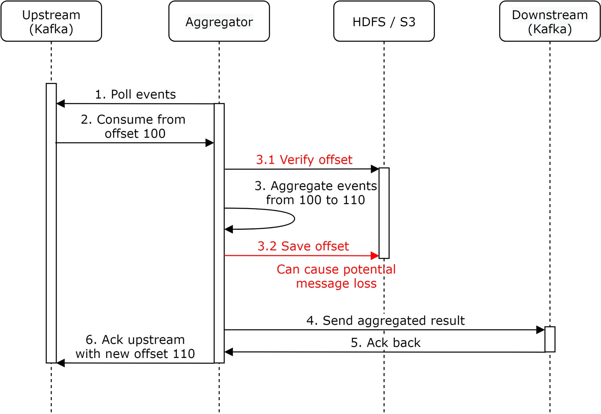

*그림 18. 오프셋 기록*

- 외부 저장소의 마지막 오프셋이 100일 때만 100~110을 처리하고, 110이면 그 앞의 이벤트는 무시한다.
- 문제: 결과를 하류로 보내기(4단계) **전에** 오프셋을 저장(3.2단계)한다. 4단계에서 집계기가 죽으면 저장된 오프셋이 이미 110이라 새 집계기는 100~110을 **영영 처리하지 않는다**. 이 구간은 **유실**된다.

**해법 2: 하류의 확인을 받은 뒤 오프셋 저장**

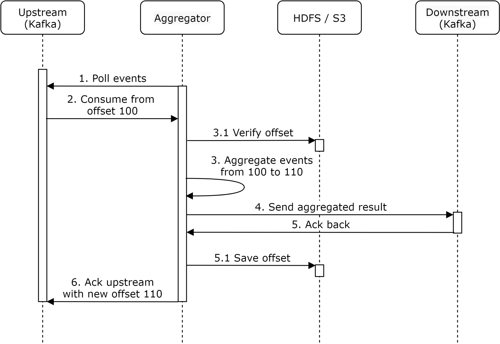

*그림 19. 확인 수신 후 오프셋 저장*

- 유실은 막지만 오프셋 저장(5.1단계) 전에 집계기가 죽으면 100~110이 하류로 **다시 간다**. 그러면 중복이 생긴다.

**해법 3: 분산 트랜잭션**

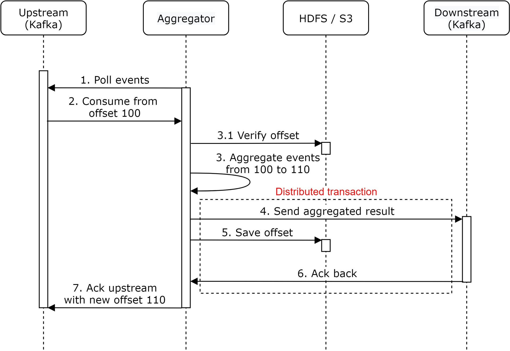

*그림 20. 분산 트랜잭션*

- **결과 전송(4) · 오프셋 저장(5) · 하류 확인(6)**을 하나의 분산 트랜잭션으로 묶는다. 하나라도 실패하면 전부 롤백한다.
- 대규모 시스템에서 중복 제거는 쉽지 않다. 정확히 한 번 처리는 고급 주제다(Flink의 종단 간 정확히 한 번 참고).

#### 규모 확장

사업이 매년 30% 성장하니 **3년마다 용량 2배**가 된다. 메시지 큐, 집계 서비스, DB가 서로 떨어져 있으니 각각 따로 확장한다.

**메시지 큐 확장** (4장 분산 메시지 큐에서 자세히 다룸)

*생산자* — 인스턴스 수에 제한이 없어 쉽게 늘린다.

*소비자* — 소비자 그룹의 **재조정**(rebalancing)으로 노드를 더하거나 뺀다. 아래 그림처럼 소비자 두 개를 더하면 소비자마다 파티션 하나씩 맡는다. 소비자가 수백 개면 재조정에 몇 분 이상 걸리기도 하니 **한가한 시간에** 늘린다.

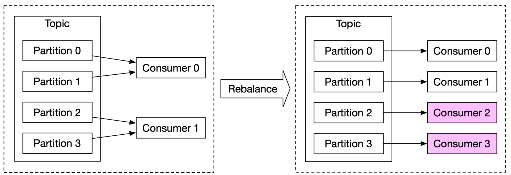

*그림 21. 소비자 추가*

*브로커*
- **해시 키**: `ad_id`를 파티션 키로 써서 같은 광고의 이벤트를 한 파티션에 모은다. 집계 서비스는 한 파티션만 구독하면 그 광고의 모든 이벤트를 받는다. (2단계에서 Map 노드를 둔 이유가 "생산자를 통제 못 해 같은 `ad_id`가 흩어질 수 있어서"였다. 교재는 이 둘의 관계를 설명하지 않는다. 첫 번째 큐에 쓰는 로그 감시자는 우리가 만드니 키를 정할 수 있다고 본 것으로 이해했다.)
- **파티션 수**: 파티션 수가 바뀌면 같은 `ad_id`가 다른 파티션으로 갈 수 있다. 그래서 **미리 넉넉히** 할당해 두고 운영 중엔 늘리지 않는다.
- **토픽의 물리적 샤딩**: 토픽 하나로는 보통 부족하다. 지역(`topic_north_america`, `topic_europe`, `topic_asia`)이나 사업 유형(`topic_web_ads`, `topic_mobile_ads`)으로 나눈다. 장점: 처리량이 늘고, 토픽당 소비자가 줄어 재조정 시간이 짧아진다. 단점: 복잡도와 유지 비용이 는다.

**집계 서비스 확장**

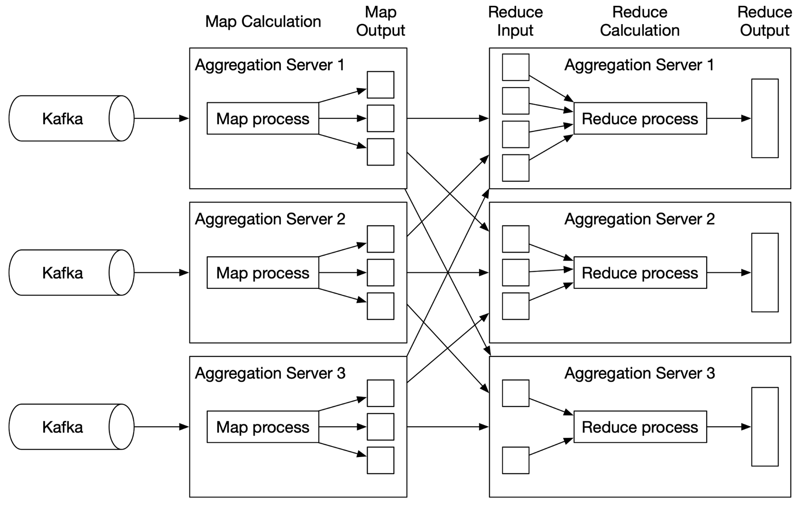

*그림 22. 집계 서비스*

2단계의 Map/Aggregate/Reduce를 실제 서버에 올리면 이렇게 된다. 집계 서버마다 Kafka에서 읽어 Map을 돌리고, 출력을 키별로 나눠 다른 서버의 Reduce 입력으로 보낸다(셔플). 각 서버의 Reduce가 자기 몫을 최종 결과로 만든다. 즉 한 서버가 Map과 Reduce를 둘 다 맡는다.

노드를 더하거나 빼서 수평 확장한다. 처리량을 높이는 방법은 두 가지:

| | 방법 | 비고 |
|---|---|---|
| 방법 1 | `ad_id`별로 이벤트를 **다른 스레드**에 할당(멀티스레딩) | 구현이 쉽고 자원 공급자에 의존하지 않음 |
| 방법 2 | **Hadoop YARN** 같은 자원 공급자 위에 집계 노드를 배포(멀티프로세싱) | 실무에서 더 많이 씀. 계산 자원을 더해 확장할 수 있어서 |

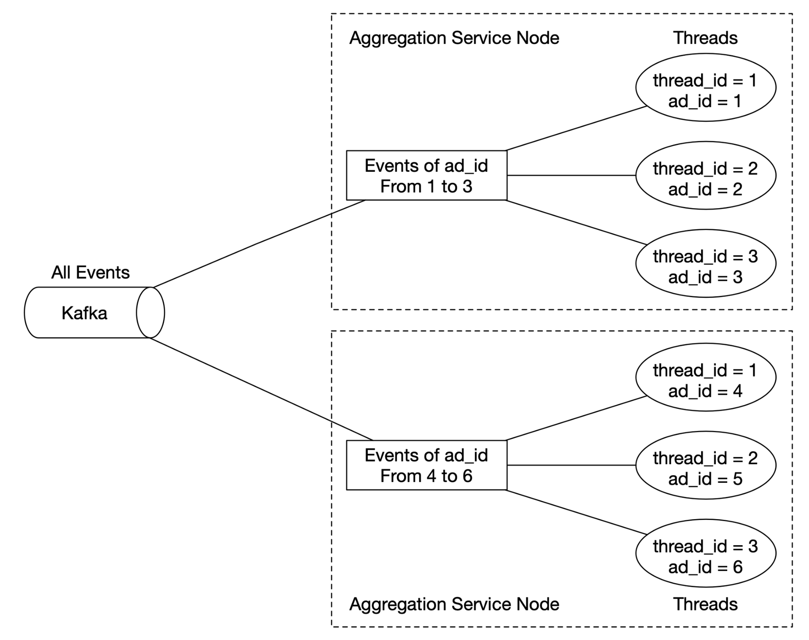

*그림 23. 멀티스레딩*

**DB 확장** — Cassandra는 안정 해시와 비슷한 방식으로 수평 확장을 기본 지원한다. 데이터는 적절한 복제 계수로 노드에 고르게 퍼지고, 각 노드는 해시 링에서 자기 몫과 다른 가상 노드의 사본을 저장한다. 새 노드를 넣으면 가상 노드가 자동으로 재분배되므로 수동 리샤딩이 필요 없다.

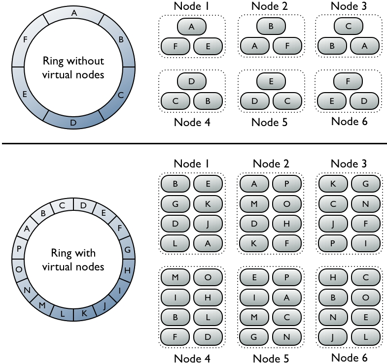

*그림 24. 가상 노드*

**핫스팟** — 큰 회사는 광고 예산이 수백만 달러라 클릭이 몰린다. `ad_id`로 파티셔닝하니 일부 집계 노드에 이벤트가 몰려 과부하가 날 수 있다. 그래서 인기 광고에 **집계 노드를 더 배정**한다. 아래 절차는 노드 하나가 100개만 처리한다고 가정한다.

1. 노드에 이벤트 300개가 몰려 용량을 넘으면 **자원 관리자**에게 추가 자원을 요청한다.
2. 자원 관리자가 집계 노드 두 개를 더 배정한다.
3. 원래 노드가 이벤트를 3그룹으로 나눠 노드마다 100개씩 처리한다.
4. 결과를 원래 노드에 다시 모은다.

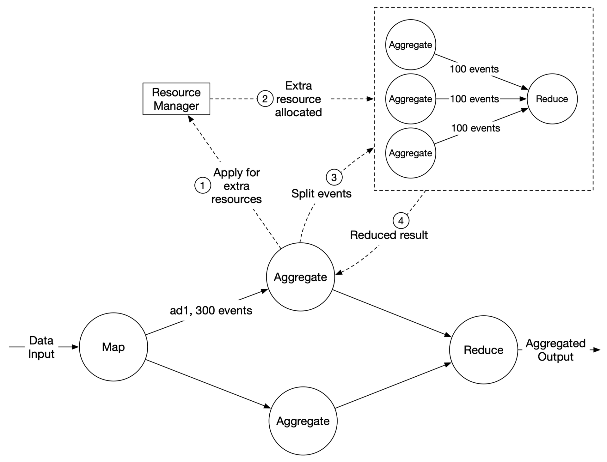

*그림 25. 집계 노드 추가 할당*

더 정교한 방법: **전역-지역 집계**(Global-Local Aggregation), **분할 고유 집계**(Split Distinct Aggregation) — Flink 성능 튜닝 문서 참고.

#### 장애 감내

- 집계가 **메모리에서** 일어나므로 노드가 죽으면 집계 결과도 사라진다. 상류 Kafka에서 이벤트를 다시 재생하면 복구된다.
- 하지만 Kafka 처음부터 재생하면 느리다. 그래서 상류 오프셋 같은 **"시스템 상태"를 스냅숏**으로 저장하고 마지막 상태에서 복구한다.
- 이 설계의 시스템 상태는 오프셋만이 아니다. **최근 M분 상위 N개 광고** 같은 데이터도 저장해야 한다.

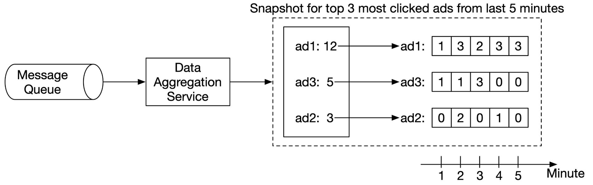

*그림 26. 스냅숏 속 데이터 — 최근 5분간 상위 3개 광고와 분별 클릭 수*

노드가 죽으면 새 노드를 띄우고 **최신 스냅숏에서 복구**한 뒤, 스냅숏 이후에 들어온 이벤트만 Kafka에서 가져와 재생한다.

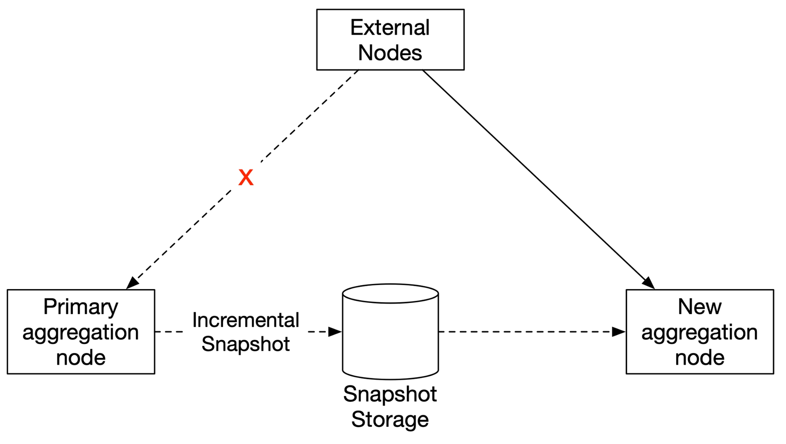

*그림 27. 집계 노드 장애 복구*

#### 데이터 모니터링과 정확성

**지속적 모니터링**
- **지연시간**: 단계마다 지연이 생기므로 이벤트가 거쳐 가는 곳마다 타임스탬프를 남기고, 그 차이를 지연 지표로 노출한다.
- **메시지 큐 크기**: 갑자기 커지면 집계 노드를 늘린다. Kafka는 분산 커밋 로그로 구현된 큐라서 큐 크기 대신 **records-lag** 지표를 본다.
- **집계 노드의 시스템 자원**: CPU, 디스크, JVM 등.

**대사(reconciliation)** — 여러 데이터 집합을 비교해 무결성을 확인하는 것.
- 은행은 내 기록과 은행 기록을 비교하면 되지만, 광고 클릭 집계는 **비교할 제3자 결과가 없다.**
- 하루가 끝나면 **배치 작업**으로 파티션마다 이벤트를 이벤트 시각순으로 정렬해 집계하고, 실시간 집계 결과와 비교한다.
- 더 정확해야 하면 대사 윈도를 줄인다(예: 1시간).
- 어떤 윈도를 쓰든 늦게 도착한 이벤트 때문에 배치 결과와 실시간 결과가 **정확히 일치하지 않을 수 있다.**

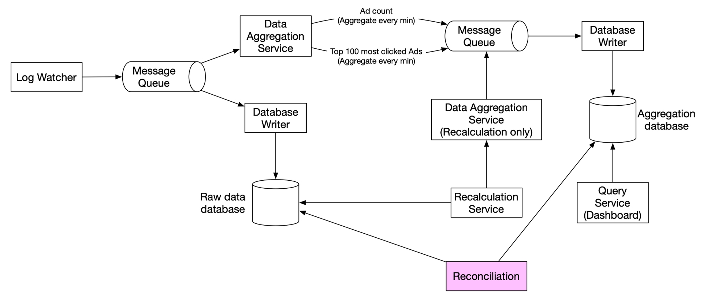

*그림 28. 최종 설계 — 대사(Reconciliation) 지원 추가*

개략적 설계(Figure 3)에서 바뀐 점:
- **재계산 서비스 + 재계산 전용 집계 서비스**가 들어갔다(원시 DB → 두 번째 큐).
- **대사** 구성 요소가 원시 DB와 집계 DB를 비교한다.

#### 대안 설계

일반 시스템 설계 면접에서 빅데이터 전문 소프트웨어 내부까지 알 필요는 없다. 사고 과정과 트레이드오프 설명이 중요하다. 다른 방법으로는 클릭 데이터를 **Hive**에 저장하고 빠른 질의용 **ElasticSearch** 계층을 두며, 집계는 **ClickHouse**나 **Druid** 같은 OLAP DB에서 하는 구성이 있다.

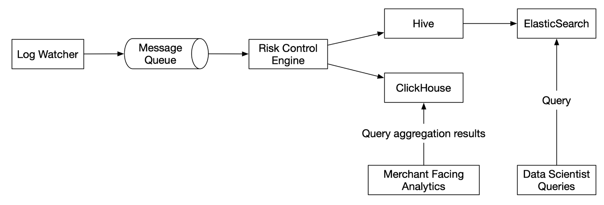

*그림 29. 대안 설계*

### 4단계 — 마무리

다룬 핵심 기법:
- 데이터 모델과 API 설계
- MapReduce 패러다임으로 광고 클릭 집계
- 메시지 큐·집계 서비스·DB 확장
- 핫스팟 완화
- 지속적 모니터링
- 대사로 정확성 보장
- 장애 감내

광고 클릭 집계는 전형적인 **빅데이터 처리 시스템**이다. Kafka, Flink, Spark 같은 업계 표준 솔루션을 알면 이해하고 설계하기가 쉬워진다.

## 토론하고 싶은 것

1. **분산 트랜잭션이 정말 답인가?** 교재는 "결과 전송·오프셋 저장·확인"을 분산 트랜잭션으로 묶으라고 하지만, 실무의 Kafka+Flink는 2PC 대신 **Kafka 트랜잭션(오프셋 커밋과 결과 쓰기를 한 트랜잭션으로)** 이나 **체크포인트 + 2단계 커밋 싱크**를 쓴다. 또 하류(DB 기록기)를 **멱등**하게 만들어(`ad_id + click_minute` 키로 upsert) "최소 한 번 + 멱등 쓰기 = 사실상 정확히 한 번"으로 가는 방법도 있다. 어느 쪽이 더 단순하고 안전한지.
2. **워터마크 15초 vs 하루 끝 대사.** 청구 금액이 걸린 시스템에서 "워터마크로 놓친 건 대사로 고친다"면, 이미 대시보드·RTB에 쓴 실시간 값과 대사 후 값이 다르다. 청구는 어느 값 기준인지, **이미 닫힌 윈도를 고쳐 쓰는(upsert)** 설계로 늦게 온 이벤트를 반영하면 어떤지.
3. **이벤트 시각은 클라이언트가 만든다.** 교재도 시계가 틀리거나 조작될 수 있다고 인정한다. 미래 시각이나 아주 과거 시각이 들어오면 어떻게 거를지(서버 수신 시각과의 허용 오차, 둘 다 저장하기 등).
4. **스타 스키마 필터의 조합 폭발.** `country`, `ip`, `user_id`를 미리 집계 차원으로 두면 `user_id`·`ip`는 카디널리티가 매우 높다(5장 카디널리티 이야기와 같은 문제). 이런 필터는 미리 집계하지 말고 원시 데이터나 OLAP DB(ClickHouse, Druid)로 돌려야 하는 것 아닌지.
5. **최근 M분 상위 N개 — 노드별 상위 N개의 합이 전체 상위 N개인가?** `ad_id`로 파티셔닝하면 한 광고는 한 노드에만 있으니 맞다. 그런데 핫스팟 때문에 한 광고를 여러 노드로 쪼개면(Figure 25) 노드별 top N 병합이 틀릴 수 있다. 쪼갠 뒤 원래 노드로 합치는 단계가 이걸 막는지.
6. **교재 표의 오류?** Table 10 필터 테이블의 IP 열에 `0012`, `0023` 같은 `filter_id` 값이 들어가 있고, Table 16의 `GPB`는 국가 코드라면 `GBR`(또는 `GB`)이어야 할 것 같다.

## 더 찾아본 것 (선택)

- **Flink 종단 간 정확히 한 번**: 체크포인트 배리어로 상태와 오프셋을 함께 스냅숏하고, 싱크는 2단계 커밋(TwoPhaseCommitSinkFunction)으로 외부 시스템 쓰기를 체크포인트와 맞춘다. 교재의 "분산 트랜잭션"과 "스냅숏"이 실제로는 이 하나의 메커니즘이다. — [An Overview of End-to-End Exactly-Once Processing in Apache Flink](https://flink.apache.org/features/2018/03/01/end-to-end-exactly-once-apache-flink.html)
- **Uber의 실시간 광고 이벤트 처리**: Kafka + Flink + Pinot으로 정확히 한 번 광고 집계를 구현한 사례. 교재의 대안 설계(Figure 29)와 비교해 볼 만하다. — [Real-Time Exactly-Once Ad Event Processing](https://eng.uber.com/real-time-exactly-once-ad-event-processing/)
- **Yelp 광고 스트림 집계 발표**: [End-to-end Exactly-once Aggregation Over Ad Streams](https://www.youtube.com/watch?v=hzxytnPcAUM)
- **Flink 성능 튜닝(전역-지역 집계, 분할 고유 집계)**: 핫스팟 완화 기법. — [Flink Table Tuning](https://nightlies.apache.org/flink/flink-docs-master/docs/dev/table/tuning/)
- 교재 참고 자료 전체: [bit.ly/systemDesignLinks](https://bit.ly/systemDesignLinks)
