# ch07. 호텔 예약 시스템 (Hotel Reservation System)

> 범위: 교재 7장 전체(1~4단계). 그림은 `images/figNN.jpg`이고, 번호는 교재 그림 번호와 같다(Figure 1~19 전부 추출).
> 목표는 메리어트 같은 **호텔 체인의 예약 시스템**이다. 트래픽은 크지 않지만 **같은 방을 동시에 예약하는 문제(이중 예약)** 를 막는 것이 핵심이다. 같은 기법을 에어비앤비, 항공권 예약, 영화 티켓 예매 설계에도 쓸 수 있다.

## 핵심 요약

1. **방이 아니라 "객실 유형 × 날짜" 단위로 재고를 관리한다.** 호텔 손님은 특정 방(1203호)이 아니라 객실 유형(스탠다드, 킹 등)을 예약하고, 방 번호는 체크인 때 받는다. 그래서 `room_type_inventory(hotel_id, room_type_id, date, total_inventory, total_reserved)` 테이블에 날짜마다 한 행을 미리 만들어 두고, 예약은 기간 안의 모든 행에서 `total_reserved + 요청 수 ≤ total_inventory × 110%`(초과 예약 10%)인지 확인한다.
2. **이중 예약은 두 가지라서 해법도 두 가지다.** ① 같은 사용자가 버튼을 두 번 누르는 경우는 **멱등 키**(`reservation_id`를 기본 키로 써서 유니크 제약)로 막는다. ② 여러 사용자가 마지막 방을 동시에 잡는 경우(경쟁 조건)는 **비관적 락 / 낙관적 락 / DB 제약 조건** 중 하나로 막는다. 예약 QPS가 낮아 충돌이 드물기 때문에 교재는 **낙관적 락이나 DB 제약 조건**을 권한다.
3. **ACID가 필요한 데이터는 한 DB에 둔다.** 마이크로서비스로 설계하되 예약과 재고 테이블은 Reservation Service 하나가 같은 관계형 DB에 둔다. 서비스마다 DB를 나누면 2PC나 사가가 필요해 복잡해지기 때문이다. 규모가 커지면 `hotel_id`로 **샤딩**하고, 재고 조회는 **Redis 캐시**로 돌리되 최종 검사는 DB가 한다.

## 설계 정리

### 1단계 — 문제 이해 및 설계 범위 확정

| 질문 | 답 |
|---|---|
| 규모 | 호텔 **5,000곳**, 객실 총 **100만 개** |
| 결제 시점 | 예약할 때 **전액 결제** |
| 예약 경로 | 호텔 웹사이트·앱만 (전화 예약 등은 제외) |
| 취소 | 가능 |
| 기타 | **10% 초과 예약**(overbooking) 허용. 취소할 손님을 예상해 실제 방보다 더 판다 |
| 가격 | **날짜마다 다를 수 있다.** 그날 호텔이 얼마나 찰지에 따라 정한다 |
| 범위 밖 | 객실 검색 |

**기능 요구사항**
- 호텔 정보 페이지 보기
- 객실 상세 페이지 보기
- 객실 예약
- 호텔·객실 정보를 추가·삭제·수정하는 관리자 패널
- 초과 예약 지원

**비기능 요구사항**

| 항목 | 내용 |
|---|---|
| 높은 동시성 | 성수기나 큰 행사 때 인기 호텔의 같은 방에 많은 사람이 몰린다 |
| 적당한 지연시간 | 빠르면 좋지만 예약 처리에 몇 초 걸려도 괜찮다 |

**개략적 추정**

| 항목 | 값 |
|---|---|
| 하루 예약 수 | 객실 100만 × 투숙률 70% ÷ 평균 숙박 3일 = 233,333 → 약 **240,000** |
| 초당 예약(TPS) | 240,000 ÷ 10⁵초 = 약 **3** |

TPS가 3밖에 안 된다. 예약 하나에 이르기까지 사용자는 보통 세 단계를 거친다.

1. 호텔·객실 상세 페이지 보기 (조회)
2. 예약 페이지 보기 — 날짜, 인원, 결제 정보 확인 (조회)
3. 객실 예약 — "예약" 버튼 클릭 (트랜잭션)

단계마다 10%만 다음으로 넘어간다고 가정하고(미리 가져오기는 없다고 가정), 마지막 단계 TPS 3에서 거꾸로 계산하면 다음과 같다.

<p align="center">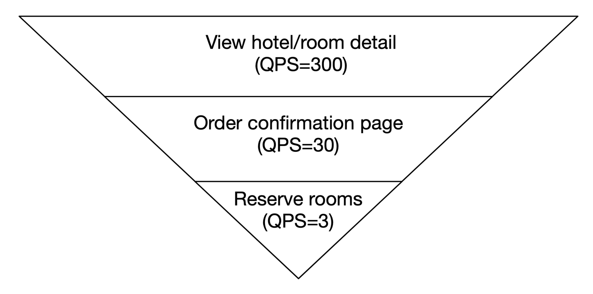</p>

*그림 1. QPS 분포 — 상세 페이지 300 → 예약 확인 페이지 30 → 예약 3*

### 2단계 — 개략적 설계

#### API 설계

검색 API는 중요하지만 기술적으로 어렵지 않아 범위에서 뺀다. RESTful 규약을 따른다.

| 구분 | API | 하는 일 |
|---|---|---|
| 호텔 | `GET /v1/hotels/ID` | 호텔 상세 정보 |
| | `POST /v1/hotels` | 호텔 추가 (호텔 직원만) |
| | `PUT /v1/hotels/ID` | 호텔 정보 수정 (호텔 직원만) |
| | `DELETE /v1/hotels/ID` | 호텔 삭제 (호텔 직원만) |
| 객실 | `GET /v1/hotels/ID/rooms/ID` | 객실 상세 정보 |
| | `POST /v1/hotels/ID/rooms` | 객실 추가 (호텔 직원만) |
| | `PUT /v1/hotels/ID/rooms/ID` | 객실 정보 수정 (호텔 직원만) |
| | `DELETE /v1/hotels/ID/rooms/ID` | 객실 삭제 (호텔 직원만) |
| 예약 | `GET /v1/reservations` | 로그인한 사용자의 예약 내역 |
| | `GET /v1/reservations/ID` | 예약 상세 정보 |
| | `POST /v1/reservations` | 새 예약 |
| | `DELETE /v1/reservations/ID` | 예약 취소 |

새 예약(`POST /v1/reservations`)의 요청 본문:

```json
{
  "startDate": "2021-04-28",
  "endDate": "2021-04-30",
  "hotelID": "245",
  "roomID": "U12354673389",
  "reservationID": "U12354673390"
}
```

`reservationID`는 **이중 예약을 막는 멱등 키**다. 이중 예약이란 같은 날 같은 방에 예약이 여러 개 잡히는 것이다(3단계 「동시성 문제」).

#### 데이터 모델

지원할 질의:
1. 호텔 상세 정보 보기
2. 날짜 범위로 예약 가능한 객실 유형 찾기
3. 예약 기록하기
4. 예약 또는 지난 예약 내역 조회

규모는 크지 않지만 큰 행사 때 몰리는 트래픽에 대비해야 한다. 교재는 **관계형 DB**를 고른다.

| 이유 | 설명 |
|---|---|
| 읽기가 많고 쓰기가 적다 | 사이트 방문자가 실제 예약자보다 몇 자릿수 많다. NoSQL은 대체로 쓰기에 최적화되어 있고, 읽기 위주라면 관계형 DB로 충분하다 |
| ACID를 보장한다 | ACID가 없으면 잔액이 음수가 되거나, 두 번 결제되거나, 이중 예약이 생기는 문제를 막기 어렵다. 애플리케이션 코드도 단순해진다 |
| 데이터를 모델링하기 쉽다 | 호텔, 객실, 객실 유형 같은 엔티티의 관계가 분명하고 잘 바뀌지 않는다 |

> **ACID**<br><sub>Atomicity, Consistency, Isolation, Durability<br>원자성(전부 되거나 전부 안 되거나), 일관성(제약을 깨지 않음), 격리성(동시 실행이 서로 끼어들지 않음), 지속성(커밋하면 남음)</sub>

처음 떠올리기 쉬운 스키마는 이렇다.

<p align="center">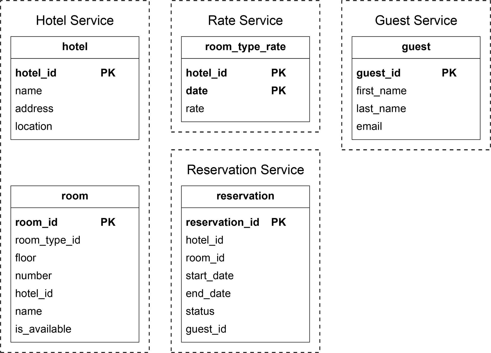</p>

*그림 2. 데이터베이스 스키마 — 서비스별로 hotel·room / room_type_rate / guest / reservation*

`reservation.status`는 다음 상태를 오간다.

<p align="center">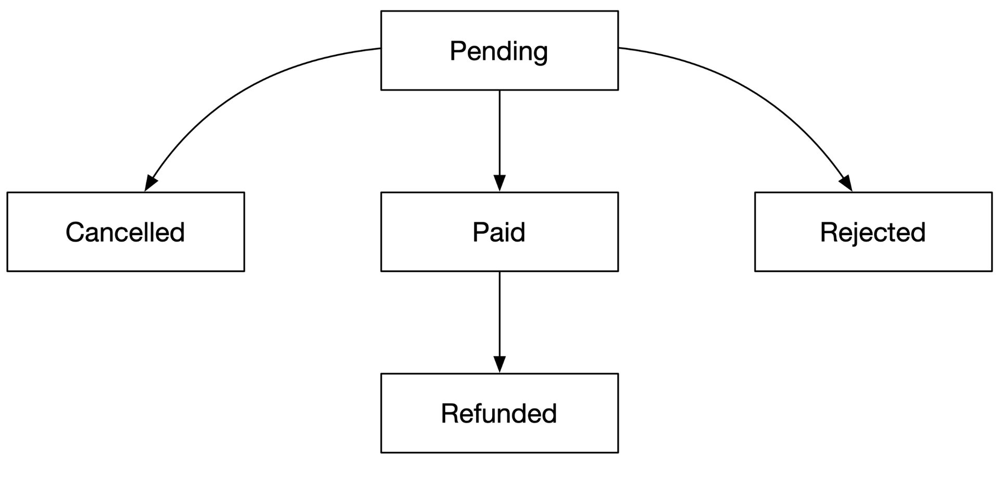</p>

*그림 3. 예약 상태 — Pending → Paid / Cancelled / Rejected, Paid → Refunded*

| 상태 | 의미 |
|---|---|
| Pending | 예약 요청을 받고 결제 대기 중 |
| Paid | 결제 성공 |
| Rejected | 결제 실패 |
| Cancelled | 결제 전 취소 |
| Refunded | 결제 후 환불 |

**이 스키마의 문제**: `reservation`에 `room_id`가 들어 있다. 에어비앤비는 사용자가 특정 숙소(`listing_id`)를 고르니 이 모델이 맞다. 하지만 호텔은 **객실 유형을 예약**하고 방 번호는 체크인 때 정해진다. 3단계 「개선된 데이터 모델」에서 고친다.

#### 개략적 설계

**마이크로서비스 아키텍처**를 쓴다.

<p align="center">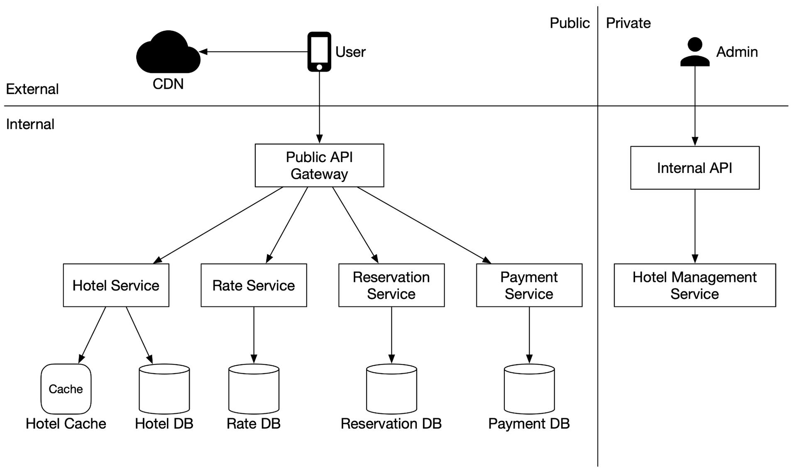</p>

*그림 4. 개략적 설계 — 왼쪽은 사용자용(Public), 오른쪽은 호텔 직원용(Private)*

| 구성 요소 | 하는 일 |
|---|---|
| User | 휴대폰이나 컴퓨터로 객실 예약 |
| Admin (호텔 직원) | 환불, 예약 취소, 객실 정보 수정 같은 관리 작업 |
| CDN | JS 번들, 이미지, 동영상, HTML 같은 정적 자원을 캐시해 로딩을 빠르게 |
| Public API Gateway | 처리율 제한, 인증을 맡는 완전 관리형 서비스. 엔드포인트에 따라 요청을 서비스로 보낸다(호텔 홈 → Hotel Service, 예약 → Reservation Service) |
| Internal API | 권한 있는 직원만 내부 소프트웨어·사이트로 접근. 보통 VPN으로 한 번 더 보호 |
| Hotel Service | 호텔·객실 상세 정보. 거의 바뀌지 않으므로 캐시하기 쉽다 |
| Rate Service | 미래 날짜별 객실 요금. 요금은 그날 호텔이 얼마나 찰지에 따라 달라진다 |
| Reservation Service | 예약 요청을 받아 객실을 예약하고, 예약·취소에 따라 **객실 재고도 관리**한다 |
| Payment Service | 결제를 실행하고 성공하면 예약 상태를 `paid`로, 실패하면 `rejected`로 바꾼다 |
| Hotel Management Service | 직원 전용. 다가오는 예약 보기, 손님 대신 예약, 예약 취소 등 |

> **CDN**<br><sub>Content Delivery Network<br>콘텐츠 전송 네트워크 — 사용자 가까운 서버에 정적 파일을 복제해 두는 망</sub><br>
> **VPN**<br><sub>Virtual Private Network<br>가상 사설망 — 공용 인터넷 위에 암호화된 사내 전용 통로를 만드는 것</sub>

그림 4는 서비스 사이 화살표를 많이 뺐다. 예를 들어 Reservation Service는 총 숙박 요금을 계산하려고 Rate Service에 요금을 묻는다. Hotel Management Service는 거의 모든 서비스와 연결되어, 직원이 바꾼 내용을 그 데이터를 가진 서비스로 넘긴다.

<p align="center">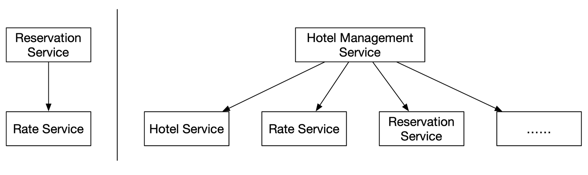</p>

*그림 5. 서비스 간 연결*

실제 운영 환경에서는 서비스 사이 통신에 **gRPC** 같은 고성능 RPC 프레임워크를 많이 쓴다.

> **RPC**<br><sub>Remote Procedure Call<br>원격 프로시저 호출 — 다른 서버의 함수를 내 함수처럼 부르는 방식</sub>

### 3단계 — 상세 설계

다룰 내용: 개선된 데이터 모델, 동시성 문제, 규모 확장, 마이크로서비스 사이의 데이터 일관성.

#### 개선된 데이터 모델

예약 API의 `roomID`를 `roomTypeID`로 바꾸고 객실 수(`roomCount`)를 더한다.

```json
{
  "startDate": "2021-04-28",
  "endDate": "2021-04-30",
  "hotelID": "245",
  "roomTypeID": "12354673389",
  "roomCount": "3",
  "reservationID": "U12354673390"
}
```

(교재 예시에는 키 이름이 여전히 `roomID`로 적혀 있지만, 본문 설명대로 `roomTypeID`가 맞다.)

<p align="center">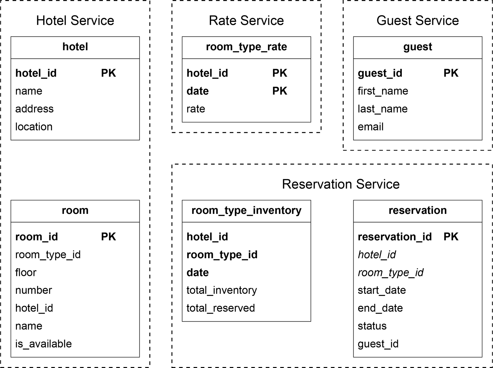</p>

*그림 6. 개선된 스키마 — Reservation Service 안에 `room_type_inventory`가 추가되고, `reservation`은 `room_id` 대신 `room_type_id`를 가진다*

| 테이블 | 내용 |
|---|---|
| `room` | 객실 정보 |
| `room_type_rate` | 객실 유형별 미래 날짜의 요금 |
| `reservation` | 손님의 예약 데이터 |
| **`room_type_inventory`** | 객실 재고. 이 시스템에서 가장 중요한 테이블 |

**`room_type_inventory` 열**

| 열 | 의미 |
|---|---|
| `hotel_id` | 호텔 ID |
| `room_type_id` | 객실 유형 ID |
| `date` | 날짜 하나 |
| `total_inventory` | 전체 객실 수 − 수리 등으로 잠시 판매에서 뺀 객실 수 |
| `total_reserved` | 그 호텔·객실 유형·날짜에 예약된 객실 수 |

- 기본 키는 `(hotel_id, room_type_id, date)` 복합 키다.
- **날짜마다 한 행**을 두면 날짜 범위 예약과 조회가 쉽다.
- 앞으로 **2년치 행을 미리 만들어** 두고, 날짜가 지나가면 매일 도는 배치 작업으로 새 날짜 행을 채운다.

**저장 공간 추정**: 호텔 5,000곳 × 객실 유형 20개 × 2년 × 365일 = **7,300만 행**. 단일 DB로 충분하다. 다만 서버 하나는 단일 장애 지점(SPOF)이므로 여러 리전이나 가용 영역에 **복제**해 가용성을 높인다.

> **SPOF**<br><sub>Single Point Of Failure<br>단일 장애 지점 — 그것 하나가 죽으면 전체가 멈추는 곳</sub>

**샘플 데이터**

| hotel_id | room_type_id | date | total_inventory | total_reserved |
|---|---|---|---|---|
| 211 | 1001 | 2021-06-01 | 100 | 80 |
| 211 | 1001 | 2021-06-02 | 100 | 82 |
| 211 | 1001 | 2021-06-03 | 100 | 86 |
| 211 | 1001 | ... | ... | ... |
| 211 | 1001 | 2023-05-31 | 100 | 0 |
| 211 | 1002 | 2021-06-01 | 200 | 164 |
| 2210 | 101 | 2021-06-01 | 30 | 23 |
| 2210 | 101 | 2021-06-02 | 30 | 25 |

**예약 가능 여부 확인**
- 입력: `startDate`(2021-07-01), `endDate`(2021-07-03), `roomTypeId`, `hotelId`, `numberOfRoomsToReserve`
- 출력: 그 객실 유형에 재고가 있으면 `true`, 없으면 `false`

```sql
-- 1) 날짜 범위의 행을 가져온다
SELECT date, total_inventory, total_reserved
FROM room_type_inventory
WHERE room_type_id = ${roomTypeId} AND hotel_id = ${hotelId}
  AND date BETWEEN ${startDate} AND ${endDate};
```

| date | total_inventory | total_reserved |
|---|---|---|
| 2021-07-01 | 100 | 97 |
| 2021-07-02 | 100 | 96 |
| 2021-07-03 | 100 | 95 |

```
-- 2) 각 행마다 애플리케이션이 검사한다. 모든 행이 참이어야 예약 가능
if (total_reserved + ${numberOfRoomsToReserve}) <= total_inventory

-- 10% 초과 예약을 허용하면
if (total_reserved + ${numberOfRoomsToReserve}) <= 110% * total_inventory
```

**예약 데이터가 DB 하나에 다 안 들어가면?**
- **현재·미래 예약만 저장한다.** 지난 예약은 잘 조회하지 않으므로 보관(archive)하고 일부는 콜드 스토리지로 옮긴다.
- **샤딩한다.** 가장 흔한 질의(예약하기, 이름으로 예약 찾기)는 모두 호텔을 먼저 고르므로 `hotel_id`가 좋은 샤딩 키다. `hash(hotel_id) % 서버 수`로 나눈다.

#### 동시성 문제

이중 예약은 두 경우를 막아야 한다.
1. **같은 사용자**가 "예약" 버튼을 여러 번 누른다.
2. **여러 사용자**가 같은 방을 동시에 예약한다.

##### 경우 1 — 같은 사용자의 중복 클릭

<p align="center">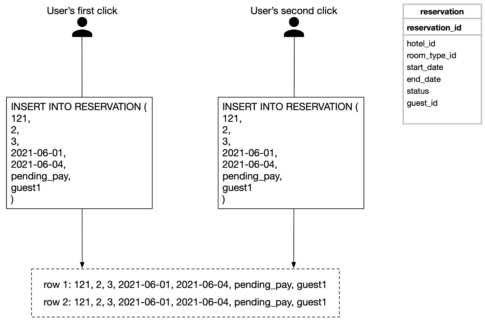</p>

*그림 7. 예약이 두 건 생김*

| 방법 | 설명 | 한계 |
|---|---|---|
| 클라이언트 측 | 요청을 보내면 "제출" 버튼을 회색 처리·숨김·비활성화 | 믿을 수 없다. 자바스크립트를 끄면 우회되고, 네트워크 문제로 두 번 눌릴 수도 있다 |
| **API 측: 멱등 키** | 예약 요청에 멱등 키를 넣는다. 몇 번 호출해도 결과가 같으면 멱등하다 | — |

**멱등 키로 막는 흐름**

<p align="center">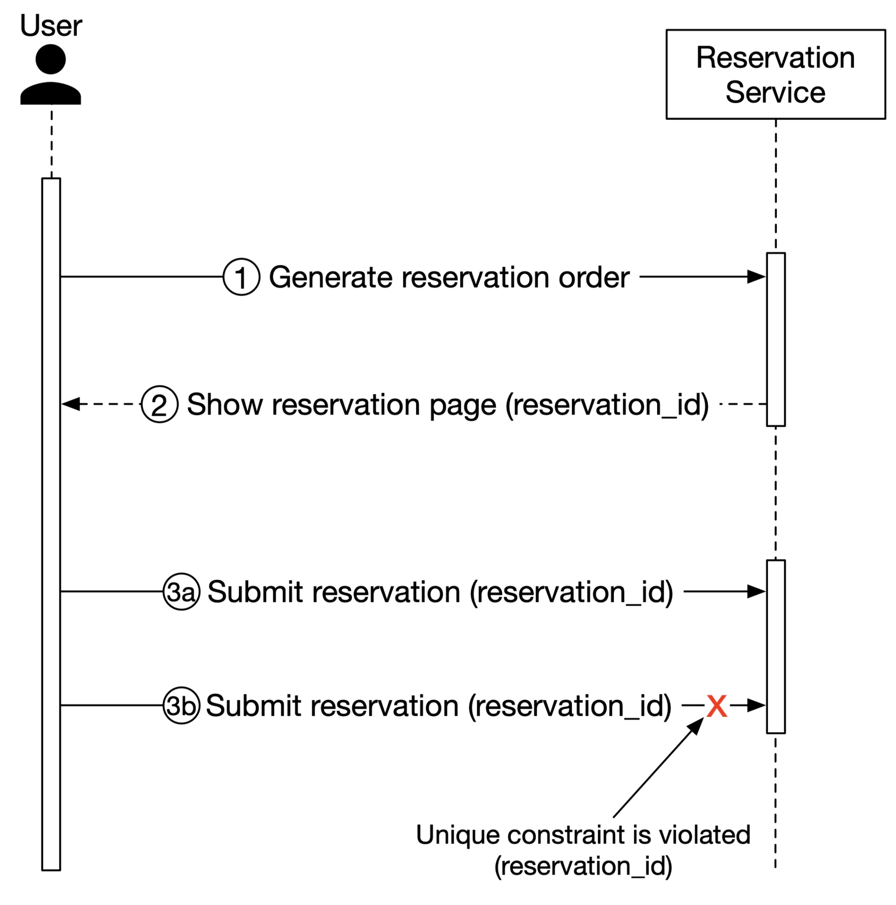</p>

*그림 8. 유니크 제약*

1. **예약 주문 생성** — 사용자가 객실 유형, 체크인·체크아웃 날짜 등을 입력하고 "계속"을 누르면 Reservation Service가 예약 주문을 만든다.
2. **예약 확인 페이지 표시** — 전역 고유 ID 생성기가 만든 `reservation_id`를 응답에 담아 돌려준다. 사용자는 이 페이지에서 내용을 검토한다.

<p align="center">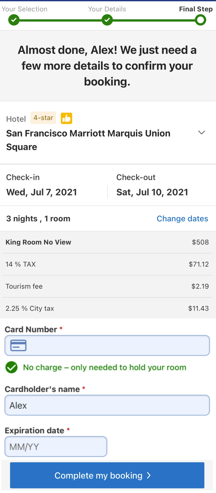</p>

*그림 9. 예약 확인 페이지 (출처: Booking.com iOS 앱)*

3. **3a. 예약 제출** — 요청에 `reservation_id`를 담는다. 이 값은 `reservation` 테이블의 **기본 키**다.
   **3b. 두 번째 제출** — 사용자가 "예약 완료"를 또 누르면 같은 `reservation_id`로 두 번째 요청이 간다. 기본 키의 **유니크 제약**에 걸려 실패하므로 이중 예약이 생기지 않는다.

<p align="center">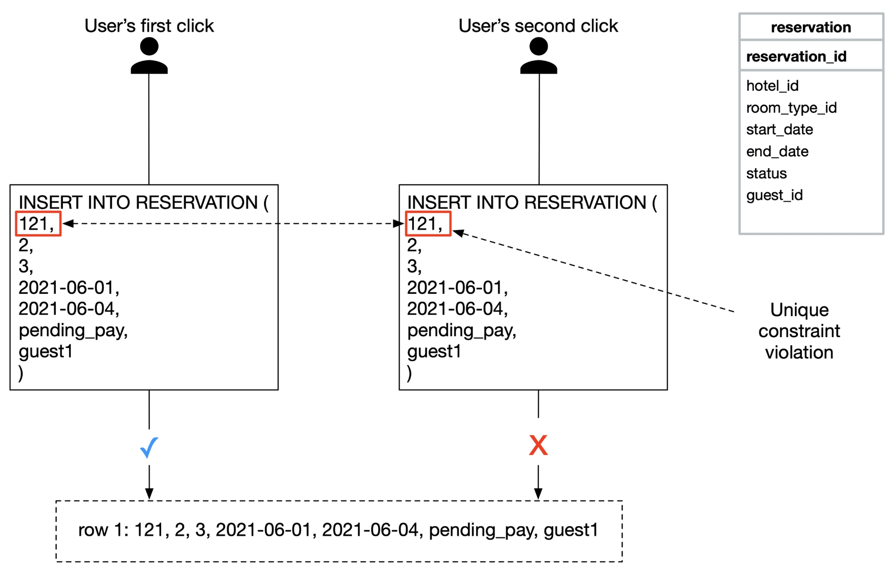</p>

*그림 10. 유니크 제약 위반*

멱등 키가 꼭 `reservation_id`일 필요는 없다. 이미 있고 이 설계에 잘 맞아서 골랐을 뿐이다.

##### 경우 2 — 여러 사용자가 마지막 방을 동시에 예약

<p align="center">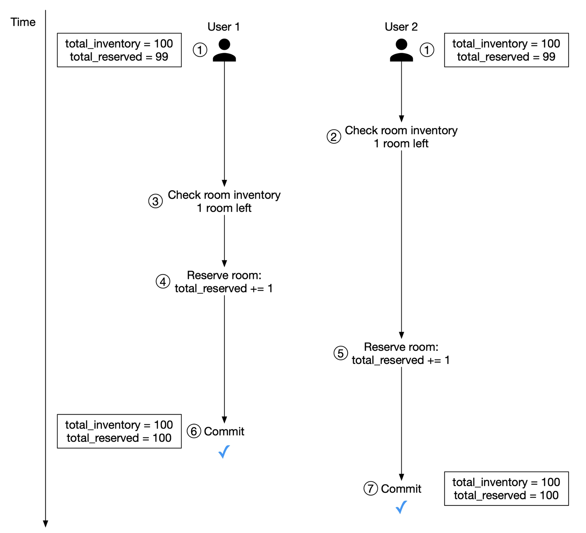</p>

*그림 11. 경쟁 조건*

DB 격리 수준이 직렬화(serializable)가 아니라고 하자. 객실 100개 중 99개가 예약됐고 1개가 남았다.

1. 사용자 1의 실행을 트랜잭션 1, 사용자 2의 실행을 트랜잭션 2라고 한다.
2. 트랜잭션 2가 `total_reserved + 예약 수 <= total_inventory`를 확인한다. 1개 남았으니 참.
3. 트랜잭션 1도 같은 검사를 한다. 역시 참.
4. 트랜잭션 1이 예약하고 `total_reserved`를 100으로 만든다.
5. 트랜잭션 2도 예약한다. 격리성 때문에 트랜잭션 1이 커밋하기 전의 변경은 보이지 않는다. 트랜잭션 2는 여전히 99를 보고 100으로 만든다.
6. 트랜잭션 1 커밋 성공.
7. 트랜잭션 2 커밋 성공 → **방 1개에 예약 2건.**

해결하려면 어떤 형태든 잠금이 필요하다. 먼저 예약 SQL의 뼈대를 보자. **재고 확인**과 **예약** 두 부분이다.

```sql
-- step 1: 재고 확인
SELECT date, total_inventory, total_reserved
FROM room_type_inventory
WHERE room_type_id = ${roomTypeId} AND hotel_id = ${hotelId}
  AND date BETWEEN ${startDate} AND ${endDate};

-- step 1에서 나온 모든 행에 대해
if ((total_reserved + ${numberOfRoomsToReserve}) > 110% * total_inventory) {
  Rollback
}

-- step 2: 예약
UPDATE room_type_inventory
SET total_reserved = total_reserved + ${numberOfRoomsToReserve}
WHERE room_type_id = ${roomTypeId}
  AND date BETWEEN ${startDate} AND ${endDate};

Commit
```

(교재의 step 2 `UPDATE`에는 `hotel_id` 조건이 빠져 있다. `room_type_id`가 호텔마다 고유하지 않다면 다른 호텔 행까지 바뀌므로 `AND hotel_id = ${hotelId}`를 넣는 게 안전하다.)

**방법 1: 비관적 락** (pessimistic locking, 비관적 동시성 제어)

누군가 레코드를 고치기 시작하면 바로 잠가서, 다른 사용자는 첫 사용자가 잠금을 풀 때(커밋할 때)까지 기다리게 한다. MySQL에서는 `SELECT ... FOR UPDATE`가 조회한 행을 잠근다.

<p align="center">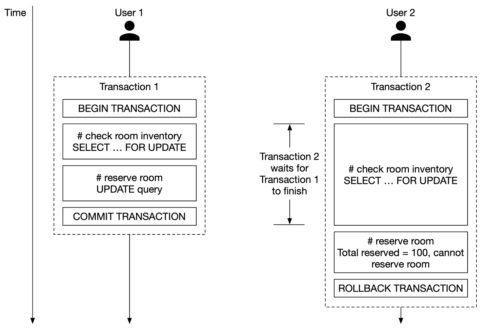</p>

*그림 12. 비관적 락 — 트랜잭션 2의 `SELECT ... FOR UPDATE`는 트랜잭션 1이 끝날 때까지 기다린다. 트랜잭션 1이 끝나면 `total_reserved`가 100이라 사용자 2는 예약할 수 없다*

| 장점 | 단점 |
|---|---|
| 고치는 중이거나 이미 바뀐 데이터를 다른 쪽이 갱신하지 못한다 | 여러 자원을 잠그면 **교착 상태**가 생길 수 있고, 교착 없는 코드를 짜기 어렵다 |
| 구현이 쉽고, 갱신을 줄 세워 충돌을 피한다. **경합이 심할 때** 유용하다 | **확장성이 없다.** 트랜잭션이 오래 잠그면 다른 트랜잭션이 기다려야 해서 DB 성능이 크게 떨어진다. 트랜잭션이 길거나 엔티티가 많으면 더 심하다 |

→ 교재는 예약 시스템에 **권하지 않는다.**

**방법 2: 낙관적 락** (optimistic locking, 낙관적 동시성 제어)

여러 사용자가 같은 자원을 동시에 고치려 시도하게 둔다. 구현은 **버전 번호**나 **타임스탬프**로 하는데, 서버 시계는 시간이 지나면 틀어질 수 있어 버전 번호가 낫다.

<p align="center">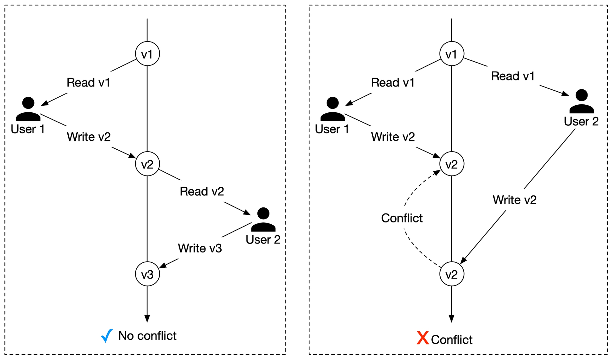</p>

*그림 13. 낙관적 락 — 왼쪽: 사용자 2가 v2를 읽고 v3를 써서 충돌 없음 / 오른쪽: 두 사용자가 모두 v1을 읽고 v2를 쓰려 해서 충돌*

1. 테이블에 `version` 열을 더한다.
2. 행을 고치기 전에 그 행의 버전을 읽는다.
3. 갱신할 때 버전을 1 올려서 쓴다.
4. DB가 검사한다: 새 버전은 현재 버전보다 정확히 1 커야 한다. 검사에 실패하면 트랜잭션을 중단하고 2단계부터 다시 시도한다.

```sql
-- 예시 (교재에는 SQL이 없어 직접 적음)
UPDATE room_type_inventory
SET total_reserved = total_reserved + 1, version = version + 1
WHERE hotel_id = 211 AND room_type_id = 1001 AND date = '2021-07-01'
  AND version = ${읽은_version};
-- 영향받은 행이 0이면 누가 먼저 바꾼 것 → 다시 읽고 재시도
```

잠그지 않으니 보통 비관적 락보다 빠르다. 하지만 **동시성이 높으면 성능이 크게 떨어진다.** 많은 사용자가 같은 호텔을 동시에 예약하면 모두 같은 재고와 버전을 읽고, 쓸 때 한 명만 성공하고 나머지는 재시도한다. 다음 라운드에서도 한 명만 성공한다. 결과는 맞지만 재시도가 반복되어 사용자 경험이 나쁘다.

| 장점 | 단점 |
|---|---|
| 오래된 데이터를 고치지 못하게 막는다 | **경합이 심하면** 성능이 나쁘다 |
| DB 자원을 잠그지 않는다. 버전 처리는 전부 애플리케이션 몫이다 | |
| 경합이 적을 때 잠금 관리 비용 없이 트랜잭션을 끝낼 수 있다 | |

→ 예약 QPS가 보통 높지 않으므로 **좋은 선택지다.**

**방법 3: DB 제약 조건**

낙관적 락과 매우 비슷하다. `room_type_inventory`에 제약을 건다.

```sql
CONSTRAINT `check_room_count` CHECK((`total_inventory - total_reserved` >= 0))
```

사용자 2가 예약하려 할 때 `total_reserved`가 101이 되면 `100 - 101 >= 0`을 어기므로 트랜잭션이 롤백된다.

<p align="center">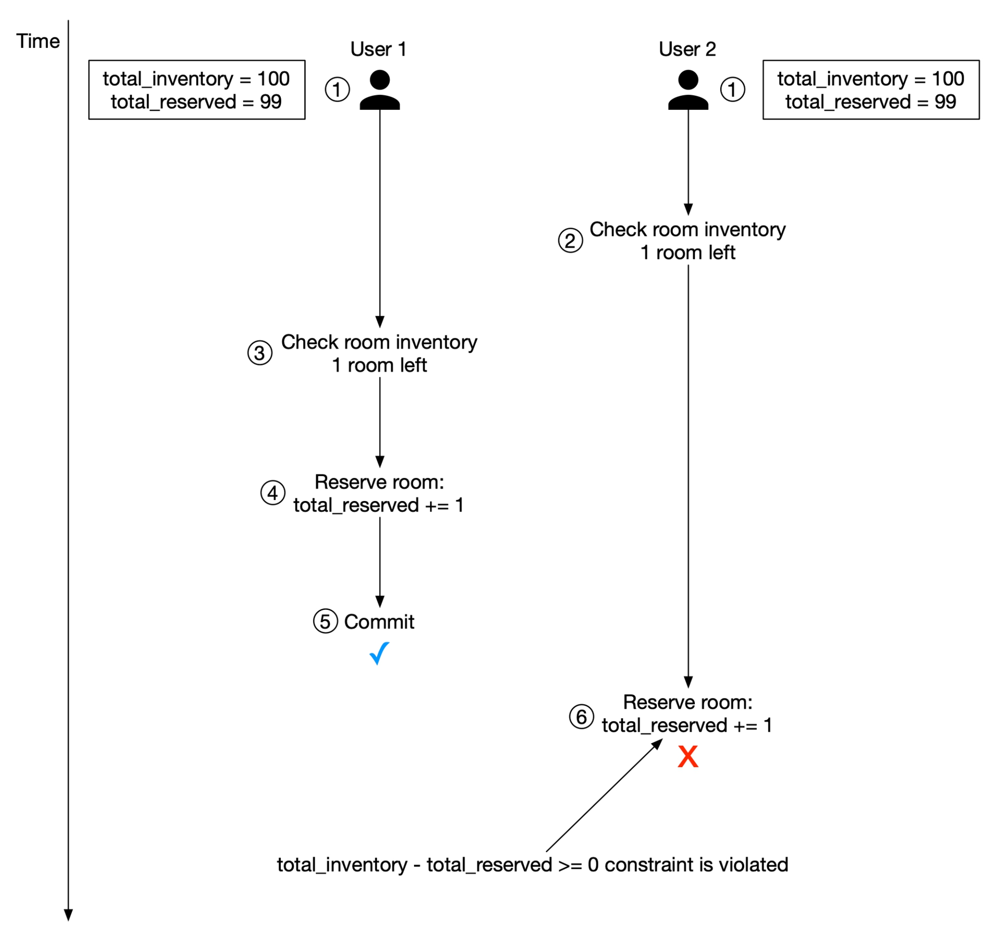</p>

*그림 14. DB 제약 조건*

| 장점 | 단점 |
|---|---|
| 구현이 쉽다 | 낙관적 락처럼 경합이 심하면 실패가 많다. 빈방이 보여서 예약했는데 "빈방 없음"을 받으면 사용자가 답답하다 |
| 경합이 적을 때 잘 동작한다 | 제약 조건은 애플리케이션 코드처럼 버전 관리하기 어렵다 |
| | 모든 DB가 제약 조건을 지원하지는 않아 DB를 옮길 때 문제가 될 수 있다 |

→ 구현이 쉽고 호텔 예약은 경합이 낮으므로(QPS가 낮으므로) **또 하나의 좋은 선택지다.**

**세 방법 비교**

| | 비관적 락 | 낙관적 락 | DB 제약 조건 |
|---|---|---|---|
| 충돌을 막는 시점 | 읽을 때 잠가서 미리 | 쓸 때 버전을 비교해서 | 쓸 때 제약을 검사해서 |
| 잘 맞는 상황 | 경합이 심할 때 | 경합이 적을 때 | 경합이 적을 때 |
| 약점 | 교착 상태, 확장성 | 경합 시 재시도 폭증 | 경합 시 실패 다발, 버전 관리·이식성 |
| 교재 판단 | 권하지 않음 | 좋은 선택 | 좋은 선택 |

#### 규모 확장

보통 호텔 예약 시스템은 부하가 크지 않다. 하지만 면접관이 "호텔 체인이 아니라 booking.com이나 expedia.com 같은 여행 사이트라면?"이라고 물으면 QPS가 **1,000배**가 될 수 있다.

서비스는 모두 무상태라 서버를 더하면 된다. 병목은 상태를 모두 가진 **DB**다.

**DB 샤딩** — 데이터를 여러 DB로 나눠 각 DB가 일부만 갖게 한다. 대부분의 질의가 `hotel_id`로 거르므로 `hotel_id`로 샤딩한다. QPS 30,000을 샤드 16개로 나누면 샤드당 1,875 QPS로, MySQL 서버 한 대가 감당할 수 있다.

<p align="center">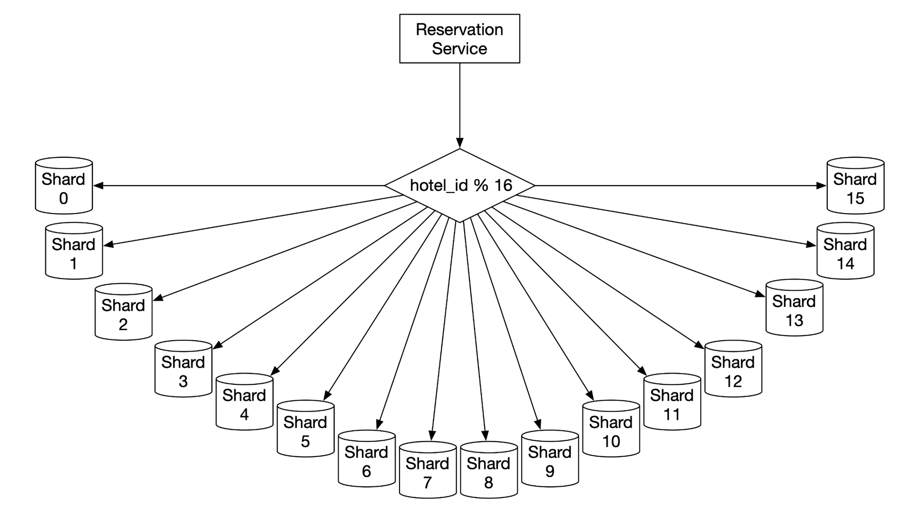</p>

*그림 15. DB 샤딩*

**캐시** — 호텔 재고 데이터는 **현재와 미래 것만 의미가 있다.** 손님은 가까운 미래의 방만 예약하기 때문이다. 그래서 오래된 데이터가 자동으로 사라지는 **TTL**이 있으면 좋고, 과거 데이터는 다른 DB에서 조회한다. **Redis**는 TTL과 **LRU** 제거 정책이 있어 메모리를 잘 쓸 수 있다.

> **TTL**<br><sub>Time To Live<br>유효 기간 — 정한 시간이 지나면 데이터가 자동으로 지워진다</sub><br>
> **LRU**<br><sub>Least Recently Used<br>가장 오래 안 쓴 것부터 내보내는 캐시 제거 방식</sub>

로딩 속도와 DB 확장이 문제가 되면 DB 앞에 캐시 계층을 두고 **재고 확인과 예약 로직을 캐시 계층으로 옮긴다.** 그러면 대부분의 안 되는 요청은 재고 캐시에서 걸러지고 일부만 DB에 닿는다. 단, Redis에 재고가 있다고 나와도 **DB에서 다시 확인해야 한다. 재고의 원천(source of truth)은 DB다.**

<p align="center">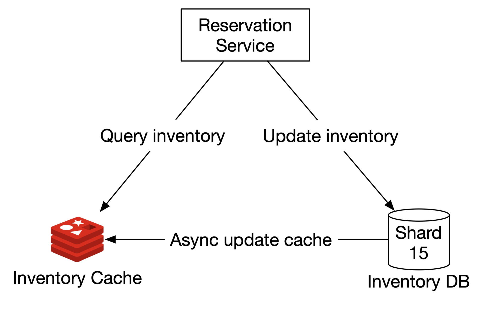</p>

*그림 16. 캐시 — 조회는 Inventory Cache로, 갱신은 Inventory DB로, DB 변경은 비동기로 캐시에 반영*

| 구성 요소 | 하는 일 |
|---|---|
| Reservation Service | 재고 관리 API 제공: 객실 유형·날짜 범위별 빈방 수 조회 / `total_reserved + 1`로 예약 / 취소 시 재고 갱신 |
| Inventory Cache (Redis) | 재고 조회를 모두 맡는다. 데이터를 미리 채워 둔다. 키 `hotelID_roomTypeID_{date}` → 값: 그 날짜의 빈방 수 |
| Inventory DB | 재고의 원천 |

재고 확인(읽기)이 쓰기보다 한 자릿수 이상 많고, 그 읽기 대부분을 캐시가 받는다.

**캐시가 만드는 새 문제: DB와 캐시의 일관성**

예약할 때 정상 흐름은 두 단계다.
1. 재고 캐시에서 빈방이 충분한지 조회한다.
2. 재고를 갱신한다. **DB를 먼저** 바꾸고, 그 변경을 **비동기로** 캐시에 반영한다. 반영은 애플리케이션 코드가 DB 저장 뒤에 캐시를 고쳐도 되고, **CDC**로 해도 된다. 흔한 도구는 **Debezium**으로, 소스 커넥터가 DB 변경을 읽어 Redis 같은 캐시에 반영한다.

> **CDC**<br><sub>Change Data Capture<br>변경 데이터 캡처 — DB에 생긴 변경을 읽어 다른 시스템에 그대로 옮기는 방식</sub>

DB를 먼저 바꾸니 캐시가 최신이 아닐 수 있다(DB엔 방이 없는데 캐시엔 있거나, 그 반대). 하지만 **DB가 최종 재고 검사를 하는 한 이 불일치는 문제가 되지 않는다.**

예: 캐시엔 빈방이 있고 DB엔 없다. 사용자는 빈방을 보고 예약을 시도하지만, 요청이 DB에 닿으면 DB가 검사해서 방이 없다고 판단하고 "방금 다른 사람이 마지막 방을 예약했다"는 오류를 돌려준다. 사용자가 새로고침할 즈음엔 DB가 캐시를 맞춰 놓았을 테니 빈방 없음이 보인다.

| 장점 | 단점 |
|---|---|
| DB 부하가 크게 준다(읽기를 캐시가 받음) | DB와 캐시의 일관성을 유지하기 어렵다. 불일치가 사용자 경험에 어떤 영향을 주는지 잘 따져야 한다 |
| 메모리에서 읽으니 빠르다 | |

#### 서비스 간 데이터 일관성

전통적인 모놀리식 아키텍처는 관계형 DB 하나를 같이 써서 일관성을 지킨다. 이 설계는 **절충안**을 골랐다. Reservation Service가 예약과 재고 API를 모두 맡아 **예약 테이블과 재고 테이블을 같은 관계형 DB에** 둔다. 그래서 「동시성 문제」에서 본 것처럼 ACID로 동시성 문제를 깔끔하게 처리할 수 있다.

하지만 마이크로서비스 원칙주의자라면 "서비스마다 자기 DB를 가져야 한다"며 반박할 수 있다(그림 17 오른쪽).

<p align="center">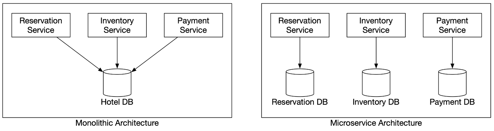</p>

*그림 17. 모놀리식 vs 마이크로서비스*

이렇게 나누면 일관성 문제가 많이 생긴다. 서비스 두 개만 놓고 보자.

<p align="center">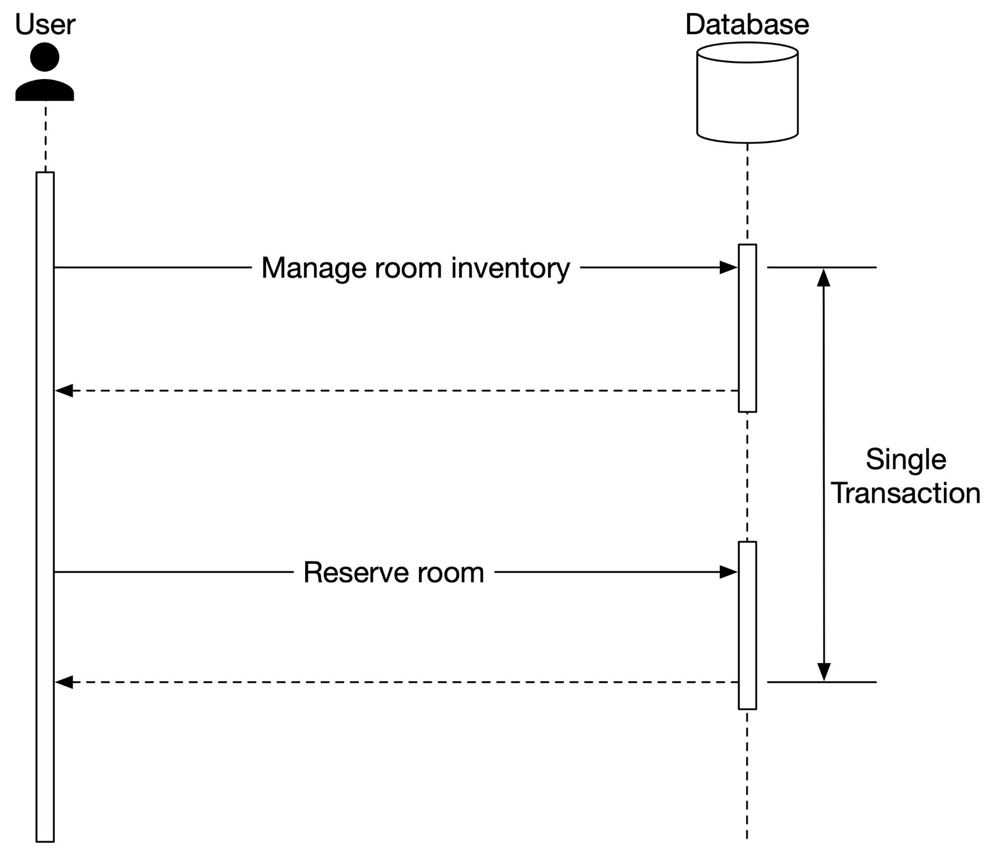</p>

*그림 18. 모놀리식 아키텍처 — 재고 관리와 예약을 하나의 트랜잭션으로 묶는다*

<p align="center">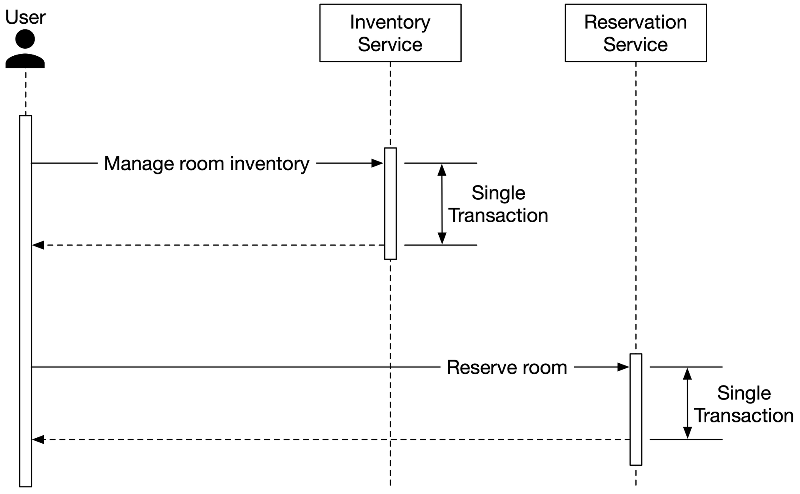</p>

*그림 19. 마이크로서비스 아키텍처 — Inventory Service와 Reservation Service가 각자 트랜잭션을 가진다*

마이크로서비스에서는 논리적으로 하나인 작업이 여러 서비스에 걸치므로 **트랜잭션 하나로 일관성을 보장할 수 없다.** 예약 DB 갱신이 실패하면 재고 DB에서 늘린 예약 수를 되돌려야 한다. 성공 경로는 하나지만 실패 경로는 여럿이다.

업계에서 검증된 해법:

| 해법 | 방식 | 특징 |
|---|---|---|
| **2PC** | 여러 노드의 트랜잭션을 원자적으로 커밋하는 DB 프로토콜. 전부 성공하거나 전부 실패 | **블로킹** 프로토콜이라 노드 하나가 죽으면 복구될 때까지 진행이 멈춘다. 성능이 좋지 않다 |
| **사가** (Saga) | 로컬 트랜잭션을 차례로 실행한다. 각 트랜잭션이 갱신 후 메시지를 발행해 다음 단계를 부른다. 한 단계가 실패하면 앞 단계들을 **보상 트랜잭션**으로 되돌린다 | 2PC는 한 번의 커밋으로 ACID를 지키지만, 사가는 여러 단계로 이루어지고 **결과적 일관성**에 기댄다 |

> **2PC**<br><sub>Two-Phase Commit<br>2단계 커밋 — 1단계에서 모두에게 "커밋할 수 있나?"를 묻고, 모두 "예"면 2단계에서 커밋한다</sub>

이런 방법은 전체 설계를 크게 복잡하게 만든다. 그 복잡도를 감수할지는 설계자가 정한다. 이 문제에서는 **감수할 가치가 없다고 보고**, 예약과 재고 데이터를 같은 관계형 DB에 두는 실용적인 쪽을 골랐다.

### 4단계 — 마무리

- 요구사항을 모으고 개략적 추정으로 규모를 파악했다.
- 개략적 설계에서 API, 데이터 모델 초안, 아키텍처를 그렸다.
- 상세 설계에서 예약이 특정 객실이 아니라 **객실 유형 단위**여야 함을 깨닫고 스키마를 고쳤다.
- 경쟁 조건을 깊게 다루고 해법 세 가지를 제시했다: **비관적 락, 낙관적 락, DB 제약 조건.**
- 규모 확장 방법으로 **DB 샤딩**과 **Redis 캐시**를 다뤘다.
- 마이크로서비스의 데이터 일관성 문제와 해법(2PC, 사가)을 짧게 살폈다.

## 토론하고 싶은 것

1. **초과 예약 10%와 DB 제약 조건이 맞지 않는다.** 교재는 재고 검사를 `<= 110% * total_inventory`로 하면서, 방법 3의 제약은 `total_inventory - total_reserved >= 0`으로 둔다. 이대로면 초과 예약분은 제약에 걸려 실패한다. 제약을 `total_reserved <= total_inventory * 1.1`로 바꾸면 될까? 아니면 초과 예약 한도를 따로 열(`overbooking_limit`)로 두는 게 나을까? 호텔마다, 날짜마다 초과 예약 비율이 다르면 어떻게 할까?
2. **"재고 확인 SELECT + UPDATE" 두 단계를 꼭 나눠야 하나?** `UPDATE ... SET total_reserved = total_reserved + n WHERE ... AND total_reserved + n <= total_inventory * 1.1` 한 문장으로 쓰고 바뀐 행 수가 기간 일수와 같은지 보면, 별도 잠금이나 버전 없이도 경쟁 조건이 사라진다(UPDATE는 행 잠금을 잡으므로). 교재의 세 방법과 비교하면 어떤 트레이드오프가 있을까? 날짜 범위가 여러 행이라 일부만 바뀐 경우의 롤백은?
3. **낙관적 락이 "QPS가 낮아서 좋다"는 판단은 맞나?** 전체 TPS는 3이지만 경합은 **같은 호텔·같은 객실 유형·같은 날짜**에서 일어난다. 연말 인기 호텔이나 콘서트 티켓처럼 한 행에 요청이 몰리면 낙관적 락은 재시도 폭증이 된다. 이런 "핫 행"에서는 비관적 락, 대기열, Redis 원자 연산(`DECR`) 중 무엇이 나을까?
4. **결제와 재고 차감의 순서.** 교재는 예약 시 전액 결제를 가정하지만 결제는 외부 PG와의 통신이라 같은 DB 트랜잭션에 넣을 수 없다. 재고를 먼저 잡고(`pending`) 결제 실패 시 되돌리는 흐름은 사실상 사가다. "예약·재고를 한 DB에 두니 분산 트랜잭션이 필요 없다"는 결론이 결제까지 포함하면 여전히 맞을까? `pending`으로 잡아 둔 재고는 언제 풀어야 할까(타임아웃)?
5. **캐시에서 "재고 확인과 예약 로직"까지 옮긴다는 말의 범위.** 교재는 읽기만 캐시로 보내고 최종 검사는 DB가 한다고 한다. 그렇다면 캐시는 "안 되는 요청을 미리 거르는 필터" 역할이다. 반대로 캐시가 빈방 없음이라고 잘못 말하는 경우(DB엔 방이 있음)는 판매 기회 손실인데, 이건 괜찮은가?

## 더 찾아본 것 (선택)

- **교재의 사소한 오류**
  - 개선된 API 예시의 키가 여전히 `roomID`다(본문 설명은 `roomTypeID`).
  - `room_type_rate`의 기본 키가 `(hotel_id, date)`로만 그려져 있는데, 객실 유형별 요금이라면 `room_type_id`도 키에 들어가야 한다.
  - 예약 SQL의 `UPDATE`에 `hotel_id` 조건이 없다.
- **MySQL InnoDB의 기본 격리 수준은 REPEATABLE READ**다. 이 수준에서도 일반 `SELECT`는 스냅숏을 읽으므로 그림 11의 경쟁 조건이 생긴다. `SELECT ... FOR UPDATE`(잠금 읽기)는 최신 커밋 값을 읽고 행을 잠근다. 격리 수준을 SERIALIZABLE로 올리면 InnoDB는 일반 SELECT를 `SELECT ... FOR SHARE`처럼 다뤄 이 문제를 막지만, 대신 교착 상태가 늘 수 있다.
- **MySQL은 8.0.16부터 CHECK 제약을 실제로 강제한다.** 그 전 버전은 문법만 받아들이고 무시했다. 교재가 말한 "모든 DB가 제약을 지원하지는 않는다"의 구체적인 예다.
- 참고 링크
  - Saga 패턴: https://microservices.io/patterns/data/saga.html
  - Debezium: https://debezium.io/
  - 낙관적 동시성 제어: https://en.wikipedia.org/wiki/Optimistic_concurrency_control
